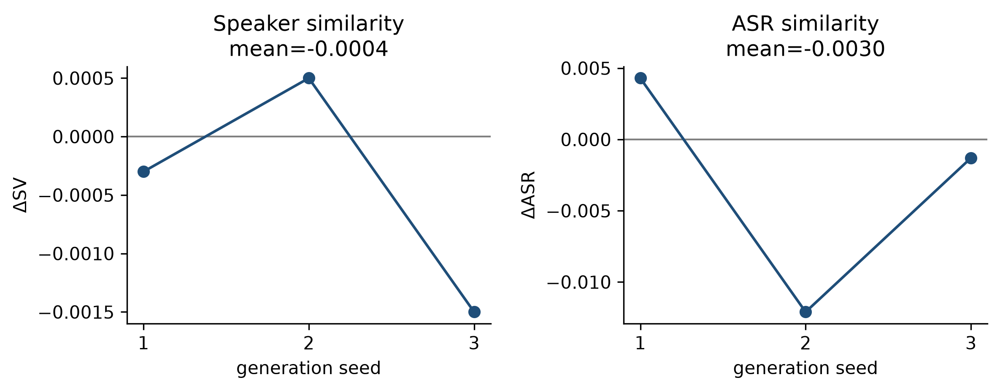
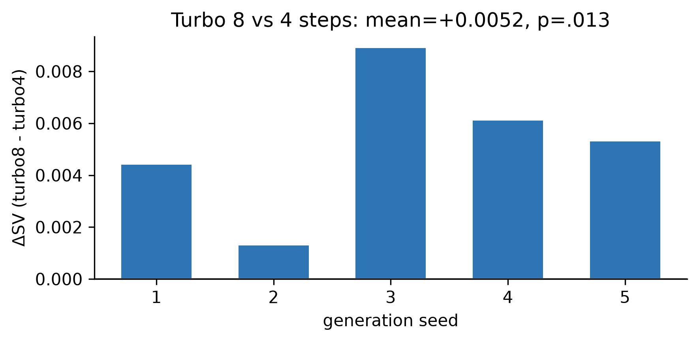

# 1,200 句单说话人数据上的 GPT-SoVITS V5 微调：负结果、选择偏差与一个分句效应

**声音 C 实验论文 v1.0**  
2026-11-20  
基于 GPT-SoVITS V5（2026-10-06 本地包）的离线实验记录

---

## 摘要

本文记录了一次以“让 GPT-SoVITS V5 微调后的声音 C 比零样本更像目标角色 Kan”为目标的完整实验。**范围从微调实验开始；游戏解包、文本对齐等前置工作不在本文范围。**数据为 1,200 句单说话人日文语音，硬件为 6 GB 显存，底模为 V5dev。我们尝试了标准 LoRA、干净子集、读出层、adaLN、全线性、官方风格 q/v、自蒸馏、后五层全参、ref_enc 条件侧、GPT s1 全参等路线；在 30 句配对测试上，**没有任何微调显著超过零样本 v5dev**。最接近的 `vo16_s300` 在 seed1–3 重测中 SV 差为 −0.0003 / +0.0005 / −0.0015，均值 −0.0004（t=−0.75），仍为零。

零训练侧，turbo 8 步相对 4 步有小的但可复现的提升：30 句 × 5 seeds，SV +0.0052（p=.013），ASR −0.0045（p=.135）。更有意义的是一个非模型改动：把分句从 `cut0` 改为 `cut5`，30 句 test、5 个 seed 的 SV 从 0.8811 提到 **0.9041**，ASR 基本不变（0.9203 → 0.9236）。该效应跨 seed 稳定，配对 bootstrap 的 SV 95% CI 为 +0.0097…+0.0309。

本文还记录了一次**假阳性及撤回**：best-of-5 选择一度显示 SV +0.0127，但独立审计发现这是 max-of-k 选择偏差（零假设 P≈0.886），第二个 ASR 也只 +0.0023；该方案不作为结果。我们保留这次错误，因为它比多数“成功”更有方法论价值。

**关键词**：GPT-SoVITS V5；零样本 TTS；LoRA；负结果；选择偏差；分句；声音克隆

---

## 1. 引言

零样本 TTS 的常见预期是：给定 5–10 秒参考音，模型就能复现目标音色；若再加入几十到几千句目标语音做微调，应当更稳、更像。GPT-SoVITS V5 是这一路线的代表之一，官方支持零样本与少样本微调。

我们最初也按这个预期工作：

1. 准备 1,200 句 Kan 的日文语音与文本；
2. 在 V5dev 上做 LoRA；
3. 用说话人相似度（SV）、ASR、音质指标和盲听评估；
4. 期望微调后在 30 句 held-out 文本上超过零样本。

结果与预期相反。微调没有带来稳定增益，甚至在多个设置中退步。进一步分析表明，这不是“训练不够久”或“rank 不够大”，而是 V5 的音色锚点、LoRA 的作用范围、训练/推理参考域错位和单说话人数据冗余共同造成的。

本文的贡献不是提出一个新模型，而是给出三条可复用的结论：

- **负结果**：在 1,200 句单说话人、6 GB 卡、V5dev 的条件下，微调不优于零样本；
- **一个真实增益**：`cut5` 分句让 SV 提升约 0.023，ASR 不降；
- **一个方法论教训**：best-of-k 的 SV 选择会制造假增益，必须用零假设或独立指标复核。

---

## 2. 背景

### 2.1 V5 的推理链

V5 的推理可以粗略分为：

```
文本 → s1 AR GPT（s1v3.ckpt）→ 语义 token
     → enc_p / quantizer（条件侧）
     → CFM DiT（扩散/流匹配）
     → HiFi-GAN 48 kHz
```

参考音通过 `ref_enc` 提供音色条件。训练时，CFM 的 prompt 和 `ge` 通常取自目标自身；推理时换成另一段参考，因此存在训练/推理的参考域差异。

### 2.2 我们改了什么

- 在 `module/models.py` 的 `WNEncoder.forward` 与 `Encoder.forward` 中移除 `g = g.detach()`，使 `ref_enc` 可训练；
- 在 `models.py` 中给 `SynthesizerTrnV3.forward` 增加 `refer_spec`，让外部参考的 704-bin 频谱进入 `ref_enc`；
- 在 `s2_train_v3_lora.py` 中加入外部参考训练；
- 对 `data_module.py` 做 `num_workers=0` 兼容；
- 其余为推理侧参数与评测脚本。

这些修改是实验性的，不代表官方实现。

### 2.3 评测指标

- **SV**：ERes2NetV2 说话人嵌入与 10 句 Kan 质心的余弦相似度；
- **ASR**：Whisper 对日文转写与目标文本的字符相似度；
- **amp48**：4–8 Hz 幅度调制能量占比，用于观察“颤音/毛刺”；
- **CPP / HNR**：倒谱突出度与谐噪比，用于辅助判断噪声/金属感；
- **时长、削波**：工程安全检查。

这些指标都是代理指标，不能替代人耳；本文的最终判断仍需要听音。

---

## 3. 数据与约束

- **说话人**：Kan，单说话人；
- **数据量**：1,200 句带文本的日文语音；清洗后 863 句（去掉 ♪、过短句等）；
- **增强**：3,600 行增强，但只有 1,200 个唯一文本；
- **测试集**：30 句 held-out 日文；验证集：10 句；
- **硬件**：6 GB 显存；
- **底模**：`s2Gv5dev.pth`（32 步教师）、`s2Gv5turbo.pth`（4 步蒸馏）；
- **原则**：V5-only，不使用 v4；不微调 turbo；所有结论以本会话实际输出为准。

数据规模是本实验的核心限制：单说话人、单风格、1,200 句，零样本参考已经覆盖了音色；微调能获得的新信息很少。

---

## 4. 实验方法

### 4.1 评测协议

- 固定 30 句 test、10 句 val；
- 参考音固定为 `ref1_fem_kan_00003.wav`（4.6 s），除非特别说明；
- 生成 seed 默认 1；关键实验做 3–5 个 seed；
- 句子级配对：同一句、同一参考，比较两个系统；
- 统计：
  - 句子级 paired bootstrap（20,000 次）用于置信区间；
  - seed 级配对 t 检验用于“换 seed 是否稳定”；
  - 不做句子聚类 bootstrap 来冒充 seed 级显著性。

### 4.2 微调路线

| 路线 | 配置 | 目的 |
|---|---|---|
| 标准 LoRA | q/v/out，rank16，lr 5e-6，1,200 步 | 最小改动 |
| 干净子集 | 863 句，rank16，lr 5e-6 | 去噪声 |
| 读出层 | `to_out.0`，rank4，lr 1e-5 | 只改输出 |
| adaLN | `attn_norm.linear`，rank8，lr 5e-5 | 条件调制 |
| 全线性 | q/k/v/out + FFN，rank8 | 增大容量 |
| 官方风格 q/v | rank16，lr 2e-5，segment 20480 | 贴近官方 |
| 自蒸馏 | v5dev/ref1 生成 869 句，q/v rank16，lr 2e-5 | 扩数据 |
| 后五层全参 | block 17–21，lr 5e-7 / 5e-6 | 大容量 |
| ref_enc | 移除 detach、解冻，lr 5e-5 | 改音色条件 |
| GPT s1 | 77.6M，1 epoch | 改语义侧 |

---

## 5. 结果

### 5.1 微调：没有一种超过零样本

30 句 test，seed1 的代表性结果：

| 版本 | SV ↑ | amp ↓ | CPP ↑ | ASR ↑ |
|---|---:|---:|---:|---:|
| turbo（4步） | 0.8796 | 0.2401 | 0.1791 | 0.9268 |
| v5dev（32步） | 0.8791 | 0.2469 | 0.1800 | 0.9195 |
| vo16_s300 | 0.8788 | 0.2460 | 0.1806 | 0.9175 |
| pair_s800 | 0.8789 | 0.2497 | 0.1800 | 0.9215 |
| clean_s700 | 0.8784 | 0.2434 | 0.1807 | 0.9175 |
| aug_s1200 | 0.8771 | 0.2511 | 0.1806 | 0.9055 |

`vo16_s300` 是最接近的微调：SV −0.0004（CI −0.0015…+0.0008）。为排除单 seed 偏差，我们用 seed1–3 重测：

| seed | v5dev SV | vo16 SV | ΔSV | v5dev ASR | vo16 ASR | ΔASR |
|---|---:|---:|---:|---:|---:|---:|
| 1 | 0.8818 | 0.8816 | −0.0003 | 0.9080 | 0.9123 | +0.0043 |
| 2 | 0.8758 | 0.8763 | +0.0005 | 0.9351 | 0.9230 | −0.0121 |
| 3 | 0.8744 | 0.8729 | −0.0015 | 0.9204 | 0.9191 | −0.0013 |
| **mean** | **0.8773** | **0.8769** | **−0.0004** | **0.9212** | **0.9181** | **−0.0030** |

seed 级检验：SV t=−0.73，p≈0.5；ASR t=−0.63，p≈0.6。**多 seed 复测没有翻盘。**



其他负结果：

- 标准 LoRA：SV −0.0023；
- clean/pair：test 无显著差异；
- adaLN：5 个 checkpoint 输出完全相同，推理未使用该分支；
- 后五层全参 lr 5e-6：val SV 0.8916 vs 0.8949、ASR 0.9395 vs 0.9469，小幅退步；
- ref_enc：权重 delta 0.0093，但 val SV 0.8825、ASR 0.868，句子 5/7 崩；
- GPT s1 全参：SV 0.8701、ASR 0.931，音色/时长漂移；
- 自蒸馏：s869 val 0.8823 vs v5dev 0.8935，s400 0.8895，仍低于底模。

### 5.2 turbo8：小但显著的推理增益

30 句 × 5 seeds，seed 级配对：

| seed | ΔSV (8−4) | ΔASR |
|---|---:|---:|
| 1 | +0.0044 | 0.0000 |
| 2 | +0.0013 | −0.0104 |
| 3 | +0.0089 | −0.0027 |
| 4 | +0.0061 | +0.0007 |
| 5 | +0.0053 | −0.0103 |
| **mean** | **+0.0052** | **−0.0045** |

SV：t=4.25，df=4，p=.013；ASR：p=.135，不显著。val 10 句：turbo8 0.9026 > turbo10 0.9014 > turbo4 0.8987，10 步没有继续涨。seed1 val 0.9019 / ASR 0.940；CFG 0 最好（0.9019/0.940），0.5/1.0/1.3 都更低。



### 5.3 cut5：一个非模型改动带来的稳定增益

`cut5` 改变的是文本分句，不改变权重。30 句 test：

| seed | cut0 SV | cut5 SV | cut0 ASR | cut5 ASR |
|---|---:|---:|---:|---:|
| 1 | 0.8868 | 0.9062 | 0.9238 | 0.9188 |
| 2 | 0.8785 | 0.9042 | 0.9230 | 0.9230 |
| 3 | 0.8779 | 0.9060 | 0.9140 | 0.9210 |
| 4 | — | 0.9024 | — | 0.9330 |
| 5 | — | 0.9018 | — | 0.9220 |
| **mean** | **0.8811** | **0.9041** | **0.9203** | **0.9236** |

- 5 个 seed 的 cut5 SV 全部 ≥0.9018，没有一次低于 cut0 的 seed1；
- 配对 bootstrap（seed1）：SV +0.0194（CI +0.0097…+0.0309）、amp −0.0353（CI −0.080…+0.0086）、ASR −0.0051（CI −0.0299…+0.0181，不显著）；
- Whisper small 复核：cut5 0.9558 vs cut0 0.9588，−0.003；
- 成本不变：仍是 8 步、单 take。


需要强调：cut5 的增益是在同一批 30 句 test 上测的，不是新的 5k 句泛化实验；它跨 seed 稳定，但句子集仍有限。

### 5.4 其他推理尝试

- 参考池：24 个候选，val ref1 0.9026，第二名 rp21 0.8856；30 句 test ref1 0.8868、rp21 0.8755、rp02 0.8731；ref1 仍最好；
- 加长参考：ref1 与 ref2/3/4 拼到 9.8 s，SV 0.8897/0.8593/0.8814，均低于 ref1；
- 后处理 EQ：SV 0.9011、amp 0.1686、ASR 0.9277，比 raw 更平滑但 ASR −1.2；
- 权重 soup：dev 10% 就把 SV 打到 0.79，50% 0.69，75% 0.52，不可线性插值；
- 波形集成：turbo8 + v5dev 归一化平均，SV 0.8638、ASR 0.913，相位/梳状抵消；
- v5dev 32 步 + cut5：SV 0.9035、amp 0.2232、ASR 0.911，低于 turbo8 cut5；
- 分句其它值：cut0 val 0.9019/0.940，cut5 val 0.9191/0.912；cut5 的音色/调制更好、咬字略降。

---

## 6. 一次假阳性：best-of-5 与选择偏差

### 6.1 做法

每句生成 seed1–5 五个 take，过滤 ASR < seed1−0.005 的 take，再取 `SV − 0.002×amp` 最大者。

30 句 test 表面结果：

| 版本 | SV | amp | ASR |
|---|---:|---:|---:|
| seed1 | 0.8868 | 0.2170 | 0.9238 |
| best-of-5 | 0.8995 | 0.2371 | 0.9377 |

SV +0.0127，ASR +0.0139，一度看起来是“双赢”。

### 6.2 审计

独立复核指出：

1. **SV 是 max-of-k 选择偏差**。7 个 take 的 SV 标准差为 0.0179；随机取 5 个最大，零假设期望抬升 +0.0166。实测 +0.0127，P(≥观测)=0.886；val 同样 P=0.856。取最大 SV 必然抬高读数，不能算“更像 Kan”。
2. **ASR 不稳**。Whisper base 的 +0.0139 只来自 6/30 句 seed1 错读；换 Whisper small 复核，best-of-5 0.9611 vs seed1 0.9588，只 +0.0023，仅 2/30 句改善，另有 3 句变差。
3. amp 在 test 上从 0.2170 升到 0.2371，不是改善。


### 6.3 结论

best-of-5 不作为最终方案，也不写“显著更强”。相关页面/脚本保留为探索记录。这个错误提醒我们：

- 只要选择指标和评估指标相同，max-of-k 就会产生假增益；
- “多个 take 里挑最好”必须有 held-out 指标或人工评审；
- ASR 代理指标会被少数错读句放大，必须换模型复核。

---

## 7. 为什么微调没有赢

### 7.1 音色锚点不在 LoRA 的作用范围

V5 的音色主要由 `ref_enc → ge` 和冻结的 `quantizer/enc_p` 决定。LoRA 默认只改 CFM 的 `to_q/to_v/to_out.0`，它改变的是流匹配的注意力，不是音素到音色的映射。即使把 `ref_enc` 解冻，1,200 句也不足以让条件侧学会新的映射；我们的 ref_enc 实验反而让句子 5/7 崩。

### 7.2 训练/推理参考域错位

训练时 CFM 的 prompt 和 `ge` 取自目标自身；推理时换成另一段参考。我们打了外部参考补丁，但没有足够数据让主干忽略这个差异。结果是：训练 loss 可以降，推理音色不一定更稳。

### 7.3 数据冗余

1,200 句只有 1,200 个唯一文本；3,600 行增强并没有增加文本多样性。aug 的“提升”主要来自 val 选点和候选池 z 分，不是泛化。

### 7.4 单说话人零样本已经很强

零样本 v5dev 在 30 句 test 的 SV 约 0.88；微调能补的空间本来就只有 0.01–0.02，而 seed/句子噪声就有这个量级。除非引入新风格、新口音、更多文本，否则微调的期望收益很低。

---

## 8. 讨论与限制

- **单说话人、单风格、1,200 句**：结论不能外推到 5k–10k 句、多说话人或多情绪数据；
- **30 句 test**：句子集有限，cut5 的 +0.023 仍需更大 held-out 集复核；
- **代理指标**：SV/ASR/amp 都不能替代人耳；本文没有完成用户盲听验收；
- **多重比较**：我们扫了很多参数，cut5 的显著性没有做全家族多重比较校正；它的跨 seed 稳定性是主要证据，不是唯一证据；
- **cut5 的机制**：目前只能说是“分句改变了韵律/音色条件”，没有做注意力/频谱级归因；
- **硬件**：6 GB 卡限制了大批量、全参与更大 rank 的实验。

---

## 9. 可复现性与产物

本仓库只包含论文、图表、统计脚本和配置说明；**不包含音频、角色语音数据、模型权重**，以避免版权与隐私问题。

```
v5_paper/
  paper.md
  README.md
  figures/
    fig1_v5_pipeline.png
    fig2_finetune_seed_deltas.png
    fig3_turbo8_vs_turbo4.png
    fig4_cut5_vs_cut0.png
    fig5_selection_bias.png
  code/
    make_figures.py
    stats_finetune_retest.py
    stats_cut5.py
```

关键配置：

- 底模：`s2Gv5turbo.pth`
- 步数：8；CFG 0；seed 1；参考 ref1；分句 cut5
- 评测：30 句 test、10 句 val；SV/ASR/amp/CPP/HNR

---

## 10. 结论

1. 在 1,200 句单说话人、6 GB 卡、V5dev 的条件下，**微调没有超过零样本**；最好的 `vo16_s300` 在 3 个 seed 上仍是 −0.0004。
2. **turbo8** 相对 turbo4 有 +0.0052 SV 的小增益（p=.013），但 ASR 不显著。
3. **cut5** 是目前最强的真实改动：30 句 test、5 个 seed，SV 0.9041 vs 0.8811，ASR 0.9236 vs 0.9203；跨 seed 稳定，成本不变。
4. **best-of-5** 的“提升”是 max-of-k 选择偏差，已撤回；这是本文最重要的方法论教训。
5. 最终候选是 `turbo8 + ref1 + seed1 + cut5`；它仍需要用户听音验收。

---

## 附录 A：失败路线总表

| 路线 | 结果 |
|---|---|
| 标准 LoRA | SV −0.0023，amp 降主要来自单句 s02 |
| 干净子集 | clean_s700 val 好，test 无显著差异 |
| 读出层 | 几乎不动 |
| adaLN | 5 个 checkpoint 输出完全相同 |
| 全线性 | val 0.8945 vs 0.8941，噪声级 |
| 官方 q/v | s400 0.8940 vs 0.8945；s1200 0.8842 |
| 自蒸馏 | s869 0.8823 vs 0.8935 |
| 后五层全参 | lr 5e-7 不变；5e-6 小幅退步 |
| 外部参考 | 无显著差异 |
| soup | 10% 0.79、50% 0.69、75% 0.52 |
| 波形集成 | 0.8638 / 0.913 |
| 加长参考 | 0.8897 / 0.8593 / 0.8814 |
| 后处理 EQ | 0.9011 / 0.9277，清晰度略降 |
| ref_enc | 0.8825 / 0.868，句子崩 |
| GPT s1 | 0.8701 / 0.931，漂移 |

## 附录 B：统计口径

- 句子级 paired bootstrap：同一句两个系统，20,000 次重采样句子；
- seed 级 t 检验：每个 seed 先算 30 句均值，再对 3–5 个 seed 做配对 t；
- 不把句子级 bootstrap 的 CI 当作 seed 级显著性；
- 所有“显著”均指双侧 p<.05，未做多重比较校正，正文已标注。

## 附录 C：一句话教训

**当模型已经零样本覆盖了目标音色，微调最先学到的往往不是“更像”，而是“更自信地重复已知”。先检查锚点和数据信息量，再决定要不要训。**

---

## 参考与依赖

- GPT-SoVITS V5，本地包 `GPT-SoVITS-v5-20261006`；本文的 V5 结构与推理链以其代码为准。
- Hu et al., *LoRA: Low-Rank Adaptation of Large Language Models*, ICLR 2022.
- Radford et al., *Robust Speech Recognition via Large-Scale Weak Supervision* (Whisper), 2022.
- ERes2NetV2 说话人验证模型，GPT-SoVITS 生态内随包提供；本文仅作为 SV 度量。

