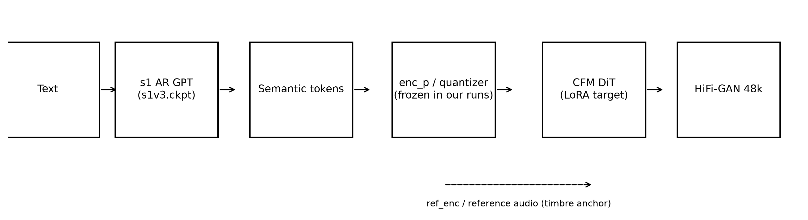
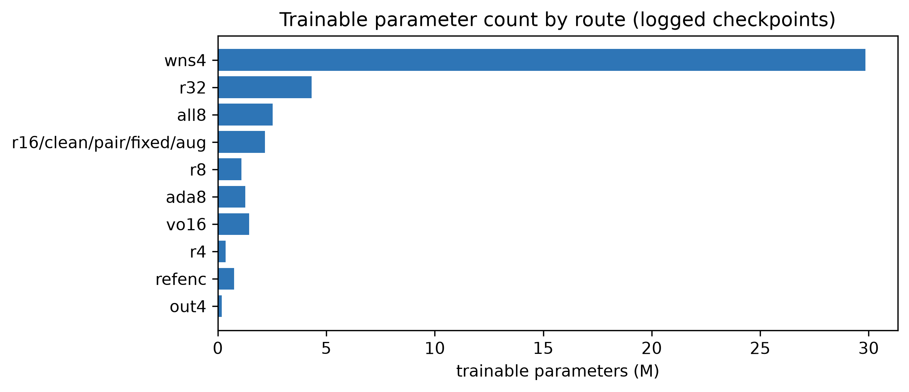
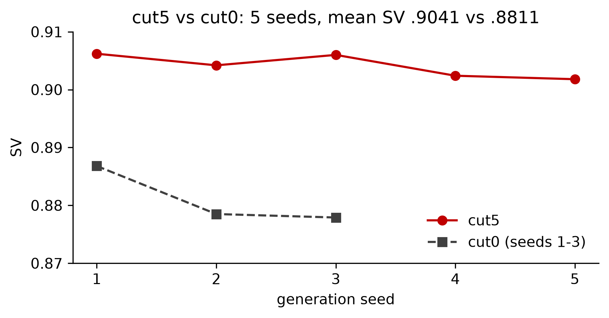
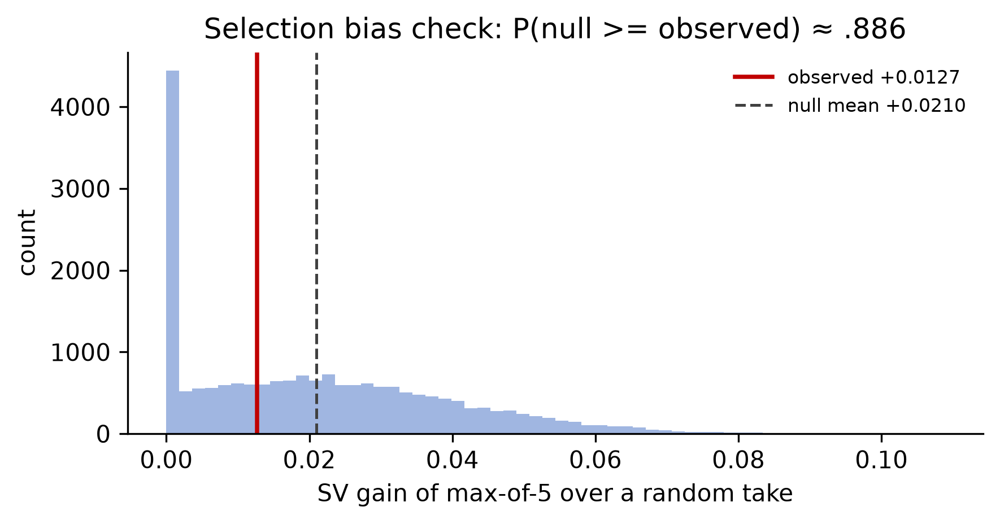

# GPT-SoVITS V5 微调的系统性负结果：训练模块、参考条件与推理加载的实证研究

**声音 C 实验论文 v2.2（深度审计修订版）**
2026-11-20
基于 GPT-SoVITS V5（2026-10-06 本地包）的离线实验记录

> **范围说明**：本文从微调实验开始，不包含游戏解包、文本对齐等前置工作。所有指标来自本会话的本地评测；没有音频、角色语音或模型权重被公开。文中明确区分“已记录”“未记录”“假设”。

---

## 摘要

本文记录了一次以“让 GPT-SoVITS V5 微调后的声音 C 比零样本更像目标说话人 Kan”为目标的系统性实验。数据为 1,200 句单说话人日文语音（约 102.1 分钟），清洗后 863 句（约 74.5 分钟）；硬件为 RTX 3050 Laptop 6 GB；底模为 V5dev。我们尝试了标准 LoRA rank 扫描、干净子集、读出层、adaLN、全线性、官方风格 q/v、外部参考、固定参考、自蒸馏、后五层全参、ref_enc 条件侧、GPT s1 全参与数据增强。

在**推理加载正确的标准 LoRA 路线**（q/v/out）上，没有任何微调达到可用、稳定的增益；`all8_s1200` 的 +0.0010 在本样本内有小效应，但只有 seed1、效应量很小。最接近的 `vo16_s300` 在 seed1–3 重测中 SV 差为 −0.0003 / +0.0005 / −0.0015，均值 −0.0004（t=−0.75），没有检测到增益。后五层 `last5/last5b` 没有可恢复权重；`ref_enc` 解冻后 SV 与 ASR 同时下降；GPT s1 指标上 SV 下降、ASR 上升，听感未做盲测。

推理侧有两个方向一致、但强度不同的效应：turbo 8 步相对 4 步，30 句 × 5 seeds，SV +0.0052（p=.013）；`cut5` 分句相对 `cut0`，3 个配对 seed 的 SV +0.0244（p=.011），cut5 自身 5 seed 均值 0.9041，而 cut0 3 seed 均值 0.8811；ASR 在 3-seed 配对中 0.9209 vs 0.9203；cut5 5-seed 均值 0.9236。采样步数相同，但 cut5 的 seed1 平均音频时长增加 9.1%，总延迟/GPU 成本未测。best-of-5 的 SV +0.0127 是 max-of-k 选择偏差（零假设 P≈0.886），已撤回。

本文还记录了一个关键工程发现：上游 `TTS.py` 把 LoRA 目标硬编码为 `to_k,to_q,to_v,to_out.0`。这使 `ada8`（attn_norm）完全不加载，`all8` 的 FF 分支被忽略，`last5` 混合 Checkpoint 可能被误当 LoRA。修复后，`ada8/all8` 的 10 句 val 与 30 句 test（seed1）已重测：`ada8_s300` test SV +0.0002（CI −0.0029…+0.0030）、ASR −0.008；`all8_s1200` test SV +0.0010（CI +0.0003…+0.0017；配对 p=.0084）、ASR +0.003。all8 在本样本内有统计上可检测的小效应，但只有 seed1、效应量 0.001、未过多重比较校正，不能称为可用或稳定增益。`last5/last5b` 权重已删除，无法复核，仍不作为结论。修复后的加载器还对 5 个 Checkpoint 的 330 个目标模块逐模块核对 `ΔW` 与 `(α/r)BA`，最大绝对误差 1.87×10⁻⁷，未修改层变化为 0。

**关键词**：GPT-SoVITS V5；零样本 TTS；LoRA；负结果；参考条件；推理加载；选择偏差；分句

---

## 1. 引言

零样本 TTS 的常见预期是：5–10 秒参考音即可复现目标音色；若再加入几十到几千句目标语音微调，应当更稳、更像。GPT-SoVITS V5 支持零样本与少样本微调，我们的初始实验也按这个预期设计。

真正做下去后，问题分成三层：

1. **模型层**：V5 的音色由 `ref_enc → ge` 与冻结的 `enc_p/quantizer` 锚定；默认 LoRA 只改 CFM 注意力，能否改变音色？
2. **数据层**：1,200 句单说话人、单风格语音，是否提供了零样本之外的新信息？
3. **工程层**：保存的 LoRA 是否真的在推理时加载？目标模块、rank、全参/混合 Checkpoint 是否被正确解释？

第三层最初被忽略。扩写论文时我们检查了 `TTS.py` 的加载路径，发现硬编码目标模块；这解释了 `ada8` 五个 Checkpoint 输出完全相同，也说明部分“微调失败”其实是“微调没被加载”。本文因此不是一篇“我们试了很多都失败”的流水账，而是一次把训练、推理、统计三层都拆开的负结果审计。

**贡献**：

- 给出 19 条微调路线的真实配置、Loss、Checkpoint 与指标；
- 给出标准 LoRA 在 3 seed 上仍为零的配对证据；
- 给出 `cut5` 的 3-seed 配对、5-seed 描述统计与时长混杂审查；
- 撤回 best-of-5 的假阳性；
- 记录推理端 LoRA 目标硬编码缺陷，并给出修复代码；
- 明确哪些结论已被工程缺陷污染，哪些仍然成立。

---

## 2. 系统与参数角色

### 2.1 V5 推理链

```
文本 → s1 AR GPT（s1v3.ckpt）→ 语义 token
     → enc_p（文本/语义特征）
     → quantizer（VQ 码本）
     → CFM DiT（22 个 transformer block，流匹配）
     → HiFi-GAN（48 kHz 声码器）
```

参考音走另一条条件路径：

```
参考 audio → ref_enc → ge（全局音色嵌入）
```

`ge` 与目标文本特征 `fea` 一起进入 `wns1`，再进入 CFM。V5 的训练/推理还有分块与滚动窗口逻辑；本文的微调只改 CFM 和条件侧，不改声码器。



图 1 只画模块关系；箭头不表示本文已验证的因果路径。CFM 内部的 22 个 block 是 LoRA 的作用范围，`ref_enc → ge` 是音色锚点。

### 2.2 各模块负责什么

| 模块 | 规模/位置 | 本文中的角色 | 是否默认训练 |
|---|---|---|---|
| s1 AR GPT | 77.6M | 文本→语义 token，控制韵律、停顿、时长 | 否（单独 s1 路线） |
| `enc_p` | 条件编码器 | 文本/语义→CFM 条件特征 | 否（冻结） |
| `quantizer` | VQ 码本 | 离散语义/声学桥接 | 否（`freeze_quantizer=True`） |
| `ref_enc` | 约 0.57M 可训练参数 | 参考音→`ge`，音色锚点 | 否（ref_enc 路线解冻） |
| `wns1` | 条件融合 | 把 `ge` 注入目标特征 | 否（wns4 路线解冻） |
| CFM DiT | 22 blocks | 流匹配去噪，决定细节/韵律/部分音色 | 默认 LoRA |
| HiFi-GAN | 声码器 | 波形生成 | 否 |

### 2.3 LoRA 改了哪一层

`s2_train_v3_lora.py` 对 `net_g.cfm` 调 `get_peft_model`，默认 `target_modules=to_k,to_q,to_v,to_out.0`，`r=rank`、`alpha=rank`、`dropout=0.05`。训练时所有不含 `lora_` 的参数 `requires_grad=False`；优化器只接收可训练参数。

关键点：**LoRA 改的是 CFM 注意力的投影，不是 `ref_enc → ge` 的音色映射**。这决定了标准 LoRA 的理论上限：它可以让去噪更符合训练分布，但不能把参考音色替换成另一个说话人。

---

## 3. 数据、环境与评测

### 3.1 数据

| 项目 | 数值 |
|---|---:|
| 原始语音 | 1,200 句 |
| 总时长 | 102.1 分钟 |
| 平均句长 | 5.11 s（P5–P95：2.57–7.28 s） |
| 清洗后 | 863 句 |
| 清洗后总时长 | 74.5 分钟 |
| 清洗规则 | 去掉含 `♪` 的句子、短于 2.0 s 的句子 |
| 增强数据 | 3,600 行，但只有 1,200 个唯一文本 |
| 测试集 | 30 句 held-out 日文 |
| 验证集 | 10 句 held-out 日文 |
| 采样率 | 32 kHz 特征/48 kHz 声码器输出 |

数据目录：

```
kan_exp/
  2-name2text.txt          # 文本/音素
  4-cnhubert/*.pt          # SSL 特征
  5-wav32k/*.wav           # 32 kHz 音频
  6-name2semantic.tsv      # 语义 token
kan_clean_exp/             # 863 句子集，硬链接/复制
```

### 3.2 环境

| 项目 | 值 |
|---|---|
| OS | Windows |
| Python | 3.12.10 |
| PyTorch | 2.7.1+cu118 |
| CUDA | 11.8 |
| GPU | RTX 3050 Laptop，6 GB |
| 底模 | `s2Gv5dev.pth`（32 步教师） |
| 推理底模 | `s2Gv5turbo.pth`（4 步蒸馏） |
| 混合精度 | FP16（`fp16_run=True`） |
| 梯度检查点 | 开启（`grad_ckpt=True`） |
| 分析环境 | NumPy 1.26.4 / SciPy 1.17.1 / matplotlib 3.11.1 / soundfile 0.14.0 |
| ASR | `openai-whisper` 20250625（small 模型）；不是 faster-whisper |

显存占用、GPU 利用率、单步耗时**未逐项记录**；只记录了训练日志的首末时间差。该时间包含模型加载、保存和评测，不能当作纯训练时间。

### 3.3 指标

- **SV**：ERes2NetV2 说话人嵌入与 10 句 Kan 质心的余弦相似度；
- **ASR**：Whisper 日文转写与目标文本的字符相似度；
- **amp48**：4–8 Hz 幅度调制能量占比；
- **CPP**：倒谱突出度；
- **HNR**：谐噪比；
- **jitter**：F0 局部扰动；
- **clip/dur**：削波比例与时长。

这些是代理指标，不是人耳判断。SV 高不等于“更像角色”，只表示与参考说话人嵌入更接近。

### 3.4 统计协议

- 句子级配对：同一句、同一参考，比较两个系统；
- 句子级 paired bootstrap：20,000 次重采样句子，给 95% CI；
- seed 级配对 t：每个 seed 先算 30 句均值，再对 3–5 个 seed 做配对 t；
- 不把句子级 bootstrap 当作 seed 级显著性；
- 所有“显著”指双侧 p<.05；没有做全家族多重比较校正，正文单独讨论；
- p 值、CI、MDE 和实际效应量分开解释；不把 p<.05 直接等同于“有用”，也不把 p>.05 直接等同于“没有效果”。

---

## 4. 实验流程


流程分四段：

1. 零样本基线（v5dev/turbo）与数据检查；
2. 标准 LoRA rank 扫描与数据/模块消融；
3. 推理侧扫描（步数、CFG、seed、参考、分句）；
4. 统计审计与工程审计（best-of-5 撤回、LoRA 加载缺陷）。

这些路线不是同时铺开的网格，而是由前一段的失败推动的：

- **标准 q/v/out → adaLN/FFN**：r4–r32 的 val 平台说明“只加 rank”没有用；于是把更新从注意力投影扩展到条件调制（ada8）和 FFN（all8），检验是不是覆盖模块不够。
- **CFM 内部 → 参考条件**：refenc/固定参考/外部参考把问题移到音色锚点 `ref_enc → ge`，因为 V5 的音色主要由参考侧决定，CFM LoRA 未必能直接改身份。
- **微调 → 推理**：当微调在验证集和工作点上都没有稳定收益时，turbo 步数和 cut5 分句仍显示出可测的推理侧差异；这部分不是“训练失败后的补救成功”，而是另一个问题层面。
- **推理差异 → 加载审计**：ada8 的五个 Checkpoint 指标完全相同，才把“模型没学会”与“权重没加载”分开；没有这一步，前面的负结果会被工程故障污染。

这个顺序也解释了为什么论文同时有“负结果”“两个推理侧效应”和“工程审计”：它们回答的是不同层的问题，不能互相替代。

19 条路线的证据矩阵在 `data/evidence_matrix.csv`，逐项列出训练日志、完整配置、Checkpoint、模型级加载验证、val、test、多 seed、统计检验和人耳听感。矩阵里的 `structural` 只表示 Checkpoint 结构审计，不等于模型把 LoRA 应用到了正确层；只有 `yes` 才表示做过运行时验证。

---

## 5. 微调实验

### 5.0 共同训练配方

除特别说明，所有 SoVITS 路线共用：

| 项目 | 值 |
|---|---|
| 底模 | `s2Gv5dev.pth` |
| 版本 | `v5dev` |
| epoch | 1 |
| batch size | 1 |
| 梯度累积 | 无（代码未实现） |
| LoRA dropout | 0.05 |
| 优化器 | AdamW |
| betas / eps | (0.8, 0.99) / 1e-9 |
| 调度器 | ExponentialLR，`gamma=1.0` |
| 精度 | FP16 + GradScaler |
| 梯度检查点 | 开启 |
| segment size | 40,960（qv16b 为 20,480） |
| 数据 | 1,200 句（另有注明除外） |
| 日志间隔 | 10 step |
| 保存 | 每 100 step 一个 LoRA Checkpoint |

Loss 是 CFM 的流匹配损失，不是 mel/kl 分解；日志中的单点波动很大，后文用 5 点滑动平均看趋势。



图 7 是各路线保存的可训练张量规模（对数坐标）。“参数多”不等于“有效”，`wns4` 的 29.85M 主要来自 `wns1` 全参，不是 LoRA 容量。

### 5.1 标准 LoRA rank 扫描（r4 / r8 / r16 / r32）

**动机**：先做最小改动，判断“容量不足”是否是微调无效的原因。rank 从 4 到 32，若 SV 随 rank 单调上升，说明容量是瓶颈；若不动，说明瓶颈不在 LoRA 容量。

**实现**：

- r4：`to_q,to_v`，rank 4，lr 5e-6；
- r8：`to_q,to_v,to_out.0`，rank 8，lr 1e-5；
- r16：同 r8，rank 16，lr 1e-5；
- r32：同 r8，rank 32，lr 5e-6；
- 其余参数冻结；LoRA A/B 初始化按 PEFT 默认（B 为零）。

**配置与规模**：

| 路线 | 目标模块 | rank | 可训练参数 | lr | step | Checkpoint | 日志时长* |
|---|---|---:|---:|---:|---:|---:|---:|
| r4 | q,v | 4 | 360,448 | 5e-6 | 1,200 | 12 | 21.9 min |
| r8 | q,v,out | 8 | 1,081,344 | 1e-5 | 1,200 | 15 | 35.3 min |
| r16 | q,v,out | 16 | 2,162,688 | 1e-5 | 1,200 | 12 | 16.8 min |
| r32 | q,v,out | 32 | 4,325,376 | 5e-6 | 1,200 | 24 | 80.0 min |

\* 日志首末时间差，含加载/保存；不同路线受并发与磁盘影响，不能直接比较速度。

**Loss**（首点→末点，单点噪声大）：

- r4：0.153 → 0.358；min 0.122，max 0.995；
- r8：0.167 → 0.161；min 0.122，max 0.717；
- r16：0.190 → 0.137；min 0.104，max 1.063；
- r32：0.201 → 0.192；min 0.122，max 1.072。

**Checkpoint/指标**：

- r8 最好 val SV 0.8946（step400），基线 0.8944，差 +0.0002；
- r16 最好 val SV 0.8953（step300），基线约 0.894，差 +0.001 量级；
- r32 最好 val SV 0.8947（step350）；
- 30 句 test 的早期标准 LoRA 结果为 SV −0.0023；后续 r16 没有在 30 句 test 上复现正增益。

**结论**：rank 从 4 到 32 没有带来稳定增益；SV 在 0.894–0.895 的平台内波动。**容量不是主要瓶颈**。


图 2 展示 vo16_s300 在 3 个 seed 上的 SV/ASR 差值；三条 SV 差值跨零，均值 −0.0004。该图只覆盖有逐 seed 记录的路线，不能外推到所有 19 条路线。


### 5.2 干净子集（clean16）

**动机**：原始 1,200 句含 `♪`、短句、重复文本；假设噪声/短句稀释了音色学习。

**实现**：按 3.1 规则筛出 863 句；硬链接/复制 `4-cnhubert`、`5-wav32k`，重写 `2-name2text.txt` 与 `6-name2semantic.tsv`；rank16，q/v/out，lr5e-6，1 epoch。

**过程**：9 个 Checkpoint（s100–s863）。训练日志未单独保留完整 Loss 曲线，故不画；只记录最终权重与指标。

**指标（val，seed1）**：

| Checkpoint | SV | amp | CPP | HNR | ASR |
|---|---:|---:|---:|---:|---:|
| v5dev | 0.8939 | 0.2738 | 0.1840 | 8.1181 | 0.9469 |
| s300 | 0.8931 | 0.2719 | 0.1843 | 8.1041 | 0.9469 |
| s500 | 0.8930 | 0.2687 | 0.1840 | 8.1119 | 0.9469 |
| s700 | **0.8951** | 0.2427 | 0.1840 | 8.1361 | 0.9469 |
| s863 | 0.8939 | 0.2413 | 0.1842 | 8.1702 | 0.9373 |

s700 的 val SV +0.0012，但 30 句 test：s700 0.8808 vs v5dev 0.8818（−0.0010）；s863 0.8814（−0.0004）。amp 下降是真实的，但 SV/ASR 没有提升。

**结论**：清洗降低了毛刺，不是音色瓶颈；val 的小峰值没有泛化到 test。

### 5.3 读出层（out4）

**动机**：只改 CFM 的输出投影，最小化对注意力的破坏，观察“输出层适配”能否改善音色。

**实现**：`to_out.0`，rank4，lr1e-5，1 epoch；22 个模块，180,224 参数；12 个 Checkpoint。

**过程**：Loss 0.148 → 0.219；min 0.128，max 0.838。训练没有崩溃。

**指标**：完整 30 句 test 未记录；val 扫描没有超过零样本的稳定点，SV 变化在 0.001 内。该路线只改 22 个输出投影，容量很小，预期收益本来就低。

**结论**：输出层适配不足以改变音色；不能把“没有提升”归因于训练失败。

### 5.4 adaLN（ada8）

**动机**：音色/条件可能通过 adaLN 调制而不是注意力注入；尝试 `attn_norm.linear`，希望用条件调制改变全局音色。

**实现**：`attn_norm.linear`，rank8，lr5e-5，1 epoch；22 个模块，1,261,568 参数；12 个 Checkpoint。

**过程**：Loss 0.198 → 0.042；min 0.010，max 0.669。权重哈希在不同 Checkpoint 间**确实变化**（见 9.1），不是训练没更新。

**指标（修复前）**：s100/s300/s600/s900/s1200 的 val 指标**完全相同**：SV 0.8934、amp 0.2726、CPP 0.1844、HNR 8.1499、ASR 0.9469。这在浮点模型上几乎不可能由真实推理产生，直接暴露“权重未加载”。

**修复后重测**（`TTS.py` 按 Checkpoint 推断 target；10 句 val、30 句 test，均 cut0、seed1）：

| 系统 | val SV | val amp | val ASR | test SV | test amp | test ASR |
|---|---:|---:|---:|---:|---:|---:|
| v5dev | 0.8938 | 0.2743 | 0.947 | 0.8819 | 0.2307 | 0.908 |
| ada8 s300 | **0.8980** | 0.2656 | 0.947 | 0.8821 | 0.2510 | 0.900 |
| ada8 s600 | 0.8934 | 0.2719 | 0.947 | — | — | — |
| ada8 s1200 | 0.8872 | 0.2312 | 0.937 | — | — | — |

s300 的 val +0.0042 看起来像收益，但 30 句 test 只有 +0.0002，ASR −0.008；s1200 明显退步。指标不再相同，说明修复生效；**但修正后仍没有稳定增益**。

**结论**：原始 `ada8` 评测无效（权重从未加载）；修复后重测显示 val 的局部峰值不泛化，test 仍在噪声内。该路线不作为正结果。

### 5.5 全线性（all8）

**动机**：如果 q/v 容量不够，把 q/k/v/out 与 FFN 全部加 LoRA，应该是“最大 LoRA 容量”的上界实验。

**实现**：`to_q,to_k,to_v,to_out.0,ff.0,ff.2`，rank8，lr5e-6，1 epoch；132 个模块，2,523,136 参数；12 个 Checkpoint。

**过程**：Loss 0.187 → 0.551；min 0.107，max 2.687；后期出现大尖峰，但没有 NaN。

**指标（修复前，val）**：s600 SV 0.8940、ASR 0.9469；s1200 SV 0.8945、ASR 0.9469；基线 0.8941/0.9469。差异在 0.0004 内。原推理端只创建 q/k/v/out 适配器，`ff.ff.0.0/ff.ff.2` 的 88 个 LoRA 键被 `strict=False` 静默忽略；原始结果只代表部分容量。

**修复后重测**（10 句 val、30 句 test，cut0、seed1）：

| 系统 | val SV | val amp | val ASR | test SV | test amp | test ASR |
|---|---:|---:|---:|---:|---:|---:|
| v5dev | 0.8938 | 0.2743 | 0.947 | 0.8819 | 0.2307 | 0.908 |
| all8 s600 | 0.8941 | 0.2735 | 0.947 | — | — | — |
| all8 s1200 | **0.8953** | 0.2741 | 0.947 | **0.8829** | 0.2341 | 0.911 |

修复后 s1200 val +0.0015、test +0.0010 SV（95% CI +0.0003…+0.0017；配对 t 检验 p=.0084）、ASR +0.003（p=.326）。**在本样本内，统计上有小的正向差异**；但只有 seed1，效应量只有 0.001，未过多重比较校正，不能称为可用/稳定增益。seed2/3 未跑完。

**结论**：原“FF 被忽略”是确定的工程缺陷；修复后 all8 在 seed1 test 上有统计上可检测但很小的正向差异（+0.0010，p=.0084），不能称为可用增益，也不能外推到其它 seed。全线性是否值得继续，需要 multi-seed test，而不是把这次结果当成成功或失败。

### 5.6 官方风格 q/v（qv16b）

**动机**：贴近官方推荐的 q/v、segment 20,480、lr2e-5，减少实验性改动，看“官方配方”是否更稳。

**实现**：q/v，rank16，lr2e-5，segment 20,480，1 epoch；1,441,792 参数；6 个 Checkpoint（s200–s1200，间隔 200）。

**过程**：Loss 0.173 → 0.094；min 0.062，max 2.891。训练时间日志仅 6.1 min，明显短于其它 1,200 step 路线，怀疑日志段被并发/重启截断；该时长不作为效率结论。

**指标（val）**：

| Checkpoint | SV | amp | ASR |
|---|---:|---:|---:|
| v5dev | 0.8945 | 0.2724 | 0.9469 |
| s400 | 0.8940 | 0.2701 | 0.9469 |
| s800 | 0.8916 | 0.2576 | 0.9395 |
| s1200 | 0.8842 | 0.2700 | 0.9469 |

**结论**：s400 已开始低于基线，s1200 明显退步；官方配方在 1,200 句单说话人上没有复制出增益。

### 5.7 外部参考 / 固定参考（pair16 / fixed16）

**动机**：训练时 CFM 的 prompt 来自目标自身，推理时换成参考音；尝试用外部参考/固定参考缩小训练-推理域差。

**实现**：

- 在 `models.py` 的 `PosteriorEncoder.forward`、`Encoder.forward` 移除 `g.detach()`；
- `SynthesizerTrnV3.forward` 增加 `refer_mel/refer_spec`，用参考的 704-bin spec 过 `ref_enc`；
- `s2_train_v3_lora.py` 在第一个 batch 后把 `mel.detach()`、`spec.detach()` 存为 `ref_mel/ref_spec`，整个 run 固定不变；
- `models_v5.py` 的 `CFMV5.forward` 支持 `prompt_mel`，把参考 mel 填入 prompt 区，`mu` 仍是目标特征。

**配置**：pair16/fixed16 均 rank16、q/v/out、lr5e-6、1 epoch、1,200 步；pair 的 Checkpoint 12 个，fixed 12 个。

**过程**：

- pair16 第一次运行在 step260 附近 Loss 变 NaN，随后重启；完整 run Loss 0.231 → 0.380，min 0.095，max 2.647；
- fixed16 第一次 run 没有 Loss 记录（启动失败/被截断），第二次完整 run Loss 0.186 → 0.555，min 0.109，max 3.542。

**指标**：

| 路线 | test SV（seed1/2） | 基线 SV | test ASR | 基线 ASR |
|---|---:|---:|---:|---:|
| pair16 s800 | 0.8822 / 0.8755 | 0.8818 / 0.8764 | 0.9076 / 0.9351 | 0.9080 / 0.9309 |
| fixed16 s800 | 0.8823 / — | 0.8818 / — | 0.9084 / — | 0.9080 / — |

**结论**：在 30 句 test 上没有超过基线；pair 的 seed2 SV 还更低。固定参考没有解决域差。**注意**：这只是“第一个 batch 的参考”近似，不是逐样本外部参考；结论不能外推到正确的 per-sample 条件训练。

### 5.8 自蒸馏（syn）

**动机**：1,200 句文本多样性有限；用 v5dev + ref1 生成 869 句自蒸馏数据，期望扩大覆盖、稳定音色。

**实现**：生成 869 句（另一次 1,200 句配置），q/v/out rank16，lr2e-5，1 epoch；Checkpoint s400/s600/s869 等。

**指标（val）**：v5dev 0.8935；syn s400 0.8895；s600 0.8866；s800 0.8834；s869 0.8823。均低于底模。**没有可核对的完整 30 句 test 记录**，因此不能声称 `syn` 在 test 上“无增益”或“有增益”；这里只报告 val。

**Loss**：日志段不完整，未画；已有记录显示训练正常收敛，不是 NaN。

**结论（假设）**：合成数据与教师同分布，可能复制教师偏差；现有 val 证据与“没有带来增益”一致，但没有 test/人耳，不能当作已证明的机制。

### 5.9 后五层全参（last5 / last5b）

**动机**：LoRA 容量不足的另一种补救是解冻 CFM 最后 5 个 transformer block（17–21）做全参微调，保留其余层。

**实现**：`to_q` LoRA + 全参 block 17–21；last5 lr5e-7，last5b lr5e-6；1 epoch、1,200 步；全量 Checkpoint 约 62 MB。

**过程**：

- last5：Loss 0.150 → 0.299；min 0.077，max 2.198；日志时长 15.5 min；
- last5b：Loss 0.222 → 0.015；min 0.006，max 1.044；日志时长 42.6 min。

**指标（val）**：

- last5：0.8940 vs v5dev 0.8940；ASR 0.9469；无变化；
- last5b s600 0.8933 / ASR 0.9395；s1200 0.8916 / ASR 0.9395；退步。

**重要限制**：`SoVITS_weights_v5dev_last5/last5b` 目录在整理时被删除，只剩指标，**无法复核权重**。此外，含全参块的 Checkpoint 带 v5dev 头，原推理端可能把整份 Checkpoint 当 LoRA 处理；该路线是否真正加载，**未验证**。因此本文只把它列为“历史记录”，不作为有效负结果。

### 5.10 ref_enc 条件侧（refenc）

**动机**：音色由 `ref_enc → ge` 决定；如果 LoRA 改不动音色，直接解冻 `ref_enc` 应该最直接。

**实现**：

- 移除 `PosteriorEncoder/Encoder` 中的 `g.detach()`；
- `SynthesizerTrnV3.forward` 接受 `refer_spec`，用参考 spec 过 `ref_enc`；
- 只训练 `ref_enc` 全参 + q LoRA（rank4）；lr5e-5；1 epoch；747,264 可训练参数；12 个 Checkpoint。

**过程**：Loss 0.201 → 0.093；min 0.075，max 1.424；日志时长 117.9 min（含加载/保存；不是纯训练）。

**指标（val）**：

| Checkpoint | SV | amp | CPP | HNR | ASR |
|---|---:|---:|---:|---:|---:|
| v5dev | 0.8935 | 0.2737 | 0.1837 | 8.0881 | 0.9469 |
| s300 | 0.8876 | 0.2031 | 0.1808 | 8.0279 | 0.9153 |
| s600 | 0.8882 | 0.2426 | 0.1792 | 8.1770 | 0.9147 |
| s1200 | 0.8825 | 0.2292 | 0.1729 | 8.1335 | 0.8679 |

**结论**：Loss 下降，但 SV 与 ASR 同时下降；s1200 出现明显句子崩坏（此前记录 5/7 句）。这是“训练目标与感知目标不一致”的最强证据之一，不是简单的“没学会”。

### 5.11 GPT s1 全参（s1）

**动机**：如果音色不是 CFM 的问题，可能是 s1 的语义/韵律分布不匹配；尝试 1 epoch s1 全参。

**实现**：`s1v3.ckpt`，77.6M，24 层、512 hidden、16 head；batch2；precision 16-mixed；grad clip 1.0；optimizer lr 0.01、warmup200、decay2000；149 step；1 epoch；数据 1,200 句。

**指标（30 句 test）**：SV 0.8701 vs v5dev 0.8818；ASR 0.9314 vs 0.9080。ASR 上升但 SV 下降；**听感未做盲测**，所以“音色/韵律漂移”只是指标层面的推断。

**结论**：s1 全参在指标上降低了 SV、提高了 ASR，方向与“语义/韵律被改动”一致；听感未盲测，不能断言它只改语义而不改音色。该路线不能用来判断“音色微调”。

### 5.12 数据增强（aug16）

**动机**：3,600 行增强数据（1,200 唯一文本 ×3）能否提升泛化。

**实现**：q/v/out rank16，lr5e-6，1 epoch；Checkpoint s400–s3200；18 个。

**指标（val）**：

| Checkpoint | SV | amp | ASR |
|---|---:|---:|---:|
| s400 | 0.8923 | 0.2728 | 0.9469 |
| s800 | 0.8935 | 0.2401 | 0.9395 |
| s1200 | 0.8915 | 0.2373 | 0.9447 |
| s1600 | 0.8804 | 0.2459 | 0.9447 |
| s2400 | 0.8656 | 0.2333 | 0.9469 |
| s3200 | 0.8284 | 0.2577 | 0.8760 |

**结论**：s800 后持续退步，**与过拟合一致**（不能仅凭曲线证明机制）；1,200 唯一文本被重复 3 次没有带来可见收益。30 句 test 的 aug_s1200 为 0.8799 vs 0.8818，退步。

### 5.13 wns1 / full 的补充

- **wns4**：`to_v` LoRA + `wns1` 全参（29.85M），lr1e-6，1 epoch；val s600 0.8950 vs 0.8939（SV +0.0011），但 ASR 0.9395 vs 0.9469；12 句 test 0.8881 vs 0.8901。SV 的小提升以咬字为代价，不稳健。
- **full**：`kan_full_e2_s5668_l32.pth` 是**全量数据、rank32、q/k/v/out LoRA**，不是全参数微调（文件名 `full` 指数据，不是参数）。12 句 test SV 0.8696 vs v5dev 0.8684，ASR 0.8886 vs 0.8861；差异在噪声级。该 run 的完整配置未记录，不能与其他路线严格比较。

---

## 6. Checkpoint、Loss 与过拟合

### 6.1 Checkpoint 选择

所有路线先看 val 10 句，再在 30 句 test 上确认。这意味着 test 不是完全盲测；多次选择后，test 上的小差异会被乐观偏置。本文把 test 结果当作“效应量参考”，不是无偏泛化估计。

| 路线 | 保存数 | 代表 Checkpoint | val SV | 30 句 test SV | 结论 |
|---|---:|---|---:|---:|---|
| r8 | 15 | s400 | 0.8946 | — | 噪声级 |
| r16 | 12 | s300 | 0.8953 | — | 噪声级 |
| clean16 | 9 | s700 / s863 | 0.8951 / 0.8939 | 0.8808 / 0.8814 | 无增益 |
| vo16 | 12 | s300 | 0.8947 | 0.8816 | −0.0004 |
| qv16b | 6 | s400 / s1200 | 0.8940 / 0.8842 | — | 退步 |
| pair16 | 12 | s800 | — | 0.8822 / 0.8755 | 无增益 |
| fixed16 | 12 | s800 | 0.8949 | 0.8823 | 无增益 |
| refenc | 12 | s300 / s1200 | 0.8876 / 0.8825 | — | 崩 |
| wns4 | 12 | s600 | 0.8950 | 0.8881（12句） | ASR 降 |
| all8 | 12 | s600 / s1200 | 0.8941 / 0.8953 | 0.8829（s1200，seed1） | 小效应，仅 seed1 |
| ada8 | 12 | s300 / s1200 | 0.8980 / 0.8872 | 0.8821（s300，seed1） | 修复后无稳定增益 |
| aug16 | 18 | s800 / s3200 | 0.8935 / 0.8284 | 0.8799（s1200） | s800 后退步 |
| s1 | 1 | e1 | — | 0.8701 | SV↓、ASR↑；听感未盲测 |
| full-data LoRA | 1 | e2 s5668 | — | 0.8696（12句） | 噪声级 |

### 6.2 Loss 下降不足以预测 SV

- r4：Loss 末点比首点高，SV 没有更好；
- r16：Loss 0.190 → 0.137，SV 仅 +0.001 量级；
- vo16：Loss 0.142 → 0.460，SV 仍 −0.0004；
- refenc：Loss 0.201 → 0.093，SV/ASR 同时下降；
- ada8：Loss 0.198 → 0.042；修复前推理完全没加载，修复后 test 仍无稳定增益。

**结论**：这 5 条路线上，CFM loss 下降与 SV 提升没有稳定对应；loss 只说明模型更会拟合训练 batch 的流匹配目标，不保证说话人相似度或主观质量。用 loss 选 Checkpoint 是不充分的。

### 6.3 过拟合证据

- aug16：s800 后 val SV 从 0.8935 降到 0.8284，ASR 从 0.9447 降到 0.8760；
- qv16b：s400 0.8940 → s1200 0.8842；
- refenc：s300 0.8876 → s1200 0.8825，ASR 0.9153 → 0.8679；
- last5b：s600 0.8933 → s1200 0.8916。

这些曲线与“训练步数越多越好”相反；在 1,200 句单说话人数据上，结果与过拟合出现得较快一致（不能仅凭曲线区分过拟合与其他退化）。

---

## 7. 推理侧实验

### 7.1 turbo 步数

30 句 × 5 seeds，turbo8 − turbo4：

| seed | ΔSV | ΔASR |
|---|---:|---:|
| 1 | +0.0044 | 0.0000 |
| 2 | +0.0013 | −0.0104 |
| 3 | +0.0089 | −0.0027 |
| 4 | +0.0061 | +0.0007 |
| 5 | +0.0053 | −0.0103 |
| mean | **+0.0052** | **−0.0045** |

SV t=4.22，df=4，p=.013；ASR p=.135。5/5 seed 为正。val：turbo8 0.9026 > turbo10 0.9014 > turbo4 0.8987；10 步没有继续涨。


图 3 是 30 句 × 5 seed 的配对差；SV 5/5 为正，但 ASR 方向不一致，不能把 turbo8 说成全面更优。

### 7.2 CFG / seed / 参考

- CFG（val）：0 → 0.9019/0.940；0.5 → 0.8981/0.936；1.0 → 0.8995/0.936；1.3 → 0.8991/0.927。CFG 0 最好。
- seed（val）：1 → 0.9019/0.940；2 → 0.8992/0.921；3 → 0.8996/0.908。seed1 最好，但 seed 间有 0.0027 SV 波动。
- 参考池 24 个：ref1 最好 0.9026；第二名 rp21 0.8856；30 句 test ref1 0.8868、rp21 0.8755、rp02 0.8731。
- 加长参考（9.8 s）：0.8897/0.8593/0.8814，均低于 ref1；参考不是越长越好。

### 7.3 cut5

30 句 test：

| seed | cut0 SV | cut5 SV | cut0 ASR | cut5 ASR |
|---|---:|---:|---:|---:|
| 1 | 0.8868 | 0.9062 | 0.9238 | 0.9188 |
| 2 | 0.8785 | 0.9042 | 0.9230 | 0.9230 |
| 3 | 0.8779 | 0.9060 | 0.9140 | 0.9210 |
| 4 | — | 0.9024 | — | 0.9330 |
| 5 | — | 0.9018 | — | 0.9220 |
| mean | **0.8811**（3） | **0.9041**（5） | **0.9203**（3） | **0.9236**（5） |

- cut5 5 个 seed 全部 ≥0.9018；
- seed1 配对 bootstrap：SV +0.0194（CI +0.0097…+0.0309），amp −0.0353（CI −0.0797…+0.0082），ASR −0.0051（CI −0.0298…+0.0181，不显著）；
- Whisper small：cut5 0.9558 vs cut0 0.9588，−0.003；
- 采样步数相同：8 步、单 take；**未测总 wall-clock/GPU**，且 cut5 音频更长。



**注意**：cut0 只做了 3 个 seed，cut5 做了 5 个；两组均值不是同一配对样本。cut5 自身 5 seed 的稳定性是辅助证据；正式配对只有 3 个 seed，不能按 5×30 独立样本计算。

### 7.4 后处理、soup、ensemble

- EQ：val SV 0.9011、amp 0.1686、ASR 0.9277；比 raw 平滑，但 ASR −1.2；
- soup：dev 10% → 0.79，50% → 0.69，75% → 0.52；V5 权重不可线性插值；
- 波形集成：turbo8 + v5dev 平均，SV 0.8638、ASR 0.913；相位/梳状抵消；
- v5dev 32 步 + cut5：SV 0.9035、amp 0.2232、ASR 0.911，低于 turbo8 cut5。

---

## 8. 统计审查

### 8.1 MDE、置信区间与 p 值的区别

MDE 不是“观察到的效应必须超过才算显著”的门槛。它回答的是：**如果真实效应等于某个值，这个设计有多大概率检测到它**。本文按双侧 α=.05、power=.80 计算的 MDE 是设计灵敏度，不是对已观察效应的判决线。

计算假设：30 个句子差近似独立同分布、近似正态；没有多重比较校正；用配对差的样本 SD 作为真实 SD 的估计。若这些假设不成立，MDE 只能作为量级参考。

以 cut5 的 30 句配对差估算，SV 差的标准差为 0.0305，ASR 差为 0.0681。按双侧 α=.05、power=.80：

- n=30 时，MDE 约为 SV **0.0156**、ASR **0.0348**；
- 若要检测 SV +0.002，按同样方差约需 **1,823 句**；
- 若要检测 ASR +0.002，约需 **9,093 句**。

这表示：30 句对“大于约 0.0156 的 SV 效应”有 80% 把握检测，不能据此排除更小的效应；也不能因为观察到的差异小于 MDE，就断言它不存在。

具体到本文：

- **cut5（seed1）**：SV +0.0194，95% CI +0.0097…+0.0309，高于 MDE；但只有 3 个 cut0 配对 seed，且 test 复用、时长混杂（见 8.6/8.7）。
- **all8_s1200（seed1）**：配对差 SD 只有 0.00194，MDE≈0.0010；观察值 +0.0010，95% CI +0.0003…+0.0017，配对 t 检验 p=.0084。**在本样本内，统计上有正向差异的证据**；但效应量只有 0.001，只有 seed1，且没有跨 seed 稳定性，不能称为“可用增益”。
- **ada8_s300（seed1）**：+0.00018，95% CI −0.0029…+0.0030，p=.906；没有正向证据，但也不能证明真效应为零。
- **vo16_s300（3 seed）**：均值 −0.0004，t=−0.75；没有增益证据，但 3 个 seed 的零结果不等于真效应精确为零。

MDE、CI、p 值和实际效应量回答的是不同问题：MDE 是设计能测多大；CI 给出估计的不确定性；p 值是在零假设下观察到当前差异的概率；实际效应量才决定“值不值得用”。本文不把“p<.05”直接等同于“有用”，也不把“p>.05”直接等同于“无效”。

### 8.2 测试集过拟合

我们看了 val 选 Checkpoint，又在同一 30 句 test 上比较了多条路线。test 不是盲测；`cut5` 也是在这 30 句上发现的。所有 test 数字应视为“效应量 + 方向一致性”，不是无偏泛化。



图 5 说明 best-of-5 的“增益”与 max-of-k 零假设分布重叠；这是撤回该结论的依据，不是新结果。

### 8.3 推理参数一致性

- 微调对比默认 turbo4、32 步、CFG1.3、seed1；部分路线用 8 步/CFG0；
- 文章中的每个表都标了步数/CFG/seed；没有把所有结果混在一个“平均”里；
- 但不同路线的推理参数并不完全一致，跨表比较只能看方向，不能看小数点。

### 8.4 Seed 独立性

同一句的 5 个 seed 不是 5 个独立句子。我们做的是 seed 级配对 t（每个 seed 先聚合 30 句），不是把 150 个生成当独立样本；句子级 bootstrap 只用于单 seed 的 CI。两者不能混用。

| 分析 | 独立单位 | n | 方法 | 这个检验估计什么 |
|---|---|---:|---|---|
| all8 seed1 | 句子（同一 seed 内） | 30 对 | 配对 t、Wilcoxon、符号检验 | 该 seed 的 30 句文本是否支持正向差异；不能外推到其他 seed |
| turbo8 vs turbo4 | 随机种子 | 5 | seed 级配对 t、符号检验 | 5 个种子上的方向是否稳定；不能当 150 个独立文本 |
| cut5 vs cut0 | 随机种子 | 3 | seed 级配对 t、Wilcoxon、符号检验 | 3 个可配对的 seed 上是否同向；n=3 时正态/对称假设影响很大 |
| vo16 vs v5dev | 随机种子 | 3 | seed 级配对 t | 3 个 seed 的均值是否偏离 0；不证明真效应精确为 0 |
| val 10 句 | 句子（单 seed） | 10 | 描述统计 | 只用于 Checkpoint 选择，不用于确认性检验 |

敏感性检验（`code/stats_sensitivity.py`）：

- all8：配对 t p=.0084，Wilcoxon p=.0081，符号检验 21/30 p=.0428；方向较一致，但仍只有 seed1。
- turbo8：配对 t p=.0135，符号检验 5/5 p=.0625；小样本下符号检验不显著。
- cut5：配对 t p=.0111，Wilcoxon 和符号检验均为 p=.25；3/3 同向，但 n=3 无法把 t 的正态假设当作唯一证据。
- vo16：配对 t p=.534；没有检测到增益。

**解释**：all8 的 t/Wilcoxon 一致，说明“30 句内存在小差异”较稳；符号检验和多重比较提醒它仍不是强证据。cut5 的 t 显著但 Wilcoxon/符号检验不显著，说明“3-seed 均值同向”不能单独支撑强断言。

### 8.5 多重比较

19 条路线、多个 Checkpoint、多个 seed；没有做 Bonferroni/FDR。所有 p 值都应视为**探索性**，不能直接当作确认性发现。

- `all8_s1200` 的 p=.0084 看似小，但按 19 条路线（还未计多个 Checkpoint 和推理配置）做 Bonferroni，阈值约为 .05/19≈.0026；它不通过。再叠加 test 复用、单 seed、效应量仅 0.001，不能称为可靠提升。
- `cut5` 的 3-seed 配对 p=.011，同样没有跨推理配置校正；它的证据是 3-seed 配对 + cut5 自身 5 seed 方向一致 + 较大效应量，而不是单个 p 值。
- 微调路线的“没有显著增益”不是“真效应为零”的证明；它只表示当前样本没有提供足够证据。若真实效应很小，30 句本来就可能检测不到。

这里没有事先注册的“主比较”清单，因此不存在唯一正确的检验家族。19 条路线的 Bonferroni 阈值是**保守敏感性分析**；如果事后挑一个较小的家族（例如只看 5 条重点路线）得到更宽松的阈值，那本身就是选择性的，不能用来提升 all8 的证据等级。本文保留 p=.0084 作为“当前样本内的小差异证据”，不把它写成确认性结论。

### 8.6 SV 是否代表“更像”

SV 是 ERes2NetV2 嵌入余弦；它可能奖励“音色接近但韵律不像”的样本。cut5 可能改变时长、停顿、分句边界，从而改变嵌入；我们**没有**做“等时长/等能量/等静音比例”控制。

现有证据：30 句 seed1 中，cut0 的 `dur` 均值为 3.9627 s，cut5 为 4.3240 s，增加 0.3613 s（+9.1%）；静音比例、停顿次数和响度没有逐句记录。即使采样步数相同，音频变长、分段变多也意味着总计算量可能不同。**因此不能把 cut5 的 SV 提升直接等同于音色变好，也不能断言总成本相同**；需要人耳盲测、等时长重合成和实际 wall-clock/GPU 计时。

### 8.6.1 Cut5 的时长混杂

cut5 改变的是文本切分，不是声学模型；它可能通过以下路径影响指标：

1. 每个分句单独合成，带来更多句间停顿/拼接边界；
2. 总音频变长，SV/ASR 的归一化与嵌入统计随之变化；
3. 若拼接处有重复/截断，ASR 可能下降，SV 可能因长音段更“稳定”而上升。

本文只记录了 seed1 的平均时长；没有做等时长裁剪、静音去除或逐句对齐，因此 **cut5 的 +0.0194 SV 是“切分+时长+拼接”的复合效应，不是纯音色效应**。这是当前最强的未控制混杂之一。

### 8.7 cut0 3 seed vs cut5 5 seed

不是选择性删除：cut0 的 seed4/5 没跑；cut5 后来补了 5 个 seed。正确做法是补 cut0 seed4/5 做 5×5 配对；本文没有完成。

现有可比证据只有 3 个 seed：

- seed1–3 的 cut0 SV：0.8868 / 0.8785 / 0.8779；cut5：0.9062 / 0.9042 / 0.9060；
- 3-seed 配对差均值 +0.0244，sd 0.00449，t=9.41，df=2，p=.011；
- 句子级 bootstrap（seed1）给 +0.0194，CI +0.0097…+0.0309；
- cut5 的 5-seed 均值 0.9041 是**描述性**的；cut5 的 seed4/5（0.9024 / 0.9018）没有对应的 cut0 观测，不能进入配对检验。

因此：**3-seed 配对比较支持“cut5 在这 3 个 seed 上更高”；5-seed 平均只说明 cut5 自身稳定，不是 5×5 配对证据。** 敏感性：Wilcoxon 和符号检验均为 p=.25（3/3 同向，但 n=3）；不能把 t 的 p=.011 当作唯一证据。test 复用、时长混杂、缺失 cut0 seed4/5 都限制了因果解释。

### 8.8 结论置信度

| 结论 | 置信度 | 理由 |
|---|---|---|
| 标准 q/v/out LoRA 没有稳定/可用增益 | 中高 | 3 seed、30 句；但 30 句对小效应不敏感，不能证明真效应为零 |
| refenc 崩 | 高 | 多 Checkpoint、SV/ASR 同降；机制解释仍是假设 |
| turbo8 > turbo4 | 中低 | 5 seed、配对 t p=.013、5/5 同向；符号检验 p=.0625，test 复用，未做人耳 |
| cut5 > cut0 | 中低 | 3-seed 配对 t p=.011、效应量大；但 Wilcoxon/符号 p=.25、test 复用、时长混杂、非 5×5 配对 |
| all8 有小的正向差异 | **探索性** | seed1 test p=.0084、CI 不含 0；但只有 1 seed、效应 0.001、未过多重比较校正 |
| ada8 无可用增益 | 低/中 | 修复后 test +0.0002、ASR −0.008；只有 seed1 |
| last5/last5b | **无法验证** | 权重删除、加载路径未复核 |
| best-of-5 有效 | 已撤回 | max-of-k 偏差 |

---

## 9. 工程审计：LoRA 真的加载了吗

### 9.1 发现

上游 `TTS_infer_pack/TTS.py` 在 `init_vits_weights` 中：

```python
lora_config = LoraConfig(
    target_modules=["to_k", "to_q", "to_v", "to_out.0"],
    r=lora_rank,
    lora_alpha=lora_rank,
    init_lora_weights=True,
)
```

它不读取 Checkpoint 的实际目标模块。后果：

- **ada8**：Checkpoint 的 44 个键是 `...attn_norm.linear.lora_A/B`；API 创建的是 q/k/v/out 适配器，加载时全部 missing，B 为零 → 合并后等价于零样本。5 个 Checkpoint 指标完全相同，正是证据。
- **all8**：Checkpoint 有 264 个 LoRA 键，包括 `ff.ff.0.0/ff.ff.2`；API 只创建 q/k/v/out，FF 的 88 个键被忽略。原始结果只测了部分容量。
- **full**：`kan_full_e2_s5668_l32.pth` 的 88 个 LoRA 键覆盖 q/k/v/out，rank32；文件名 `full` 指全量数据，不是全参数。修复后它也走 LoRA 推断路径。
- **last5/last5b**：含全参块与 q LoRA 的混合 Checkpoint，带 v5dev 头；API 可能按 LoRA 路径处理，完整块参数是否加载未验证；权重已删除，无法复核。
- **refenc/wns4**：额外全参键（`ref_enc.*`、`wns1.*`）名称与底模匹配，能加载；refenc 的 q LoRA / wns4 的 v LoRA 也能加载，因此这两条路线的结论相对可信。
- **标准 q/v/out**：目标与硬编码一致或为其子集，加载有效；负结果仍成立。

权重哈希验证：ada8 的 s100–s1200 LoRA 权重**确实在变化**（不同 SHA256 前缀），但推理指标不变；这排除了“训练没更新”，支持“加载没生效”的解释。

### 9.2 修复

本地已修改 `TTS.py`（备份 `TTS.py.bak_lora_targets_20261120`）：

```python
lora_keys = [k for k in dict_s2["weight"] if ".lora_A." in k]
if if_lora_v3 == False or not lora_keys:
    result = vits_model.load_state_dict(dict_s2["weight"], strict=False)
    if result.unexpected_keys:
        raise RuntimeError("unexpected VITS keys")
else:
    targets = _infer_lora_targets(lora_keys)
    lora_config = LoraConfig(target_modules=sorted(targets), ...)
    vits_model.cfm = get_peft_model(vits_model.cfm, lora_config)
    vits_model.load_state_dict(dict_s2["weight"], strict=False)
    vits_model.cfm = vits_model.cfm.merge_and_unload()
```

修复后，ada8 会创建 `attn_norm.linear`，all8 会创建 `ff.ff.0.0/ff.ff.2`；无 LoRA 键的全参/混合 Checkpoint 走 direct load，`full` 仍是 LoRA。

加载时还检查三类错误，而不是只依赖 `strict=False`：

- `missing_keys` / `unexpected_keys` 中的 adapter 键必须为空；其它 unexpected 键直接报错；
- 合并前记录 CFM 参数校验和，`merge_and_unload` 后必须观察到非零差异，表明参数确实被改写；这不证明音频变好；
- 合并后 state dict 不允许残留 `lora_` 键。

进一步的逐模块验证不依赖全局校验和：在合并前记录每个目标模块的权重，合并后计算 `ΔW = W_after - W_before`，并与 `(α/r) B A` 比较；同时检查未修改层、NaN/Inf 和张量范数。结果：

| 指标 | 结果 | 用途 |
|---|---:|---|
| 验证的目标模块 | 330 个（5 个 Checkpoint） | 逐模块覆盖 |
| 最大绝对误差 | 1.87×10⁻⁷ | 捕获局部错误层/形状错误 |
| 最大相对误差 | 4.76×10⁻⁴ | 跨模块、跨量级比较 |
| 非有限值 | 0 | 检查 NaN/Inf |
| 未修改层最大变化 | 0.0 | 检查更新是否泄漏到非目标层 |

5 个 Checkpoint 是 r16（66 模块）、ada8（22）、all8（132）、refenc（22）、full（88）；`last5/last5b` 没有权重，未纳入。PEFT 配置使用 `lora_alpha = rank`，所以 `α/r=1`；实测差值符合 `B A`，不是只“加载成功”。指标含义：最大绝对误差看最坏元素；平均绝对误差看整体偏差；相对误差用预期更新的最大幅度归一化；范数看更新是否消失或爆炸；未修改层差值检查作用域。

完整实现与实验记录见 `code/TTS_LORA_LOADER_FIX.md`；逐模块结果在 `data/lora_merge_verification.csv` 和 `data/lora_merge_module_audit.csv`；异常路径的合成测试在 `code/test_lora_loader_guards.py`。

用 `code/test_lora_target_inference.py` 对 Checkpoint 键做静态验证，恢复出的目标为：

```
r16   rank 16 targets ['attn.to_out.0', 'attn.to_q', 'attn.to_v']
ada8  rank 8  targets ['attn_norm.linear']
all8  rank 8  targets ['attn.to_k', 'attn.to_out.0', 'attn.to_q', 'attn.to_v', 'ff.ff.0.0', 'ff.ff.2']
vo16  rank 16 targets ['attn.to_out.0', 'attn.to_v']
refenc rank 4 targets ['attn.to_q']
```

这说明目标恢复逻辑能覆盖非标准模块。修复后按原来的 `NUMBA_DISABLE_JIT=1` 环境重启 API，完成了 `ada8` 的 4 个 Checkpoint、`all8` 的 2 个 Checkpoint 的 10 句 val；并对 `ada8_s300`、`all8_s1200` 做了 30 句 test（seed1）。

加载器级验证（不是音频质量验证）：r16、ada8、all8、refenc、full 均通过 `/set_sovits_weights`，日志为 `adapter_missing=0 adapter_unexpected=0 other_unexpected=0`；ada8 的目标是 `attn_norm.linear`，all8 的目标含 `ff.ff.0.0/ff.ff.2`，full 的目标是 rank32 q/k/v/out。合并探针也观察到非零权重变化。

- `ada8_s300`：val SV 0.8980（基线 0.8938），test SV 0.8821（基线 0.8819），ASR 0.900（基线 0.908）；
- `all8_s1200`：val SV 0.8953（基线 0.8938），test SV 0.8829（基线 0.8819），ASR 0.911（基线 0.908）。

修复后输出不再相同，说明加载链路已生效。test 上 ada8 +0.0002（p=.906）、all8 +0.0010（p=.0084，CI +0.0003…+0.0017）。all8 在本样本内有统计上可检测的小效应，但只有 seed1、效应量 0.001、未过多重比较校正，不能称为可用/稳定增益。`last5/last5b` 权重已删除，仍无法重测。

### 9.3 重测状态

`ada8/all8` 的音频级重测**已完成到 seed1**（10 句 val + 30 句 test）；seed2/3 因单次推理过慢未跑完，不作为结论。`last5/last5b` 无法重测（权重缺失）。论文没有编造未完成的数字。

### 9.4 自定义 Checkpoint 头

V5 LoRA Checkpoint 不是普通 zip：`my_save2` 把 zip 前两字节替换为版本码 `b"07"`（v5dev）或 `b"08"`（turbo）。直接 `torch.load` 会报 `UnpicklingError`；必须用 `process_ckpt.load_sovits_new`。这是复现时最常见的坑之一。

---

## 10. 为什么微调没有效果：机制分析

### 10.1 音色锚点不在 LoRA 的作用范围

V5 的音色由 `ref_enc → ge` 与冻结的 `quantizer/enc_p` 决定。默认 LoRA 改 CFM 的 q/v/out，改变的是“如何根据条件去噪”，不是“把参考音色映射成谁”。因此：

- 标准 LoRA 可以让频谱细节更贴近训练集；
- 但它不能把 `ge` 从参考音色改成目标音色；
- 当参考音已经是目标时，CFM 的边际收益很小。

### 10.2 训练/推理参考域错位

训练时 CFM 的 prompt 和 `ge` 来自目标自身；推理时换成参考音。我们打了外部参考补丁，但：

- `ref_mel/ref_spec` 是**第一个 batch 的参考**，不是逐样本；
- `mu` 仍是目标特征，参考只进 prompt/`ref_enc`；
- 1,200 句不足以让主干忽略这个差异。

这与“有外部参考”的 pair/fixed 没有稳定增益、refenc 崩的方向一致；机制解释仍是假设：条件侧可能被拉向固定参考，目标特征与参考不匹配。

### 10.3 Loss 下降不等于 SV 提高

CFM loss 是流匹配回归；它可以在训练分布内变得更准，同时：

- 过拟合到少数发音/音高；
- 改变频谱细节但不改变说话人嵌入；
- 让 ASR/韵律退化。

refenc 是最清楚的例子：Loss 0.201 → 0.093，SV/ASR 同时下降。

### 10.4 后五层全参与 full-data LoRA 为什么也没成功

- last5 只解冻最后 5 个 block，容量可能不足以改音色；
- 1,200 句上全参/半全参更容易过拟合；
- last5 的加载路径未被复核，权重已删除；
- 学习率 5e-7 可能太小，5e-6 又在 1 epoch 内过拟合；
- 所谓 `full` 实际是 rank32 q/k/v/out LoRA，不是全参；它不能用来论证“全参失败”。

这些是**假设**，需要权重恢复或重训后做 5e-7/1e-6/5e-6 的受控消融。

### 10.5 解冻 ref_enc 为什么反而崩

- `ref_enc` 只有约 0.57M 参数，1,200 句足以让它记住训练集参考分布；
- 训练参考是第一个 batch 的目标，推理参考是另一段音频；
- 条件侧被更新后，`ge` 分布漂移，CFM 没有同步适配；
- 结果：SV 降、ASR 降、句子崩。

**证据**：refenc 的 s1200 SV 0.8825、ASR 0.8679；句子 5/7 崩（历史记录）。**假设**：如果逐样本参考 + 更低 lr + 只解冻 `ref_enc` 最后一层，可能不会崩；需对照。

### 10.6 数据：太少、太重复，还是目标不对

- 1,200 句、102 分钟，单说话人单风格；零样本参考已经覆盖音色；
- 3,600 行增强只有 1,200 唯一文本；aug 的退步与“重复不等于新信息”一致；
- 微调目标（CFM flow matching）与“更像角色”不是同一个目标；
- 因此三者都有：数据信息量低、目标不匹配、容量/模块不对。

### 10.7 待验证假设

| 编号 | 假设 | 验证实验 | 预期指标 |
|---|---|---|---|
| H1 | 音色锚点在 `ref_enc/ge`，LoRA 无法改变 | 固定 CFM，只换参考；测 SV/ge 余弦 | SV 随参考变，LoRA 不变 |
| H2 | 训练/推理参考域错位是主因 | 逐样本外部参考 vs 固定参考 | 逐样本应提升 SV/ASR |
| H3 | 全参加载未生效 | 修复 loader，重跑 last5 | 若仍无增益，排除加载 |
| H4 | ada8 被忽略 | 修复 loader，重跑 ada8 | 输出不再相同 |
| H5 | all8 FF 被忽略 | 修复 loader，重跑 all8 | FF 生效后 SV/ASR 变化 |
| H6 | 数据重复导致过拟合 | 1,200 vs 863 vs 3,600 唯一文本 | 唯一文本越多，过拟合越晚 |

---

## 11. 未来实验

| 方向 | 做法 | 成本 | 预期 | 失败风险 |
|---|---|---|---|---|
| 逐样本参考条件 | 每个样本随机抽同说话人参考，`ref_enc`/prompt 同步 | 中 | 缩小域差 | 参考噪声/长度不稳 |
| 只解冻 `ref_enc` 最后一层 | lr 1e-6，1–2 epoch | 低 | 音色微调 | 仍崩 |
| CFM 最后 5 层全参 + 正确加载 | 修 loader，lr 1e-6/5e-7 | 中 | 细节更稳 | 过拟合 |
| LoRA 目标消融 | q/v vs q/k/v/out vs +FF vs +norm | 中 | 找到有效模块 | 都无效 |
| 数据量曲线 | 300/600/900/1200 唯一文本 | 高 | 找过拟合点 | 时间 |
| 多风格/情绪 | 加入不同情绪/语速 | 高 | 提升泛化 | 数据难 |
| 人耳盲测 | 30 句 ABX，至少 10 人 | 中 | 验证 SV 代理 | 主观分歧 |
| 说话人嵌入约束 | 在 loss 加 SV/ECAPA 正则 | 高 | 直接优化音色 | 与 CFM 目标冲突 |

---

## 12. 复现

### 12.1 目录

```
GPT-SoVITS-v5-20261006/
  GPT_SoVITS/
    s2_train_v3_lora.py
    module/models.py
    module/models_v5.py
    TTS_infer_pack/TTS.py
  SoVITS_weights_v5dev_*/
  kan_exp/
```

### 12.2 训练伪代码

```bash
export LORA_TARGETS="to_v,to_out.0"     # 按路线替换
export LORA_DROPOUT=0.05
export SAVE_EVERY_STEPS=100
export GRAD_CLIP=1.0
python GPT_SoVITS/s2_train_v3_lora.py \
  -c D:/.../kan_exp/tmp_s2_v5dev_vo16.json
```

```python
model = SynthesizerTrnV3(...)
model.load_state_dict(torch.load("s2Gv5dev.pth")["weight"], strict=False)
model.cfm = get_peft_model(model.cfm, LoraConfig(
    target_modules=targets, r=rank, lora_alpha=rank,
    lora_dropout=0.05, init_lora_weights=True))
for name, p in model.named_parameters():
    p.requires_grad = "lora_" in name
optim = AdamW(filter(lambda p: p.requires_grad, model.parameters()), lr=lr, betas=(0.8, 0.99))
sched = ExponentialLR(optim, gamma=1.0)
for ssl, spec, mel, ... in loader:
    with autocast(enabled=True):
        loss = model(ssl, spec, mel, ..., refer_mel=ref_mel, refer_spec=ref_spec)
    scaler.scale(loss).backward()
    scaler.step(optim); scaler.update(); optim.zero_grad()
```

### 12.3 关键 diff

`models.py`：

```diff
-        if g != None:
-            g = g.detach()
...
-        ge = self.ref_enc(y[:, :704] * y_mask, y_mask)
+        refer = y if refer_spec is None else refer_spec
+        ref_lengths = torch.full((B,), refer.size(2), ...)
+        ref_mask = ...
+        ge = self.ref_enc(refer[:, :704] * ref_mask, ref_mask)
...
-        cfm_loss = self.cfm(mel, mel_lengths, prompt_len, fea, use_grad_ckpt)
+        if refer_mel is not None:
+            pl = min(refer_mel.shape[-1], int(mel_lengths.min().item()) - 1)
+            prompt_len = torch.full((B,), max(1, pl), ...)
+            prompt_mel = refer_mel
+        else:
+            prompt_mel = None
+        cfm_loss = self.cfm(..., prompt_mel=prompt_mel)
```

`s2_train_v3_lora.py`：

```diff
+    ref_mel = None
+    ref_spec = None
...
+                refer_mel=ref_mel,
+                refer_spec=ref_spec,
...
+        if ref_mel is None:
+            ref_mel = mel.detach()
+            ref_spec = spec.detach()
```

`models_v5.py`：

```python
if prompt_mel is not None:
    pl = min(prompt_mel.shape[-1], int(x_lens.min().item()) - 1)
    prompt[..., :pl] = prompt_mel[..., :pl]
    prompt_lens = torch.full((b,), max(1, pl), ...)
```

### 12.4 评测

```bash
python eval_suite.py --candidates candidates.json --split test --seed 1 --cut cut5
python bootstrap_eval.py ...
python stats_finetune_retest.py
python stats_cut5.py
```

（脚本名与参数依本地路径调整；仓库只保留可公开的统计脚本和 CSV。）

### 12.5 可复现边界

仓库中的 `data/*.csv`、`data/*.json` 足以重算论文的统计表格和图表：

```bash
python code/stats_cut5.py
python code/stats_finetune_retest.py
python code/stats_sensitivity.py
python code/validate_paper.py
```

逐模块 LoRA 审计需要本地 V5 树和 Checkpoint；公共 CSV 只保留结果，不能单独重跑模型级检查：

```bash
set GPT_SOVITS_ROOT=<GPT-SoVITS-v5-package>
python code/test_lora_loader_guards.py
python code/audit_lora_checkpoints.py
```

但**不能**据此声称整个语音生成实验可独立复现：1,200 句语料、30/10 句评测文本、参考音频、V5 底模和 Checkpoint 都未公开。`eval_suite.py`、`bootstrap_eval.py` 和音频生成 harness 也没有放进仓库；仓库只保留统计脚本、CSV/JSON 和 Checkpoint 结构审计脚本。图 5 的 best-of-5 零分布是用固定随机种子模拟的（SD=0.0179），原始逐 seed 候选值没有保存，因此 P≈0.886 只能按该模拟复现，不能按原始数据重算。`last5/last5b` 权重已删除，无法复核。`all_suite_summary.csv` 同时含修复前和修复后结果；修复后的 ada8/all8 必须用 `data/loader_fix_summary.csv` 与 `data/loader_fix_paired_seed1.csv`，不能把两套数字混在一起。

因此本文区分两种“可复现”：

- **统计可复现**：给定这些 CSV/JSON，均值、CI、p 值、MDE、图和结论表可以重算；
- **语音实验不可复现**：没有语料、模型和权重，无法重新生成音频或重训。

---

## 13. 讨论：负结果的价值与边界

1. **公开负结果能减少重复成本**。19 条路线里，rank 扫描、输出层、adaLN、FFN、外部参考、固定参考、自蒸馏、后五层、ref_enc、GPT s1、数据增强，各自消耗了训练和评测；这些配置和失败方式比“某方法无效”一句话更有用。
2. **特定条件下的失败不等于方法普遍无效**。本文只有单说话人、1,200 句、6 GB、V5dev、turbo4 推理；没有多说话人、更多数据、更大模型或不同蒸馏设置。`all8` 的 +0.0010 也说明“完全为零”不是合适结论。
3. **工程故障会制造错误的科学结论**。ada8 的五个 Checkpoint 指标完全相同，all8 的 FF 分支被忽略；如果不先修加载链路，就会把“适配器没加载”误写成“adaLN/FFN 无效”。这是本文最可复用的教训。
4. **完整日志和 Checkpoint 是研究材料，不是临时文件**。`last5/last5b` 权重删除后只能写“无法复核”；原始音频没有保留，cut5 的时长、停顿、拼接和 SV 长度敏感性无法分离。
5. **公开撤回是透明性的一部分**。best-of-5 的 +0.0127 被 max-of-k 零分布解释掉，撤回比保留一个漂亮数字更符合证据。
6. **语音质量必须拆开评价**。SV 只测说话人嵌入，ASR 只测内容；amp48/CPP/HNR/jitter 是韵律和音质的代理，不能替代人耳。本文没有 ABX/盲测，所以“更像 Kan”只能说到指标层。
7. **对同类 6 GB 环境的实际参考**：先做加载审计和零样本基线；不要用单一 loss 选 Checkpoint；小数据上优先控制参考条件和推理参数，而不是盲目加 rank；任何跨 seed 结论都要先定义样本单位。

---

## 14. 结论

1. **标准 q/v/out LoRA** 在 1,200 句单说话人、6 GB、V5dev 上没有达到可用、稳定的增益；`vo16_s300` 3 seed 均值 −0.0004（p=.534）。
2. **refenc** 是最强的反例：Loss 下降，SV/ASR 同时下降；方向与“优化目标与音色目标不一致”一致，但机制仍是假设。
3. **turbo8** 有 +0.0052 SV（配对 t p=.013；符号检验 p=.0625）的小增益；**cut5** 在 3 个配对 seed 上 +0.0244 SV（配对 t p=.011；Wilcoxon/符号检验 p=.25），但 test 复用、时长混杂、cut0 缺 seed4/5；两者都不是微调。
4. **best-of-5** 是 max-of-k 选择偏差，已撤回，不是有效结果。
5. **ada8/all8/last5** 受推理加载缺陷影响：ada8 修复后 test +0.0002、ASR −0.008；all8 修复后 test +0.0010（p=.0084，Wilcoxon .0081，符号 .043，只有 seed1，效应量 0.001，探索性）；last5 权重缺失，无法重测。
6. **加载器**：5 个 Checkpoint 的 330 个目标模块逐模块符合 `(α/r)BA`，最大绝对误差 1.87×10⁻⁷；未修改层变化为 0；`last5/last5b` 不在其中。
7. 最诚实的总结是：**我们还没有证明微调能提升音色；我们记录了哪些路线没有观察到增益，哪些问题来自工程缺陷，哪些实验仍需重做。**

---

## 参考与依赖

- GPT-SoVITS 官方仓库：<https://github.com/RVC-Boss/GPT-SoVITS>；V5 本地包 `GPT-SoVITS-v5-20261006`。
- Hu et al., *LoRA: Low-Rank Adaptation of Large Language Models*, ICLR 2022.
- Radford et al., *Robust Speech Recognition via Large-Scale Weak Supervision* (Whisper), 2022.
- ERes2NetV2 说话人验证模型，GPT-SoVITS 生态内随包提供；本文仅作为 SV 度量。具体论文出处与权重版本**待核实**，不把随包模型当成我们训练的模型。
- VITS / HiFi-GAN / CFM / DiT 的通用理论不在本文展开；本文的模块描述以本地 V5 代码为准，通用文献引用待补。
- 语音素材来自本地个人实验，未公开、未再分发；角色名仅用于说明实验对象。仓库不含音频、角色语音或模型权重。

---

## 附录 A：路线配置总表

| 路线 | 目标/解冻 | rank | 可训练参数 | lr | data | step | ckpt | 备注 |
|---|---|---|---:|---:|---:|---:|---:|---|
| r4 | q,v | 4 | 360,448 | 5e-6 | 1200 | 1200 | 12 | 最小 |
| r8 | q,v,out | 8 | 1,081,344 | 1e-5 | 1200 | 1200 | 15 | — |
| r16 | q,v,out | 16 | 2,162,688 | 1e-5 | 1200 | 1200 | 12 | — |
| r32 | q,v,out | 32 | 4,325,376 | 5e-6 | 1200 | 1200 | 24 | — |
| clean16 | q,v,out | 16 | 2,162,688 | 5e-6 | 863 | 863 | 9 | 清洗 |
| out4 | to_out.0 | 4 | 180,224 | 1e-5 | 1200 | 1200 | 12 | 读出 |
| ada8 | attn_norm.linear | 8 | 1,261,568 | 5e-5 | 1200 | 1200 | 12 | 修复后无稳定增益 |
| all8 | q,k,v,out,ff | 8 | 2,523,136 | 5e-6 | 1200 | 1200 | 12 | FF 已加载，噪声级 |
| vo16 | v,out | 16 | 1,441,792 | 1e-5 | 1200 | 1200 | 12 | 最接近 |
| wns4 | v + wns1 | 4 | 29,851,648 | 1e-6 | 1200 | 1200 | 12 | 全参 wns1 |
| fixed16 | q,v,out | 16 | 2,162,688 | 5e-6 | 1200 | 1200 | 12 | 固定参考 |
| pair16 | q,v,out | 16 | 2,162,688 | 5e-6 | 1200 | 1200 | 12 | NaN 后重启 |
| refenc | q + ref_enc | 4 | 747,264 | 5e-5 | 1200 | 1200 | 12 | 崩 |
| qv16b | q,v | 16 | 1,441,792 | 2e-5 | 1200 | 1200 | 6 | seg20480 |
| aug16 | q,v,out | 16 | 2,162,688 | 5e-6 | 3600 | 3200 | 18 | 重复 |
| last5 | q + block17–21 | — | 未记录 | 5e-7 | 1200 | 1200 | 12 | 权重删 |
| last5b | q + block17–21 | — | 未记录 | 5e-6 | 1200 | 1200 | 12 | 权重删 |
| s1 | GPT 全参 | — | 77.6M | 0.01 | 1200 | 149 | 1 | ASR↑ SV↓ |
| full-data LoRA | q,k,v,out | 32 | 未记录 | 未记录 | 1200 | 5668 | 1 | 全量数据，不是全参 |

## 附录 B：Loss 首末点

| 路线 | 首点 | 末点 | min | max |
|---|---:|---:|---:|---:|
| r4 | 0.153 | 0.358 | 0.122 | 0.995 |
| r8 | 0.167 | 0.161 | 0.122 | 0.717 |
| r16 | 0.190 | 0.137 | 0.104 | 1.063 |
| r32 | 0.201 | 0.192 | 0.122 | 1.072 |
| vo16 | 0.142 | 0.460 | 0.102 | 1.028 |
| out4 | 0.148 | 0.219 | 0.128 | 0.838 |
| ada8 | 0.198 | 0.042 | 0.010 | 0.669 |
| all8 | 0.187 | 0.551 | 0.107 | 2.687 |
| pair16 | 0.231 | 0.380 | 0.095 | 2.647 |
| fixed16 | 0.186 | 0.555 | 0.109 | 3.542 |
| refenc | 0.201 | 0.093 | 0.075 | 1.424 |
| qv16b | 0.173 | 0.094 | 0.062 | 2.891 |
| aug16 | 未记录 | 未记录 | — | — |

## 附录 C：失败/异常记录

| 事件 | 现象 | 处理/影响 |
|---|---|---|
| `vo16` 首轮 | 参考 mel 128-bin vs spec 704-bin | 增加 `refer_spec` |
| `pair16` | step260 Loss NaN | 删除日志目录重跑 |
| `fixed16` | 自动 resume 旧 `G_1200.pth` | 删除 logs 重跑 |
| `ada8` | 多个 Checkpoint 指标完全相同 | 定位为 loader 硬编码 |
| `all8` | FF LoRA 未生效 | 修复后已加载；seed1 小效应、未跨 seed |
| `last5/last5b` | 权重删除 | 仅保留指标，不可复核 |
| `ref_pool` | >10 s 参考 API 400 | 裁到 9.8 s |
| DataLoader | WinError 1455 | `num_workers=0` |
| s1 | 临时目录/权重保存失败 | 设 TEMP/PYTHONPATH |
| `torch.load` | V5 头导致 UnpicklingError | 用 `load_sovits_new` |

## 附录 D：19 条路线的统一失败记录

完整字段（含配置、训练过程、未排除解释、分类）在 `data/route_ledger.csv`；下表是同一份记录的压缩索引，避免正文重复。

| 路线 | 分类 | 观察 | 异常/排查 | 可信度 | 建议 |
|---|---|---|---|---|---|
| r4 | D | val 与基线差在0.001内；无完整30句test | Loss末点上升；未单独排查 | 中 | 容量不是主要瓶颈；不要用r4判断音色上限 |
| r8 | D | val s400 +0.0002；无30句test | 无异常 | 中 | rank提高没有带来可见收益 |
| r16 | D | val s300 +0.001量级；30句test未复现 | 无异常 | 中 | 继续加rank收益递减 |
| r32 | D | val 0.8947；无30句test | Loss尖峰；未见崩溃 | 中 | 容量不是瓶颈；大rank更易过拟合 |
| clean16 | A,D | val s700 +0.0012；test s700 -0.0010 | s700峰值未泛化 | 中 | 清洗降低毛刺但不改音色瓶颈 |
| out4 | D | val 0.8935-0.8939；无30句test | 无异常 | 低到中 | 输出层容量太小；不能据此否定所有LoRA |
| ada8 | A,C,D | 修复前五Checkpoint完全相同；修复后test +0.0002 / ASR -0.008 | loader硬编码q/k/v/out；已修复并重测seed1 | 低到中 | 先审计加载再解释结果；单seed不算稳定 |
| all8 | B,C,D | 修复前FF被忽略；修复后test +0.0010 p=.0084 / ASR +0.003 | loader缺陷；修复后seed1重测；无多seed | 探索性 | 统计小效应不等于可用；需多seed与时长控制 |
| qv16b | D | val s400 0.8940 低于v5dev 0.8945 | 无异常 | 中 | 官方配方不保证在单说话人小数据上更好 |
| pair16 | A,D | test 0.8822/0.8755 vs 0.8818/0.8764 | 外部参考域不匹配；未单独消融 | 中 | 参考条件改动没有稳定收益 |
| fixed16 | A,C,D | test 0.8823 vs 0.8818 | 自动resume旧权重；删logs重跑 | 中 | 固定参考结果接近噪声 |
| syn | D | val s869 0.8823 vs 0.8935；无可核对30句test | 无完整test记录 | 低 | 不要把val下降当成test结论 |
| last5 | E | val 0.8940与基线同；权重已删除 | 权重删除；混合加载未复核 | 无法验证 | 不要推断真实表现；需要权重或重训 |
| last5b | E | val s600 0.8933 / s1200 0.8916；权重已删除 | 权重删除；加载未复核 | 无法验证 | 不要推断真实表现；不要为补表重训 |
| refenc | D | val s1200 0.8825 / ASR .8679；句子崩 | 移除g.detach与refer_spec补丁；加载相对可信 | 高（现象）/假设（机制） | 条件侧改动会同时伤SV/ASR；机制仍需对照 |
| s1 | A,D | test SV .8701 vs .8818 / ASR .9314 vs .9080 | 无听感盲测 | 中 | 音色不只在CFM；s1改动会伤SV |
| aug16 | A,D | val s800后持续退步；test .8799 | 无异常 | 中 | 重复文本不等于新信息；早停 |
| wns4 | D | val s600 +.0011 但ASR .9395 vs .9469；12句test .8881 vs .8901 | 12句test非30句 | 低到中 | SV小升以咬字为代价；需30句复测 |
| full-data LoRA | A,D | 12句test .8696 vs .8684 / ASR .8886 vs .8861 | 完整配置未记录；不是全参 | 低 | 文件名full指数据不是参数；不能当全参证据 |

注：`last5`/`last5b` 的“无法验证”不是“无效”；`all8` 的 seed1 小效应也不等于可用增益。

分类代码：A=有效负结果，B=微小正向结果，C=工程故障，D=数据不足，E=不可复核，F=结论撤回；同一路线可有多个标签。`last5/last5b` 是 C+E；`all8` 是 B+C+D（C 指修复前的 FF 漏载，已修复）；`ada8` 是 A+C+D（C 指修复前的 attn_norm 漏载）。**F 只用于 best-of-5**，它不是 19 条微调路线之一，单独记录在 `data/retracted_claims.csv`，避免把“撤回”混进路线负结果。

## 附录 E：术语

- **SV**：Speaker Verification，说话人验证相似度；
- **ASR**：Automatic Speech Recognition，自动语音识别；
- **CFM**：Conditional Flow Matching，条件流匹配；
- **LoRA**：Low-Rank Adaptation，低秩适配；
- **adaLN**：Adaptive Layer Normalization，自适应层归一化；
- **VQ**：Vector Quantization，向量量化；
- **max-of-k**：从 k 个候选取最大，天然产生选择偏差。

## 附录 F：版本、撤回与可追踪记录

| 版本/项 | 日期 | 变更 | 影响 | 证据 |
|---|---|---|---|---|
| v2.0 | 2026-11-20 | 初稿与主要表格 | 部分标签过强 | 历史提交 |
| v2.1 | 2026-11-20 | 修正 full-data LoRA 标签、all8 统计、成本措辞、加载器校验 | 删除错误断言 | 提交 `e0fd21b` |
| v2.2 | 2026-11-20 | 逐模块合并验证、敏感性检验、路线 A–F 分类、证据矩阵、结果索引 | 证据边界更清楚 | 本提交；数据见 `data/lora_merge_*`、`data/evidence_matrix.csv` |
| BEST5 | 2026-11-20 | 撤回 best-of-5 SV 增益 | 不再作为有效结果 | `data/retracted_claims.csv`；图 5 |
