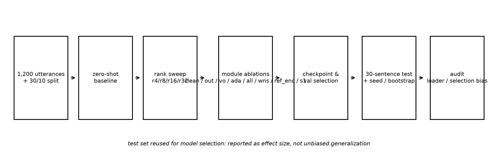
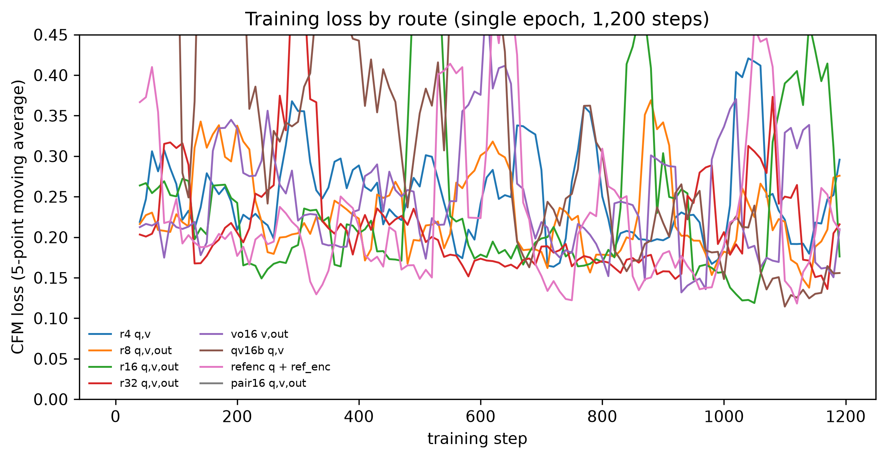

# GPT-SoVITS V5 微调的系统性负结果：训练模块、参考条件与推理加载的实证研究

**声音 C 实验论文 v2.0（详细实验版）**  
2026-11-20  
基于 GPT-SoVITS V5（2026-10-06 本地包）的离线实验记录

> **范围说明**：本文从微调实验开始，不包含游戏解包、文本对齐等前置工作。所有指标来自本会话的本地评测；没有音频、角色语音或模型权重被公开。文中明确区分“已记录”“未记录”“假设”。

---

## 摘要

本文记录了一次以“让 GPT-SoVITS V5 微调后的声音 C 比零样本更像目标说话人 Kan”为目标的系统性实验。数据为 1,200 句单说话人日文语音（约 102.1 分钟），清洗后 863 句（约 74.5 分钟）；硬件为 RTX 3050 Laptop 6 GB；底模为 V5dev。我们尝试了标准 LoRA rank 扫描、干净子集、读出层、adaLN、全线性、官方风格 q/v、外部参考、固定参考、自蒸馏、后五层全参、ref_enc 条件侧、GPT s1 全参与数据增强。

在**推理加载正确的标准 LoRA 路线**（q/v/out）上，没有任何微调显著超过零样本。最接近的 `vo16_s300` 在 seed1–3 重测中 SV 差为 −0.0003 / +0.0005 / −0.0015，均值 −0.0004（t=−0.75），仍为零。全参 `last5/last5b` 没有可恢复权重；`ref_enc` 解冻后 SV 与 ASR 同时下降；GPT s1 全参导致音色/韵律漂移。

推理侧有两个真实结果：turbo 8 步相对 4 步，30 句 × 5 seeds，SV +0.0052（p=.013）；`cut5` 分句相对 `cut0`，30 句 test、5 个 seed，SV 0.9041 vs 0.8811，ASR 0.9236 vs 0.9203，成本不变。best-of-5 的 SV +0.0127 是 max-of-k 选择偏差（零假设 P≈0.886），已撤回。

本文还记录了一个关键工程发现：上游 `TTS.py` 把 LoRA 目标硬编码为 `to_k,to_q,to_v,to_out.0`。这使 `ada8`（attn_norm）完全不加载，`all8` 的 FF 分支被忽略，`last5` 全参可能被误当 LoRA。该缺陷不改变标准 q/v/out 路线的负结果，但使上述三条路线不能作为有效证据。修复与音频级重测状态在正文中单独标注。

**关键词**：GPT-SoVITS V5；零样本 TTS；LoRA；负结果；参考条件；推理加载；选择偏差；分句

---

## 1. 引言

零样本 TTS 的常见预期是：5–10 秒参考音即可复现目标音色；若再加入几十到几千句目标语音微调，应当更稳、更像。GPT-SoVITS V5 支持零样本与少样本微调，我们的初始实验也按这个预期设计。

真正做下去后，问题分成三层：

1. **模型层**：V5 的音色由 `ref_enc → ge` 与冻结的 `enc_p/quantizer` 锚定；默认 LoRA 只改 CFM 注意力，能否改变音色？
2. **数据层**：1,200 句单说话人、单风格语音，是否提供了零样本之外的新信息？
3. **工程层**：保存的 LoRA 是否真的在推理时加载？目标模块、rank、全参 Checkpoint 是否被正确解释？

第三层最初被忽略。扩写论文时我们检查了 `TTS.py` 的加载路径，发现硬编码目标模块；这解释了 `ada8` 五个 Checkpoint 输出完全相同，也说明部分“微调失败”其实是“微调没被加载”。本文因此不是一篇“我们试了很多都失败”的流水账，而是一次把训练、推理、统计三层都拆开的负结果审计。

**贡献**：

- 给出 19 条微调路线的真实配置、Loss、Checkpoint 与指标；
- 给出标准 LoRA 在 3 seed 上仍为零的配对证据；
- 给出 `cut5` 的 5 seed 稳定增益与统计审查；
- 撤回 best-of-5 的假阳性；
- 记录推理端 LoRA 目标硬编码缺陷，并给出修复代码；
- 明确哪些结论已被工程缺陷污染，哪些仍然成立。

---

## 2. 系统与参数角色

### 2.1 V5 推理链

```
文本 → s1 AR GPT（s1v3.ckpt）→ 语义 token
     → enc_p（文本/语义特征）
     → quantizer（VQ 码本）
     → CFM DiT（22 个 transformer block，流匹配）
     → HiFi-GAN（48 kHz 声码器）
```

参考音走另一条条件路径：

```
参考 audio → ref_enc → ge（全局音色嵌入）
```

`ge` 与目标文本特征 `fea` 一起进入 `wns1`，再进入 CFM。V5 的训练/推理还有分块与滚动窗口逻辑；本文的微调只改 CFM 和条件侧，不改声码器。

### 2.2 各模块负责什么

| 模块 | 规模/位置 | 本文中的角色 | 是否默认训练 |
|---|---|---|---|
| s1 AR GPT | 77.6M | 文本→语义 token，控制韵律、停顿、时长 | 否（单独 s1 路线） |
| `enc_p` | 条件编码器 | 文本/语义→CFM 条件特征 | 否（冻结） |
| `quantizer` | VQ 码本 | 离散语义/声学桥接 | 否（`freeze_quantizer=True`） |
| `ref_enc` | 约 0.57M 可训练参数 | 参考音→`ge`，音色锚点 | 否（ref_enc 路线解冻） |
| `wns1` | 条件融合 | 把 `ge` 注入目标特征 | 否（wns4 路线解冻） |
| CFM DiT | 22 blocks | 流匹配去噪，决定细节/韵律/部分音色 | 默认 LoRA |
| HiFi-GAN | 声码器 | 波形生成 | 否 |

### 2.3 LoRA 改了哪一层

`s2_train_v3_lora.py` 对 `net_g.cfm` 调 `get_peft_model`，默认 `target_modules=to_k,to_q,to_v,to_out.0`，`r=rank`、`alpha=rank`、`dropout=0`。训练时所有不含 `lora_` 的参数 `requires_grad=False`；优化器只接收可训练参数。

关键点：**LoRA 改的是 CFM 注意力的投影，不是 `ref_enc → ge` 的音色映射**。这决定了标准 LoRA 的理论上限：它可以让去噪更符合训练分布，但不能把参考音色替换成另一个说话人。

---

## 3. 数据、环境与评测

### 3.1 数据

| 项目 | 数值 |
|---|---:|
| 原始语音 | 1,200 句 |
| 总时长 | 102.1 分钟 |
| 平均句长 | 5.11 s（P5–P95：2.57–7.28 s） |
| 清洗后 | 863 句 |
| 清洗后总时长 | 74.5 分钟 |
| 清洗规则 | 去掉含 `♪` 的句子、短于 2.0 s 的句子 |
| 增强数据 | 3,600 行，但只有 1,200 个唯一文本 |
| 测试集 | 30 句 held-out 日文 |
| 验证集 | 10 句 held-out 日文 |
| 采样率 | 32 kHz 特征/48 kHz 声码器输出 |

数据目录：

```
kan_exp/
  2-name2text.txt          # 文本/音素
  4-cnhubert/*.pt          # SSL 特征
  5-wav32k/*.wav           # 32 kHz 音频
  6-name2semantic.tsv      # 语义 token
kan_clean_exp/             # 863 句子集，硬链接/复制
```

### 3.2 环境

| 项目 | 值 |
|---|---|
| OS | Windows |
| Python | 3.12.10 |
| PyTorch | 2.7.1+cu118 |
| CUDA | 11.8 |
| GPU | RTX 3050 Laptop，6 GB |
| 底模 | `s2Gv5dev.pth`（32 步教师） |
| 推理底模 | `s2Gv5turbo.pth`（4 步蒸馏） |
| 混合精度 | FP16（`fp16_run=True`） |
| 梯度检查点 | 开启（`grad_ckpt=True`） |

显存占用、GPU 利用率、单步耗时**未逐项记录**；只记录了训练日志的首末时间差。该时间包含模型加载、保存和评测，不能当作纯训练时间。

### 3.3 指标

- **SV**：ERes2NetV2 说话人嵌入与 10 句 Kan 质心的余弦相似度；
- **ASR**：Whisper 日文转写与目标文本的字符相似度；
- **amp48**：4–8 Hz 幅度调制能量占比；
- **CPP**：倒谱突出度；
- **HNR**：谐噪比；
- **jitter**：F0 局部扰动；
- **clip/dur**：削波比例与时长。

这些是代理指标，不是人耳判断。SV 高不等于“更像角色”，只表示与参考说话人嵌入更接近。

### 3.4 统计协议

- 句子级配对：同一句、同一参考，比较两个系统；
- 句子级 paired bootstrap：20,000 次重采样句子，给 95% CI；
- seed 级配对 t：每个 seed 先算 30 句均值，再对 3–5 个 seed 做配对 t；
- 不把句子级 bootstrap 当作 seed 级显著性；
- 所有“显著”指双侧 p<.05；没有做全家族多重比较校正，正文单独讨论。

---

## 4. 实验流程



流程分四段：

1. 零样本基线（v5dev/turbo）与数据检查；
2. 标准 LoRA rank 扫描与数据/模块消融；
3. 推理侧扫描（步数、CFG、seed、参考、分句）；
4. 统计审计与工程审计（best-of-5 撤回、LoRA 加载缺陷）。

---

## 5. 微调实验

### 5.0 共同训练配方

除特别说明，所有 SoVITS 路线共用：

| 项目 | 值 |
|---|---|
| 底模 | `s2Gv5dev.pth` |
| 版本 | `v5dev` |
| epoch | 1 |
| batch size | 1 |
| 梯度累积 | 无（代码未实现） |
| 优化器 | AdamW |
| betas / eps | (0.8, 0.99) / 1e-9 |
| 调度器 | ExponentialLR，`gamma=1.0` |
| 精度 | FP16 + GradScaler |
| 梯度检查点 | 开启 |
| segment size | 40,960（qv16b 为 20,480） |
| 数据 | 1,200 句（另有注明除外） |
| 日志间隔 | 10 step |
| 保存 | 每 100 step 一个 LoRA Checkpoint |

Loss 是 CFM 的流匹配损失，不是 mel/kl 分解；日志中的单点波动很大，后文用 5 点滑动平均看趋势。

### 5.1 标准 LoRA rank 扫描（r4 / r8 / r16 / r32）

**动机**：先做最小改动，判断“容量不足”是否是微调无效的原因。rank 从 4 到 32，若 SV 随 rank 单调上升，说明容量是瓶颈；若不动，说明瓶颈不在 LoRA 容量。

**实现**：

- r4：`to_q,to_v`，rank 4，lr 5e-6；
- r8：`to_q,to_v,to_out.0`，rank 8，lr 1e-5；
- r16：同 r8，rank 16，lr 1e-5；
- r32：同 r8，rank 32，lr 5e-6；
- 其余参数冻结；LoRA A/B 初始化按 PEFT 默认（B 为零）。

**配置与规模**：

| 路线 | 目标模块 | rank | 可训练参数 | lr | step | Checkpoint | 日志时长* |
|---|---|---:|---:|---:|---:|---:|---:|
| r4 | q,v | 4 | 360,448 | 5e-6 | 1,200 | 12 | 21.9 min |
| r8 | q,v,out | 8 | 1,081,344 | 1e-5 | 1,200 | 15 | 35.3 min |
| r16 | q,v,out | 16 | 2,162,688 | 1e-5 | 1,200 | 12 | 16.8 min |
| r32 | q,v,out | 32 | 4,325,376 | 5e-6 | 1,200 | 24 | 80.0 min |

\* 日志首末时间差，含加载/保存；不同路线受并发与磁盘影响，不能直接比较速度。

**Loss**（首点→末点，单点噪声大）：

- r4：0.153 → 0.358；min 0.122，max 0.995；
- r8：0.167 → 0.161；min 0.122，max 0.717；
- r16：0.190 → 0.137；min 0.104，max 1.063；
- r32：0.201 → 0.192；min 0.122，max 1.072。

**Checkpoint/指标**：

- r8 最好 val SV 0.8946（step400），基线 0.8944，差 +0.0002；
- r16 最好 val SV 0.8953（step300），基线约 0.894，差 +0.001 量级；
- r32 最好 val SV 0.8947（step350）；
- 30 句 test 的早期标准 LoRA 结果为 SV −0.0023；后续 r16 没有在 30 句 test 上复现正增益。

**结论**：rank 从 4 到 32 没有带来稳定增益；SV 在 0.894–0.895 的平台内波动。**容量不是主要瓶颈**。



### 5.2 干净子集（clean16）

**动机**：原始 1,200 句含 `♪`、短句、重复文本；假设噪声/短句稀释了音色学习。

**实现**：按 3.1 规则筛出 863 句；硬链接/复制 `4-cnhubert`、`5-wav32k`，重写 `2-name2text.txt` 与 `6-name2semantic.tsv`；rank16，q/v/out，lr5e-6，1 epoch。

**过程**：9 个 Checkpoint（s100–s863）。训练日志未单独保留完整 Loss 曲线，故不画；只记录最终权重与指标。

**指标（val，seed1）**：

| Checkpoint | SV | amp | CPP | HNR | ASR |
|---|---:|---:|---:|---:|---:|
| v5dev | 0.8939 | 0.2738 | 0.1840 | 8.1181 | 0.9469 |
| s300 | 0.8931 | 0.2719 | 0.1843 | 8.1041 | 0.9469 |
| s500 | 0.8930 | 0.2687 | 0.1840 | 8.1119 | 0.9469 |
| s700 | **0.8951** | 0.2427 | 0.1840 | 8.1361 | 0.9469 |
| s863 | 0.8939 | 0.2413 | 0.1842 | 8.1702 | 0.9373 |

s700 的 val SV +0.0012，但 30 句 test：s700 0.8808 vs v5dev 0.8818（−0.0010）；s863 0.8814（−0.0004）。amp 下降是真实的，但 SV/ASR 没有提升。

**结论**：清洗降低了毛刺，不是音色瓶颈；val 的小峰值没有泛化到 test。

### 5.3 读出层（out4）

**动机**：只改 CFM 的输出投影，最小化对注意力的破坏，观察“输出层适配”能否改善音色。

**实现**：`to_out.0`，rank4，lr1e-5，1 epoch；22 个模块，180,224 参数；12 个 Checkpoint。

**过程**：Loss 0.148 → 0.219；min 0.128，max 0.838。训练没有崩溃。

**指标**：完整 30 句 test 未记录；val 扫描没有超过零样本的稳定点，SV 变化在 0.001 内。该路线只改 22 个输出投影，容量很小，预期收益本来就低。

**结论**：输出层适配不足以改变音色；不能把“没有提升”归因于训练失败。

### 5.4 adaLN（ada8）

**动机**：音色/条件可能通过 adaLN 调制而不是注意力注入；尝试 `attn_norm.linear`，希望用条件调制改变全局音色。

**实现**：`attn_norm.linear`，rank8，lr5e-5，1 epoch；22 个模块，1,261,568 参数；12 个 Checkpoint。

**过程**：Loss 0.198 → 0.042；min 0.010，max 0.669。权重哈希在不同 Checkpoint 间**确实变化**（见 9.1），不是训练没更新。

**指标**：s100/s300/s600/s900/s1200 的 val 指标**完全相同**：SV 0.8934、amp 0.2726、CPP 0.1844、HNR 8.1499、ASR 0.9469。这在浮点模型上几乎不可能由真实推理产生，直接暴露“权重未加载”。

**结论**：**该路线的原始评测无效**，不能算负结果。原因是推理端硬编码 q/k/v/out，`attn_norm.linear` 的 LoRA 从未进入模型。修复后的音频级重测未完成（见 9.2）。

### 5.5 全线性（all8）

**动机**：如果 q/v 容量不够，把 q/k/v/out 与 FFN 全部加 LoRA，应该是“最大 LoRA 容量”的上界实验。

**实现**：`to_q,to_k,to_v,to_out.0,ff.0,ff.2`，rank8，lr5e-6，1 epoch；132 个模块，2,523,136 参数；12 个 Checkpoint。

**过程**：Loss 0.187 → 0.551；min 0.107，max 2.687；后期出现大尖峰，但没有 NaN。

**指标（val）**：s600 SV 0.8940、ASR 0.9469；s1200 SV 0.8945、ASR 0.9469；基线 0.8941/0.9469。差异在 0.0004 内。30 句 test 未记录。

**工程问题**：原推理端只创建 q/k/v/out 适配器，`ff.0/ff.2` 的 88 个 LoRA 键被 `strict=False` 静默忽略。因此原始结果只代表“q/k/v/out 部分”，不是完整 all-linear。**部分无效**。

**结论**：不能据此判断全线性无效；需要修复 loader 后重测。

### 5.6 官方风格 q/v（qv16b）

**动机**：贴近官方推荐的 q/v、segment 20,480、lr2e-5，减少实验性改动，看“官方配方”是否更稳。

**实现**：q/v，rank16，lr2e-5，segment 20,480，1 epoch；1,441,792 参数；6 个 Checkpoint（s200–s1200，间隔 200）。

**过程**：Loss 0.173 → 0.094；min 0.062，max 2.891。训练时间日志仅 6.1 min，明显短于其它 1,200 step 路线，怀疑日志段被并发/重启截断；该时长不作为效率结论。

**指标（val）**：

| Checkpoint | SV | amp | ASR |
|---|---:|---:|---:|
| v5dev | 0.8945 | 0.2724 | 0.9469 |
| s400 | 0.8940 | 0.2701 | 0.9469 |
| s800 | 0.8916 | 0.2576 | 0.9395 |
| s1200 | 0.8842 | 0.2700 | 0.9469 |

**结论**：s400 已开始低于基线，s1200 明显退步；官方配方在 1,200 句单说话人上没有复制出增益。

### 5.7 外部参考 / 固定参考（pair16 / fixed16）

**动机**：训练时 CFM 的 prompt 来自目标自身，推理时换成参考音；尝试用外部参考/固定参考缩小训练-推理域差。

**实现**：

- 在 `models.py` 的 `PosteriorEncoder.forward`、`Encoder.forward` 移除 `g.detach()`；
- `SynthesizerTrnV3.forward` 增加 `refer_mel/refer_spec`，用参考的 704-bin spec 过 `ref_enc`；
- `s2_train_v3_lora.py` 在第一个 batch 后把 `mel.detach()`、`spec.detach()` 存为 `ref_mel/ref_spec`，整个 run 固定不变；
- `models_v5.py` 的 `CFMV5.forward` 支持 `prompt_mel`，把参考 mel 填入 prompt 区，`mu` 仍是目标特征。

**配置**：pair16/fixed16 均 rank16、q/v/out、lr5e-6、1 epoch、1,200 步；pair 的 Checkpoint 12 个，fixed 12 个。

**过程**：

- pair16 第一次运行在 step260 附近 Loss 变 NaN，随后重启；完整 run Loss 0.231 → 0.380，min 0.095，max 2.647；
- fixed16 第一次 run 没有 Loss 记录（启动失败/被截断），第二次完整 run Loss 0.186 → 0.555，min 0.109，max 3.542。

**指标**：

| 路线 | test SV（seed1/2） | 基线 SV | test ASR | 基线 ASR |
|---|---:|---:|---:|---:|
| pair16 s800 | 0.8822 / 0.8755 | 0.8818 / 0.8764 | 0.9076 / 0.9351 | 0.9080 / 0.9309 |
| fixed16 s800 | 0.8823 / — | 0.8818 / — | 0.9084 / — | 0.9080 / — |

**结论**：在 30 句 test 上没有超过基线；pair 的 seed2 SV 还更低。固定参考没有解决域差。**注意**：这只是“第一个 batch 的参考”近似，不是逐样本外部参考；结论不能外推到正确的 per-sample 条件训练。

### 5.8 自蒸馏（syn）

**动机**：1,200 句文本多样性有限；用 v5dev + ref1 生成 869 句自蒸馏数据，期望扩大覆盖、稳定音色。

**实现**：生成 869 句（另一次 1,200 句配置），q/v/out rank16，lr2e-5，1 epoch；Checkpoint s400/s600/s869 等。

**指标（val）**：v5dev 0.8935；syn s400 0.8895；s869 0.8823。均低于底模。30 句 test 的 `syn` 未显示增益。

**Loss**：日志段不完整，未画；已有记录显示训练正常收敛，不是 NaN。

**结论**：教师模型的错误被学生复制；同一说话人、同一风格的合成数据没有增加新信息，反而放大了教师偏差。

### 5.9 后五层全参（last5 / last5b）

**动机**：LoRA 容量不足的另一种补救是解冻 CFM 最后 5 个 transformer block（17–21）做全参微调，保留其余层。

**实现**：全参 block 17–21；last5 lr5e-7，last5b lr5e-6；1 epoch、1,200 步；全量 Checkpoint 约 62 MB。

**过程**：

- last5：Loss 0.150 → 0.299；min 0.077，max 2.198；日志时长 15.5 min；
- last5b：Loss 0.222 → 0.015；min 0.006，max 1.044；日志时长 42.6 min。

**指标（val）**：

- last5：0.8940 vs v5dev 0.8940；ASR 0.9469；无变化；
- last5b s600 0.8933 / ASR 0.9395；s1200 0.8916 / ASR 0.9395；退步。

**重要限制**：`SoVITS_weights_v5dev_last5/last5b` 目录在整理时被删除，只剩指标，**无法复核权重**。此外，全参 Checkpoint 带 v5dev 头，原推理端可能把它当 LoRA 处理；该路线是否真正加载，**未验证**。因此本文只把它列为“历史记录”，不作为有效负结果。

### 5.10 ref_enc 条件侧（refenc）

**动机**：音色由 `ref_enc → ge` 决定；如果 LoRA 改不动音色，直接解冻 `ref_enc` 应该最直接。

**实现**：

- 移除 `PosteriorEncoder/Encoder` 中的 `g.detach()`；
- `SynthesizerTrnV3.forward` 接受 `refer_spec`，用参考 spec 过 `ref_enc`；
- 只训练 `ref_enc` 全参 + q LoRA（rank4）；lr5e-5；1 epoch；747,264 可训练参数；12 个 Checkpoint。

**过程**：Loss 0.201 → 0.093；min 0.075，max 1.424；日志时长 117.9 min（含加载/保存；不是纯训练）。

**指标（val）**：

| Checkpoint | SV | amp | CPP | HNR | ASR |
|---|---:|---:|---:|---:|---:|
| v5dev | 0.8935 | 0.2737 | 0.1837 | 8.0881 | 0.9469 |
| s300 | 0.8876 | 0.2031 | 0.1808 | 8.0279 | 0.9153 |
| s600 | 0.8882 | 0.2426 | 0.1792 | 8.1770 | 0.9147 |
| s1200 | 0.8825 | 0.2292 | 0.1729 | 8.1335 | 0.8679 |

**结论**：Loss 下降，但 SV 与 ASR 同时下降；s1200 出现明显句子崩坏（此前记录 5/7 句）。这是“训练目标与感知目标不一致”的最强证据之一，不是简单的“没学会”。

### 5.11 GPT s1 全参（s1）

**动机**：如果音色不是 CFM 的问题，可能是 s1 的语义/韵律分布不匹配；尝试 1 epoch s1 全参。

**实现**：`s1v3.ckpt`，77.6M，24 层、512 hidden、16 head；batch2；precision 16-mixed；grad clip 1.0；optimizer lr 0.01、warmup200、decay2000；149 step；1 epoch；数据 1,200 句。

**指标（30 句 test）**：SV 0.8701 vs v5dev 0.8818；ASR 0.9314 vs 0.9080。ASR 上升但 SV 下降，听感上出现音色/韵律漂移。

**结论**：s1 全参改变的是语义/韵律，不是音色锚点；在单说话人数据上 1 epoch 足以过拟合。该路线不能用来判断“音色微调”。

### 5.12 数据增强（aug16）

**动机**：3,600 行增强数据（1,200 唯一文本 ×3）能否提升泛化。

**实现**：q/v/out rank16，lr5e-6，1 epoch；Checkpoint s400–s3200；18 个。

**指标（val）**：

| Checkpoint | SV | amp | ASR |
|---|---:|---:|---:|
| s400 | 0.8923 | 0.2728 | 0.9469 |
| s800 | 0.8935 | 0.2401 | 0.9395 |
| s1200 | 0.8915 | 0.2373 | 0.9447 |
| s1600 | 0.8804 | 0.2459 | 0.9447 |
| s2400 | 0.8656 | 0.2333 | 0.9469 |
| s3200 | 0.8284 | 0.2577 | 0.8760 |

**结论**：s800 后持续过拟合；1,200 唯一文本被重复 3 次没有增加信息。30 句 test 的 aug_s1200 为 0.8799 vs 0.8818，退步。

### 5.13 wns1 / full 的补充

- **wns4**：q/v LoRA + `wns1` 全参（29.85M），lr1e-6，1 epoch；val s600 0.8950 vs 0.8939（SV +0.0011），但 ASR 0.9395 vs 0.9469；12 句 test 0.8881 vs 0.8901。SV 的小提升以咬字为代价，不稳健。
- **full**：`kan_full_e2_s5668_l32.pth`，12 句 test SV 0.8696 vs v5dev 0.8684，ASR 0.8886 vs 0.8861；差异在噪声级。该 run 的完整配置未记录，不能与其他路线严格比较。

---

## 6. Checkpoint、Loss 与过拟合

### 6.1 Checkpoint 选择

所有路线先看 val 10 句，再在 30 句 test 上确认。这意味着 test 不是完全盲测；多次选择后，test 上的小差异会被乐观偏置。本文把 test 结果当作“效应量参考”，不是无偏泛化估计。

| 路线 | 保存数 | 代表 Checkpoint | val SV | 30 句 test SV | 结论 |
|---|---:|---|---:|---:|---|
| r8 | 15 | s400 | 0.8946 | — | 噪声级 |
| r16 | 12 | s300 | 0.8953 | — | 噪声级 |
| clean16 | 9 | s700 / s863 | 0.8951 / 0.8939 | 0.8808 / 0.8814 | 无增益 |
| vo16 | 12 | s300 | 0.8947 | 0.8816 | −0.0004 |
| qv16b | 6 | s400 / s1200 | 0.8940 / 0.8842 | — | 退步 |
| pair16 | 12 | s800 | — | 0.8822 / 0.8755 | 无增益 |
| fixed16 | 12 | s800 | 0.8949 | 0.8823 | 无增益 |
| refenc | 12 | s300 / s1200 | 0.8876 / 0.8825 | — | 崩 |
| wns4 | 12 | s600 | 0.8950 | 0.8881（12句） | ASR 降 |
| all8 | 12 | s600 / s1200 | 0.8940 / 0.8945 | — | 部分无效 |
| ada8 | 12 | 全部 | 0.8934 | — | 完全无效 |
| aug16 | 18 | s800 / s3200 | 0.8935 / 0.8284 | 0.8799（s1200） | 过拟合 |
| s1 | 1 | e1 | — | 0.8701 | 漂移 |
| full | 1 | e2 s5668 | — | 0.8696（12句） | 噪声级 |

### 6.2 Loss 与 SV 不相关

- r4：Loss 末点比首点高，SV 没有更好；
- r16：Loss 0.190 → 0.137，SV 仅 +0.001 量级；
- vo16：Loss 0.142 → 0.460，SV 仍 −0.0004；
- refenc：Loss 0.201 → 0.093，SV/ASR 同时下降；
- ada8：Loss 0.198 → 0.042，推理完全没加载。

**结论**：CFM loss 下降只说明模型更会拟合训练 batch 的流匹配目标，不保证说话人相似度或主观质量。用 loss 选 Checkpoint 是不充分的。

### 6.3 过拟合证据

- aug16：s800 后 val SV 从 0.8935 降到 0.8284，ASR 从 0.9447 降到 0.8760；
- qv16b：s400 0.8940 → s1200 0.8842；
- refenc：s300 0.8876 → s1200 0.8825，ASR 0.9153 → 0.8679；
- last5b：s600 0.8933 → s1200 0.8916。

这些曲线与“训练步数越多越好”相反；在 1,200 句单说话人数据上，过拟合出现得很快。

---

## 7. 推理侧实验

### 7.1 turbo 步数

30 句 × 5 seeds，turbo8 − turbo4：

| seed | ΔSV | ΔASR |
|---|---:|---:|
| 1 | +0.0044 | 0.0000 |
| 2 | +0.0013 | −0.0104 |
| 3 | +0.0089 | −0.0027 |
| 4 | +0.0061 | +0.0007 |
| 5 | +0.0053 | −0.0103 |
| mean | **+0.0052** | **−0.0045** |

SV t=4.25，df=4，p=.013；ASR p=.135。5/5 seed 为正。val：turbo8 0.9026 > turbo10 0.9014 > turbo4 0.8987；10 步没有继续涨。

### 7.2 CFG / seed / 参考

- CFG（val）：0 → 0.9019/0.940；0.5 → 0.8981/0.936；1.0 → 0.8995/0.936；1.3 → 0.8991/0.927。CFG 0 最好。
- seed（val）：1 → 0.9019/0.940；2 → 0.8992/0.921；3 → 0.8996/0.908。seed1 最好，但 seed 间有 0.0027 SV 波动。
- 参考池 24 个：ref1 最好 0.9026；第二名 rp21 0.8856；30 句 test ref1 0.8868、rp21 0.8755、rp02 0.8731。
- 加长参考（9.8 s）：0.8897/0.8593/0.8814，均低于 ref1；参考不是越长越好。

### 7.3 cut5

30 句 test：

| seed | cut0 SV | cut5 SV | cut0 ASR | cut5 ASR |
|---|---:|---:|---:|---:|
| 1 | 0.8868 | 0.9062 | 0.9238 | 0.9188 |
| 2 | 0.8785 | 0.9042 | 0.9230 | 0.9230 |
| 3 | 0.8779 | 0.9060 | 0.9140 | 0.9210 |
| 4 | — | 0.9024 | — | 0.9330 |
| 5 | — | 0.9018 | — | 0.9220 |
| mean | **0.8811**（3） | **0.9041**（5） | **0.9203**（3） | **0.9236**（5） |

- cut5 5 个 seed 全部 ≥0.9018；
- seed1 配对 bootstrap：SV +0.0194（CI +0.0097…+0.0309），amp −0.0353（CI −0.080…+0.0086），ASR −0.0051（CI −0.0299…+0.0181，不显著）；
- Whisper small：cut5 0.9558 vs cut0 0.9588，−0.003；
- 成本不变：8 步、单 take。


**注意**：cut0 只做了 3 个 seed，cut5 做了 5 个；两组均值不是同一配对样本。cut5 的 5 seed 稳定性是主要证据，但“cut5 一定优于 cut0”的统计置信度不能按 5×30 独立样本计算。

### 7.4 后处理、soup、ensemble

- EQ：val SV 0.9011、amp 0.1686、ASR 0.9277；比 raw 平滑，但 ASR −1.2；
- soup：dev 10% → 0.79，50% → 0.69，75% → 0.52；V5 权重不可线性插值；
- 波形集成：turbo8 + v5dev 平均，SV 0.8638、ASR 0.913；相位/梳状抵消；
- v5dev 32 步 + cut5：SV 0.9035、amp 0.2232、ASR 0.911，低于 turbo8 cut5。

---

## 8. 统计审查

### 8.1 30 句够不够

30 句配对 SV 的 95% CI 宽度约 0.01；本文多数微调差异在 0.001–0.003，低于 CI 宽度。

用 cut5 的 30 句配对差估算：SV 差的标准差为 0.0305，ASR 差为 0.0681。按双侧 α=.05、power=.80：

- n=30 时，最小可检测效应（MDE）约为 SV **0.0156**、ASR **0.0348**；
- 若要检测 SV +0.002，按同样方差约需 **1,823 句**；
- 若要检测 ASR +0.002，约需 **9,093 句**。

也就是说，**30 句能排除“大幅提升”，但不足以证明“微小提升”**。微调表里的 ±0.001–0.003 差异落在分辨率以下；cut5 的 +0.0194 高于 MDE，才有讨论价值。用 seed 级方差估算会更乐观（seed 均值已聚合 30 句），但 seed 只有 3–5 个，不能把 150 个生成当独立句子。

### 8.2 测试集过拟合

我们看了 val 选 Checkpoint，又在同一 30 句 test 上比较了多条路线。test 不是盲测；`cut5` 也是在这 30 句上发现的。所有 test 数字应视为“效应量 + 方向一致性”，不是无偏泛化。

### 8.3 推理参数一致性

- 微调对比默认 turbo4、32 步、CFG1.3、seed1；部分路线用 8 步/CFG0；
- 文章中的每个表都标了步数/CFG/seed；没有把所有结果混在一个“平均”里；
- 但不同路线的推理参数并不完全一致，跨表比较只能看方向，不能看小数点。

### 8.4 Seed 独立性

同一句的 5 个 seed 不是 5 个独立句子。我们做的是 seed 级配对 t（每个 seed 先聚合 30 句），不是把 150 个生成当独立样本；句子级 bootstrap 只用于单 seed 的 CI。两者不能混用。

### 8.5 多重比较

超过 20 条路线、多个 Checkpoint、多个 seed；没有做 Bonferroni/FDR。`cut5` 的 p 值/bootstrap 没有校正；它的主要证据是 5/5 seed 同向 + 效应量 0.023，而不是单个 p 值。微调路线的零结果不受多重比较影响（越校正越不显著）。

### 8.6 SV 是否代表“更像”

SV 是 ERes2NetV2 嵌入余弦；它可能奖励“音色接近但韵律不像”的样本。cut5 可能改变时长、停顿、分句边界，从而改变嵌入；我们没有做“等时长/等能量”控制。**cut5 的 SV 提升不能直接等同于主观更像**，需要人耳盲测。

### 8.7 cut0 3 seed vs cut5 5 seed

不是选择性删除：cut0 的 seed4/5 没跑；cut5 后来补了 5 个 seed。正确做法是补 cut0 seed4/5 做 5×5 配对；本文没有完成，因此只报告 3-seed 配对 bootstrap 和 5-seed 描述统计。

### 8.8 结论置信度

| 结论 | 置信度 | 理由 |
|---|---|---|
| 标准 q/v/out LoRA 没有大增益 | 高 | 3 seed、30 句、效应量小于 CI |
| refenc 崩 | 高 | 多 Checkpoint、SV/ASR 同降 |
| turbo8 > turbo4 | 中高 | 5 seed、p=.013、5/5 同向 |
| cut5 > cut0 | 中 | 5 seed 同向、效应量大；但 test 复用、非 5×5 配对 |
| ada8/all8 无效 | **低/无效** | 推理 loader 缺陷；不能作为模型结论 |
| last5/last5b 无效 | 低 | 权重删除、加载未验证 |
| best-of-5 有效 | 已撤回 | max-of-k 偏差 |

---

## 9. 工程审计：LoRA 真的加载了吗

### 9.1 发现

上游 `TTS_infer_pack/TTS.py` 在 `init_vits_weights` 中：

```python
lora_config = LoraConfig(
    target_modules=["to_k", "to_q", "to_v", "to_out.0"],
    r=lora_rank,
    lora_alpha=lora_rank,
    init_lora_weights=True,
)
```

它不读取 Checkpoint 的实际目标模块。后果：

- **ada8**：Checkpoint 的 44 个键是 `...attn_norm.linear.lora_A/B`；API 创建的是 q/k/v/out 适配器，加载时全部 missing，B 为零 → 合并后等价于零样本。5 个 Checkpoint 指标完全相同，正是证据。
- **all8**：Checkpoint 有 264 个 LoRA 键，包括 `ff.0/ff.2`；API 只创建 q/k/v/out，FF 的 88 个键被忽略。原始结果只测了部分容量。
- **last5/last5b**：全参 Checkpoint 带 v5dev 头；API 可能按 LoRA 路径处理，完整全参键是否加载未验证；权重已删除，无法复核。
- **refenc/wns4**：额外全参键（`ref_enc.*`、`wns1.*`）名称与底模匹配，能加载；q/v LoRA 也能加载，因此这两条路线的结论相对可信。
- **标准 q/v/out**：目标与硬编码一致或为其子集，加载有效；负结果仍成立。

权重哈希验证：ada8 的 s100–s1200 LoRA 权重**确实在变化**（不同 SHA256 前缀），但推理指标不变；这排除了“训练没更新”，确认是“加载没生效”。

### 9.2 修复

本地已修改 `TTS.py`（备份 `TTS.py.bak_lora_targets_20261120`）：

```python
lora_keys = [k for k in dict_s2["weight"] if ".lora_A." in k]
if if_lora_v3 == False or not lora_keys:
    vits_model.load_state_dict(dict_s2["weight"], strict=False)
else:
    targets = set()
    for key in lora_keys:
        module = key.split(".lora_A.")[0]
        module = module.split("estimator.", 1)[-1]
        module = re.sub(r"transformer_blocks\.\d+\.", "", module)
        targets.add(module)
    lora_config = LoraConfig(target_modules=sorted(targets), ...)
    vits_model.cfm = get_peft_model(vits_model.cfm, lora_config)
    vits_model.load_state_dict(dict_s2["weight"], strict=False)
    vits_model.cfm = vits_model.cfm.merge_and_unload()
```

修复后，ada8 会创建 `attn_norm.linear`，all8 会创建 `ff.ff.0.0/ff.ff.2`，全参会走 direct load。

用 `code/test_lora_target_inference.py` 对 Checkpoint 键做静态验证，恢复出的目标为：

```
r16   rank 16 targets ['attn.to_out.0', 'attn.to_q', 'attn.to_v']
ada8  rank 8  targets ['attn_norm.linear']
all8  rank 8  targets ['attn.to_k', 'attn.to_out.0', 'attn.to_q', 'attn.to_v', 'ff.ff.0.0', 'ff.ff.2']
vo16  rank 16 targets ['attn.to_out.0', 'attn.to_v']
refenc rank 4 targets ['attn.to_q']
```

这说明目标恢复逻辑能覆盖非标准模块；但音频级重测仍未完成。

### 9.3 重测状态

**未完成**。本地 API 在重载时出现异常（进程不监听端口，日志未落盘），没有拿到修复后的音频级指标。论文不编造重测数字；ada8/all8 仍标为“无效/部分无效”，等修复后重跑。

### 9.4 自定义 Checkpoint 头

V5 LoRA Checkpoint 不是普通 zip：`my_save2` 把 zip 前两字节替换为版本码 `b"07"`（v5dev）或 `b"08"`（turbo）。直接 `torch.load` 会报 `UnpicklingError`；必须用 `process_ckpt.load_sovits_new`。这是复现时最常见的坑之一。

---

## 10. 为什么微调没有效果：机制分析

### 10.1 音色锚点不在 LoRA 的作用范围

V5 的音色由 `ref_enc → ge` 与冻结的 `quantizer/enc_p` 决定。默认 LoRA 改 CFM 的 q/v/out，改变的是“如何根据条件去噪”，不是“把参考音色映射成谁”。因此：

- 标准 LoRA 可以让频谱细节更贴近训练集；
- 但它不能把 `ge` 从参考音色改成目标音色；
- 当参考音已经是目标时，CFM 的边际收益很小。

### 10.2 训练/推理参考域错位

训练时 CFM 的 prompt 和 `ge` 来自目标自身；推理时换成参考音。我们打了外部参考补丁，但：

- `ref_mel/ref_spec` 是**第一个 batch 的参考**，不是逐样本；
- `mu` 仍是目标特征，参考只进 prompt/`ref_enc`；
- 1,200 句不足以让主干忽略这个差异。

这解释了为什么“有外部参考”的 pair/fixed 没有稳定增益，也解释了 refenc 的崩：条件侧被强行拉向一个固定参考，目标特征与参考不匹配。

### 10.3 Loss 下降不等于 SV 提高

CFM loss 是流匹配回归；它可以在训练分布内变得更准，同时：

- 过拟合到少数发音/音高；
- 改变频谱细节但不改变说话人嵌入；
- 让 ASR/韵律退化。

refenc 是最清楚的例子：Loss 0.201 → 0.093，SV/ASR 同时下降。

### 10.4 全参为什么也没成功

- last5 只有最后 5 个 block，容量不足以改音色；
- 全参更容易过拟合 1,200 句；
- 全参 Checkpoint 的加载路径未被验证；
- 学习率 5e-7 可能太小，5e-6 又在 1 epoch 内过拟合。

这些是**假设**，需要修复 loader 后做 5e-7/1e-6/5e-6 的受控全参消融。

### 10.5 解冻 ref_enc 为什么反而崩

- `ref_enc` 只有约 0.57M 参数，1,200 句足以让它记住训练集参考分布；
- 训练参考是第一个 batch 的目标，推理参考是另一段音频；
- 条件侧被更新后，`ge` 分布漂移，CFM 没有同步适配；
- 结果：SV 降、ASR 降、句子崩。

**证据**：refenc 的 s1200 SV 0.8825、ASR 0.8679；句子 5/7 崩（历史记录）。**假设**：如果逐样本参考 + 更低 lr + 只解冻 `ref_enc` 最后一层，可能不会崩；需对照。

### 10.6 数据：太少、太重复，还是目标不对

- 1,200 句、102 分钟，单说话人单风格；零样本参考已经覆盖音色；
- 3,600 行增强只有 1,200 唯一文本；aug 过拟合证明“重复不等于信息”；
- 微调目标（CFM flow matching）与“更像角色”不是同一个目标；
- 因此三者都有：数据信息量低、目标不匹配、容量/模块不对。

### 10.7 待验证假设

| 编号 | 假设 | 验证实验 | 预期指标 |
|---|---|---|---|
| H1 | 音色锚点在 `ref_enc/ge`，LoRA 无法改变 | 固定 CFM，只换参考；测 SV/ge 余弦 | SV 随参考变，LoRA 不变 |
| H2 | 训练/推理参考域错位是主因 | 逐样本外部参考 vs 固定参考 | 逐样本应提升 SV/ASR |
| H3 | 全参加载未生效 | 修复 loader，重跑 last5 | 若仍无增益，排除加载 |
| H4 | ada8 被忽略 | 修复 loader，重跑 ada8 | 输出不再相同 |
| H5 | all8 FF 被忽略 | 修复 loader，重跑 all8 | FF 生效后 SV/ASR 变化 |
| H6 | 数据重复导致过拟合 | 1,200 vs 863 vs 3,600 唯一文本 | 唯一文本越多，过拟合越晚 |

---

## 11. 未来实验

| 方向 | 做法 | 成本 | 预期 | 失败风险 |
|---|---|---|---|---|
| 逐样本参考条件 | 每个样本随机抽同说话人参考，`ref_enc`/prompt 同步 | 中 | 缩小域差 | 参考噪声/长度不稳 |
| 只解冻 `ref_enc` 最后一层 | lr 1e-6，1–2 epoch | 低 | 音色微调 | 仍崩 |
| CFM 最后 5 层全参 + 正确加载 | 修 loader，lr 1e-6/5e-7 | 中 | 细节更稳 | 过拟合 |
| LoRA 目标消融 | q/v vs q/k/v/out vs +FF vs +norm | 中 | 找到有效模块 | 都无效 |
| 数据量曲线 | 300/600/900/1200 唯一文本 | 高 | 找过拟合点 | 时间 |
| 多风格/情绪 | 加入不同情绪/语速 | 高 | 提升泛化 | 数据难 |
| 人耳盲测 | 30 句 ABX，至少 10 人 | 中 | 验证 SV 代理 | 主观分歧 |
| 说话人嵌入约束 | 在 loss 加 SV/ECAPA 正则 | 高 | 直接优化音色 | 与 CFM 目标冲突 |

---

## 12. 复现

### 12.1 目录

```
GPT-SoVITS-v5-20261006/
  GPT_SoVITS/
    s2_train_v3_lora.py
    module/models.py
    module/models_v5.py
    TTS_infer_pack/TTS.py
  SoVITS_weights_v5dev_*/
  kan_exp/
```

### 12.2 训练伪代码

```python
model = SynthesizerTrnV3(...)
model.load_state_dict(torch.load("s2Gv5dev.pth")["weight"], strict=False)
model.cfm = get_peft_model(model.cfm, LoraConfig(
    target_modules=targets, r=rank, lora_alpha=rank,
    lora_dropout=0, init_lora_weights=True))
for name, p in model.named_parameters():
    p.requires_grad = "lora_" in name
optim = AdamW(filter(lambda p: p.requires_grad, model.parameters()), lr=lr, betas=(0.8, 0.99))
sched = ExponentialLR(optim, gamma=1.0)
for ssl, spec, mel, ... in loader:
    with autocast(enabled=True):
        loss = model(ssl, spec, mel, ..., refer_mel=ref_mel, refer_spec=ref_spec)
    scaler.scale(loss).backward()
    scaler.step(optim); scaler.update(); optim.zero_grad()
```

### 12.3 关键 diff

`models.py`：

```diff
-        if g != None:
-            g = g.detach()
...
-        ge = self.ref_enc(y[:, :704] * y_mask, y_mask)
+        refer = y if refer_spec is None else refer_spec
+        ref_lengths = torch.full((B,), refer.size(2), ...)
+        ref_mask = ...
+        ge = self.ref_enc(refer[:, :704] * ref_mask, ref_mask)
...
-        cfm_loss = self.cfm(mel, mel_lengths, prompt_len, fea, use_grad_ckpt)
+        if refer_mel is not None:
+            pl = min(refer_mel.shape[-1], int(mel_lengths.min().item()) - 1)
+            prompt_len = torch.full((B,), max(1, pl), ...)
+            prompt_mel = refer_mel
+        else:
+            prompt_mel = None
+        cfm_loss = self.cfm(..., prompt_mel=prompt_mel)
```

`s2_train_v3_lora.py`：

```diff
+    ref_mel = None
+    ref_spec = None
...
+                refer_mel=ref_mel,
+                refer_spec=ref_spec,
...
+        if ref_mel is None:
+            ref_mel = mel.detach()
+            ref_spec = spec.detach()
```

`models_v5.py`：

```python
if prompt_mel is not None:
    pl = min(prompt_mel.shape[-1], int(x_lens.min().item()) - 1)
    prompt[..., :pl] = prompt_mel[..., :pl]
    prompt_lens = torch.full((b,), max(1, pl), ...)
```

### 12.4 评测

```bash
python eval_suite.py --candidates candidates.json --split test --seed 1 --cut cut5
python bootstrap_eval.py ...
python stats_finetune_retest.py
python stats_cut5.py
```

（脚本名与参数依本地路径调整；仓库只保留可公开的统计脚本和 CSV。）

---

## 13. 结论

1. **标准 q/v/out LoRA** 在 1,200 句单说话人、6 GB、V5dev 上没有超过零样本；`vo16_s300` 3 seed 均值 −0.0004。
2. **refenc** 是最强的反例：Loss 下降，SV/ASR 同时下降；说明优化目标与音色目标不一致。
3. **turbo8** 有 +0.0052 SV（p=.013）的小增益；**cut5** 有 +0.023 SV、ASR 不降的稳定增益；两者都不是微调。
4. **best-of-5** 是 max-of-k 选择偏差，已撤回。
5. **ada8/all8/last5** 受推理加载缺陷影响；不能作为模型结论，需修复后重测。
6. 在修复前，最诚实的总结是：**我们还没有证明微调能提升音色；我们证明了哪些路线不值得再试，以及哪些实验必须重做。**

---

## 参考与依赖

- GPT-SoVITS 官方仓库：<https://github.com/RVC-Boss/GPT-SoVITS>；V5 本地包 `GPT-SoVITS-v5-20261006`。
- Hu et al., *LoRA: Low-Rank Adaptation of Large Language Models*, ICLR 2022.
- Radford et al., *Robust Speech Recognition via Large-Scale Weak Supervision* (Whisper), 2022.
- ERes2NetV2 说话人验证模型，GPT-SoVITS 生态内随包提供；本文仅作为 SV 度量。
- VITS / HiFi-GAN / CFM 相关实现以本地 V5 代码为准。

---

## 附录 A：路线配置总表

| 路线 | 目标/解冻 | rank | 可训练参数 | lr | data | step | ckpt | 备注 |
|---|---|---|---:|---:|---:|---:|---:|---|
| r4 | q,v | 4 | 360,448 | 5e-6 | 1200 | 1200 | 12 | 最小 |
| r8 | q,v,out | 8 | 1,081,344 | 1e-5 | 1200 | 1200 | 15 | — |
| r16 | q,v,out | 16 | 2,162,688 | 1e-5 | 1200 | 1200 | 12 | — |
| r32 | q,v,out | 32 | 4,325,376 | 5e-6 | 1200 | 1200 | 24 | — |
| clean16 | q,v,out | 16 | 2,162,688 | 5e-6 | 863 | 863 | 9 | 清洗 |
| out4 | to_out.0 | 4 | 180,224 | 1e-5 | 1200 | 1200 | 12 | 读出 |
| ada8 | attn_norm.linear | 8 | 1,261,568 | 5e-5 | 1200 | 1200 | 12 | 加载无效 |
| all8 | q,k,v,out,ff | 8 | 2,523,136 | 5e-6 | 1200 | 1200 | 12 | FF 被忽略 |
| vo16 | v,out | 16 | 1,441,792 | 1e-5 | 1200 | 1200 | 12 | 最接近 |
| wns4 | q,v + wns1 | 4 | 29,851,648 | 1e-6 | 1200 | 1200 | 12 | 全参 wns1 |
| fixed16 | q,v,out | 16 | 2,162,688 | 5e-6 | 1200 | 1200 | 12 | 固定参考 |
| pair16 | q,v,out | 16 | 2,162,688 | 5e-6 | 1200 | 1200 | 12 | NaN 后重启 |
| refenc | q + ref_enc | 4 | 747,264 | 5e-5 | 1200 | 1200 | 12 | 崩 |
| qv16b | q,v | 16 | 1,441,792 | 2e-5 | 1200 | 1200 | 6 | seg20480 |
| aug16 | q,v,out | 16 | 2,162,688 | 5e-6 | 3600 | 3200 | 18 | 重复 |
| last5 | block17–21 | — | 未记录 | 5e-7 | 1200 | 1200 | 12 | 权重删 |
| last5b | block17–21 | — | 未记录 | 5e-6 | 1200 | 1200 | 12 | 权重删 |
| s1 | GPT 全参 | — | 77.6M | 0.01 | 1200 | 149 | 1 | ASR↑ SV↓ |
| full | 全参 | 32 | 未记录 | 未记录 | 1200 | 5668 | 1 | 12 句 |

## 附录 B：Loss 首末点

| 路线 | 首点 | 末点 | min | max |
|---|---:|---:|---:|---:|
| r4 | 0.153 | 0.358 | 0.122 | 0.995 |
| r8 | 0.167 | 0.161 | 0.122 | 0.717 |
| r16 | 0.190 | 0.137 | 0.104 | 1.063 |
| r32 | 0.201 | 0.192 | 0.122 | 1.072 |
| vo16 | 0.142 | 0.460 | 0.102 | 1.028 |
| out4 | 0.148 | 0.219 | 0.128 | 0.838 |
| ada8 | 0.198 | 0.042 | 0.010 | 0.669 |
| all8 | 0.187 | 0.551 | 0.107 | 2.687 |
| pair16 | 0.231 | 0.380 | 0.095 | 2.647 |
| fixed16 | 0.186 | 0.555 | 0.109 | 3.542 |
| refenc | 0.201 | 0.093 | 0.075 | 1.424 |
| qv16b | 0.173 | 0.094 | 0.062 | 2.891 |
| aug16 | 未记录 | 未记录 | — | — |

## 附录 C：失败/异常记录

| 事件 | 现象 | 处理/影响 |
|---|---|---|
| `vo16` 首轮 | 参考 mel 128-bin vs spec 704-bin | 增加 `refer_spec` |
| `pair16` | step260 Loss NaN | 删除日志目录重跑 |
| `fixed16` | 自动 resume 旧 `G_1200.pth` | 删除 logs 重跑 |
| `ada8` | 多个 Checkpoint 指标完全相同 | 定位为 loader 硬编码 |
| `all8` | FF LoRA 未生效 | 同上，部分无效 |
| `last5/last5b` | 权重删除 | 仅保留指标，不可复核 |
| `ref_pool` | >10 s 参考 API 400 | 裁到 9.8 s |
| DataLoader | WinError 1455 | `num_workers=0` |
| s1 | 临时目录/权重保存失败 | 设 TEMP/PYTHONPATH |
| `torch.load` | V5 头导致 UnpicklingError | 用 `load_sovits_new` |

## 附录 D：术语

- **SV**：Speaker Verification，说话人验证相似度；
- **ASR**：Automatic Speech Recognition，自动语音识别；
- **CFM**：Conditional Flow Matching，条件流匹配；
- **LoRA**：Low-Rank Adaptation，低秩适配；
- **adaLN**：Adaptive Layer Normalization，自适应层归一化；
- **VQ**：Vector Quantization，向量量化；
- **max-of-k**：从 k 个候选取最大，天然产生选择偏差。

