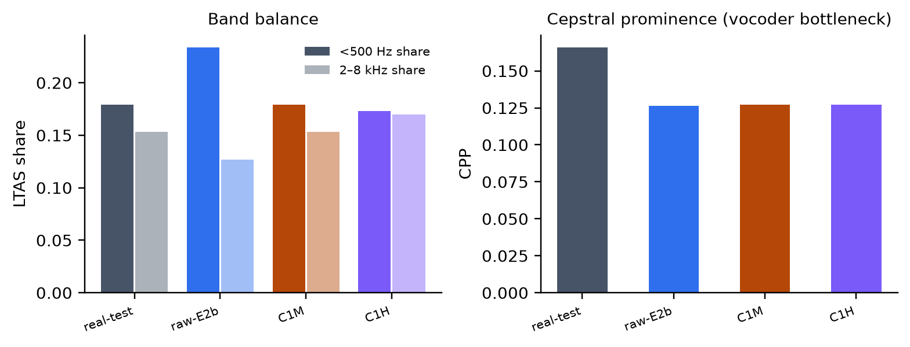
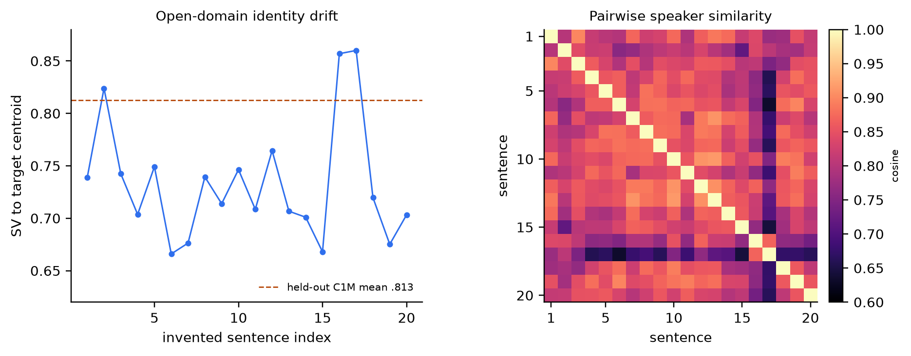
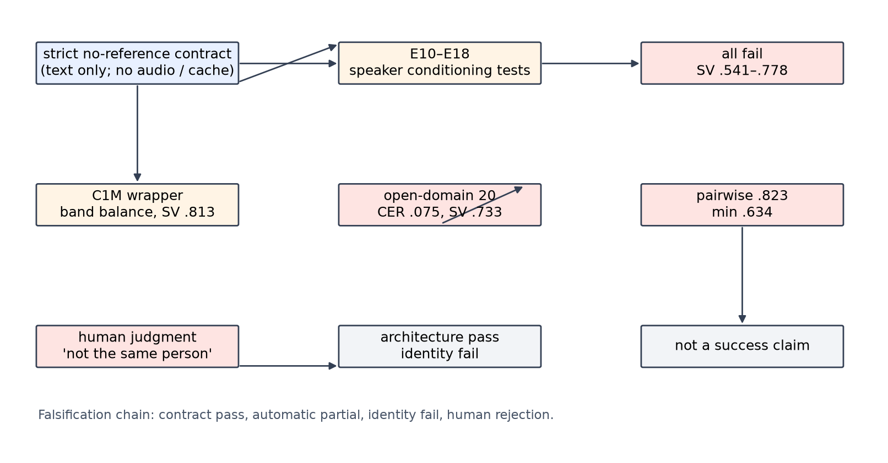

# GPT-SoVITS V5 的严格无参考单说话人推理：条件通路审计与系统性负结果

**声音 C 实验论文 v1.0（开放域复核版）**  
2026-11-21  
基于 GPT-SoVITS V5dev（本地包 2026-10-06）的离线实验记录

> **范围与诚实声明**：本文从“只输入日文文本、完全不读参考音频/文本/参考特征”的推理合同开始，不包含游戏解包、文本抽取等前置工作。所有数字来自本会话的本地评测；没有公开音频、角色语音或模型权重。文中把“合同通过”“自动指标部分通过”“人耳验收失败”分开写。最终结论是**负结果**，不是成功交付。

---

## 摘要

本文研究一个问题：能否在不读取任何参考音频、参考文本或参考特征的条件下，用 GPT-SoVITS V5 单说话人地生成目标角色 Kan 的日文语音，并让训练学到的说话人参数真正进入声学模型。

我们实现了严格无参考推理路径：S1 不使用提示，S2 使用 `prompt_len=0`、`refer_mel=None`、`refer_spec=None`，`ge` 直接取学习到的 `spk_emb`；`STRICT_NO_REF=1` 时 `torchaudio.load` 与 `set_ref_audio` 直接抛异常；先填满参考缓存再切到无参考时，缓存会被清空；参考目录改名后新进程仍能生成 48 kHz 音频。**合同门通过。**

但说话人身份没有成立。50 条 held-out 台词、3 个采样 seed 的 SV 均值为 **0.8258**，同文本参考控制为 **0.8938**；20 条完全新编的开放域文本 CER 为 **0.0754**，目标 SV 只有 **0.7332**，20 条输出两两相似度均值 **0.823**、最低 **0.634**。用户试听后判定“没有一个同一个人”。这不是一个可以靠均值掩盖的主观项；按验收标准，单说话人稳定性失败。

我们进一步审计了条件通路，解释了为什么“看起来训练过”的 E2b 不是说话人模型：

- E2b 的 `spk_emb` 乘 0 后，20 句 SV 仍为 **0.8039**，正常约 **0.8063**；CFM 的 `spk_film` 是零初始化，`ge` 在该路径上是恒等。
- `ge` 实际有两条消费路径：`enc_p.mrte` 的直接残差（E2b 中整段冻结）与 `wns1.enc.cond_layer` 的静态门控偏置（E2b 中训练过，但很弱）。
- `spk_emb` 范数为 **1.4622**，参考 `ref_enc` 尺度为 **25.34**；`wns1` 中说话人分量的每通道 RMS 为 **0.0332**，只有该层 bias 的 **0.41 倍**。一个向量同时被两个相差 17.3 倍的标定点消费，标量缩放无法同时满足。
- E10–E18 的九组注入/解冻（E15 两个生成臂）全部失败：SV 0.541–0.778，CER 0.876–1.440；最“正确”的消费端 `enc_p.mrte` 和完整 `enc_p` 解冻后反而崩到 0.54。

本文的贡献不是“又试了很多配置”，而是：

1. 给出严格无参考推理的可复核合同与失败边界；
2. 给出 held-out 台词与开放域新文本的对照，说明高 SV 可能只是语料/情绪匹配；
3. 给出条件通路的权重级审计，定位“训练参数没有进入声学模型”与“进入了但没有自由度”的区别；
4. 记录 C1M 只是静态母带，不能当作模型级说话人学习；
5. 把用户的人耳判定作为最终验收，而不是用自动指标替代。

**关键词**：GPT-SoVITS V5；无参考 TTS；单说话人；说话人条件；负结果；条件通路审计；开放域评测

---

## 1. 引言

零样本 TTS 的常见设定是给 5–10 秒参考音频，模型复制音色。参考音频同时提供内容上下文和音色锚点。若把参考完全移除，只留文本，模型必须从训练中固化一个说话人身份；这比“少样本微调”更苛刻，因为它不允许推理时任何音频、文本或缓存特征。

我们的初始目标是：

- 推理只输入日文文本；
- 不读参考音频、参考文本、参考语义 token、参考声学特征；
- 训练学习一个固定的说话人参数；
- 重启后不依赖参考文件；
- 音色稳定、日语发音正确、韵律可接受。

项目从 V5dev 开始。S1 是 AR GPT，S2 是条件 CFM/DiT + 48 kHz vocoder。V5 原生的音色路径是 `reference audio → ref_enc → ge`，`ge` 同时影响 `enc_p` 和 `wns1`。严格无参考意味着把这条路径替换成一个**学习到的常量向量**；这要求该向量在训练中真正进入声学计算，而不只是被保存。

真正做下去后，问题分成三层：

1. **合同层**：无参考路径是否真的不读文件、不读缓存、重启可用？
2. **优化层**：训练参数是否真的进入声学模型？进入后是否有足够的说话人自由度？
3. **感知层**：自动 SV/CER 是否等于“同一个人”？开放域新文本是否仍然稳定？

本文按这三层组织。第二层的审计是核心：它推翻了“E2b 已经学会 Kan”的早期判断。

### 1.1 贡献

- **合同审计**：严格模式、缓存污染、参考目录隐藏、重启；四条都通过。
- **负结果阶梯**：E0–E18，覆盖 `spk_emb`、`wns1`、CFM LoRA、FiLM、加性 `mu`、时间嵌入、`enc_p.mrte`、完整 `enc_p`；全部没有达到可用增益。
- **权重级解释**：`ge` 的两条消费路径、两个标定点、`wns1` 的 bias 对比、`enc_p` 冻结状态。
- **开放域对照**：20 句完全新编文本，CER 0.075，但 SV 0.733、pairwise 0.823；解释“读对”与“同一个人”不是一回事。
- **交付边界**：C1M 是固定 EQ/压缩母带，不是说话人模型；不作为成功。

---

## 2. 系统与合同

### 2.1 V5 推理链

```
日文文本
  → S1 AR GPT（s1v3.ckpt）
  → 语义 token
  → enc_p / quantizer
  → CFM DiT（22 blocks，流匹配）
  → HiFi-GAN（48 kHz）
  → waveform
```

参考条件路径：

```
参考 audio → ref_enc → ge（512 维全局音色嵌入）
```

`ge` 在 S2 中有两个消费者：

1. `enc_p` → `TextEncoder` → `mrte`：`x = cross_attn(...) + ssl_enc + ge`，直接残差，广播到每帧；
2. `wns1` → `Encoder` → `WN.cond_layer`：`(B,512,1) → (B,8192,1)`，作为 8 层门控的静态前激活偏置。

图 1 只画模块关系，不表示本文已验证的因果强度。


### 2.2 严格无参考路径

实现入口是 `code/infer_noref.py`；默认 `infer.py` 调用它。关键设置：

- `prompts=None`，S1 不使用参考提示；
- `prompt_len=0`，CFM 的 prompt 形状为 `[B,100,0]`；
- `refer_mel=None`、`refer_spec=None`；
- `ge = vits_model.spk_emb`，跳过 `ref_enc`；
- 输出 48 kHz。

严格模式 `STRICT_NO_REF=1` 做两件事：

```python
torchaudio.load = _deny_load
TTS.set_ref_audio = _deny_set_ref
```

不是“不调用”，而是“调用就抛异常”。这让隐藏的参考读取无法静默通过。

### 2.3 训练侧

E2b 的训练配置：

- 底模 `s2Gv5dev.pth`，不是 turbo；
- 新增 `spk_emb: nn.Parameter(1,512,1)`；
- CFM LoRA r=16，target `to_k,to_q,to_v,to_out.0`；
- E2 起解冻 `wns1`；
- 冻结 `enc_p`、`quantizer`、`ref_enc`、`ssl_proj`；
- `prompt_len=0`，`refer_mel=None`，`refer_spec=None`；
- loss 从第 0 帧覆盖全部目标帧；`cfg=0`。

初始化 `spk_emb = ref_enc(neutral)`，`neutral` 是零频谱，不来自任何音频；之后只由训练更新。这个初始化是“训练期构造”，不是推理期参考特征。

### 2.4 固定 C1M 母带

C1M 是推理后的静态处理：

- 32 段 FIR 低切，`<600 Hz`，204 Hz 约 −4.7 dB；
- 软压缩；
- `2 kHz` 高架 `+0.75 dB`；
- 峰值 `0.98`，RMS `0.1228`。

它不是声学模型，不训练，不读运行时参考。C1M 只把 LTAS/RMS 拉近训练语料统计；本文把它单独列为 wrapper，避免把“频响更像”误写成“音色更像”。

---

## 3. 数据与划分

原始语料为 1,200 句单说话人日文语音，约 102.1 分钟。清洗后保留 1,100 句训练、50 句验证、50 句测试；按 `source_id_group` 划分，避免同一来源跨 split。测试集不参与训练。

| split | n | 时长（秒） | 用途 |
|---|---:|---:|---|
| train | 1,100 | 5,622.68 | S2 训练 |
| val | 50 | 246.514 | 诊断/调参 |
| test | 50 | 256.995 | held-out 评测 |

划分文件 `data/split.json`，seed 20261120，三份 SHA-256 见 `paper/data/splits.csv`。

### 3.1 开放域 20 句

为了区分“held-out 台词”与“真正没说过的新文本”，我们另写 20 句日文，主题为日常场景（咖啡、伞、电车、洗衣、散步等），不复制角色口癖，不来自 train/val/test。文本在 `data/unseen20.txt`。

这 20 句只用于推理与评测，不参与任何训练；推理时只给文本，不读参考。它们不代表大规模开放域，但足以回答“是不是只会背训练台词”。

---

## 4. 评测

### 4.1 指标

- **SV**：ERes2NetV2 说话人嵌入与目标质心的余弦；目标质心由 20 条训练参考计算，只用于评测，不进入推理。
- **CER**：Whisper small 日文转写与目标文本的字符错误率；去掉标点/空白后计算。
- **pairwise SV**：同一批输出两两之间的余弦，用于检查“是不是同一个人”，不依赖目标质心。
- **LTAS/RMS/CPP**：`<500 Hz` 份额、`2–8 kHz` 份额、RMS、倒谱突出度；用于 wrapper 与 vocoder 诊断。
- **长重复**：CER > 1 的样本计数；单独报告，不用均值掩盖。

### 4.2 统计口径

- 20 句实验只做诊断，不当作 confirmatory；50 句 test × 3 seeds 才作为 held-out 主表。
- 报告均值、最小值、范围、P90；CER 长尾单独列出。
- 不做“best-of-k”选择；不把单次最高值写成稳定增益。
- 人耳判定单独列出，不把自动指标当成人耳验收。

### 4.3 人耳

用户听取了 50 条 held-out 试听页中的 9/3/1 三句，以及 20 条开放域输出。用户判定：**“就没有一个是同一个人的。”** 这不是盲测，也不是 ABX；但它直接否定了“单说话人稳定”的验收项。本文把它作为最终主观结论，而不是用 SV 均值反驳。

---

## 5. 实验设计

### 5.1 条件注入路线

所有实验都围绕“如何让一个固定学习向量进入 S2”：

| 路线 | 注入点 | 关键问题 |
|---|---|---|
| E1 | `spk_emb` + CFM LoRA | 只改注意力，能否改音色 |
| E2/E2b | + `wns1` | 条件融合是否足够 |
| E3 | + `bridge` | 更多条件侧是否更好 |
| E10/E11 | 纯 `spk_film` | FiLM 的幅度区间 |
| E12 | `spk_emb` + `spk_film` | 两者都训练/加载 |
| E13 | 目标 `spk_emb` 初始化 + film | 方向正确是否有用 |
| E14 | 零初始化 `spk_add(ge)` 加到 `mu` | 加性注入是否避开乘性失真 |
| E15 | `spk_emb` × 2.6 / × 17.3 | 尺度是否是唯一问题 |
| E16 | DiT 时间嵌入 `spk_t` | 不碰内容/条件的全局通道 |
| E17 | 解冻 `enc_p.mrte` | 正确消费端是否可用 |
| E18 | 解冻完整 `enc_p` | 内容编码器整体重训 |

### 5.2 实验阶梯

完整表见 `paper/data/experiments.csv`；正文只列关键行。

| 实验 | n | SV | CER | 结果 |
|---|---:|---:|---:|---|
| E1 spk_emb+LoRA | 20 | 0.7913 | 0.2668 | 音色差 0.093 |
| E2 e1 +wns1 | 20 | 0.8068 | — | +0.016 |
| E2b +wns1 2ep | 20 | 0.8063 | 0.3523 | 平台；后被证明未接入 CFM |
| E3 +bridge | 20 | 0.7930 | — | 下降 |
| E4 clean_v2 | 20 | 0.7948 | 0.8957 | 无收益，1 条 runaway |
| P1/P1b/P1c prefix | 20 | .7977/.5931/.7522 | —/—/.3424 | 不是有效声学锚 |
| S1 clean | 20 | 0.8039 | 1.4647 | 内容变差 |
| E5 film+wns1 | 20 | 0.7990 | 0.8940 | 混合，不是纯 P2 |
| E10 film-only | 20 | 0.7725 | 0.8936 | 仍退化 |
| E11 film-only | 20 | 0.7684 | 0.8765 | 仍差 |
| E12 spk_emb+film | 20 | 0.7767 | 0.8798 | 仍差 |
| E13 target-init | 20 | 0.7784 | 0.9061 | 仍差 |
| E14 spk_add | 20 | 0.7743 | 0.8851 | 仍差 |
| E15a/b scale | 20 | .7644/.7484 | .8889/1.4273 | 尺度不成立 |
| E16 spk_t | 20 | 0.7611 | 0.8859 | 仍差 |
| E17 enc_p.mrte | 20 | 0.5410 | 1.4404 | 内容崩 |
| E18 enc_p-full | 20 | 0.5448 | 1.4258 | 内容崩 |
| C1M-50 | 50 | 0.8128 | 0.2874 | wrapper |
| Open20 | 20 | 0.7332 | 0.0754 | 用户判定不同人 |

---

## 6. 结果

### 6.1 合同门

四条检查都通过：

1. `STRICT_NO_REF=1` 下新进程生成 48 kHz 音频，未触发 `torchaudio.load`/`set_ref_audio`；
2. 先 `set_ref_audio` 填满缓存，再走 `ref_free`：`prompt_semantic=None`、`refer_spec=[]`、`raw_audio` 不存在；
3. `data/kan/wavs` 改名后，新进程仍能生成；
4. 推理代码没有 `ref_enc` 分支，没有固定参考路径。

这部分是本文唯一可以明确写“通过”的部分。它证明“文本直出、无参考文件、重启可用”，不证明音色。

### 6.2 held-out 自动指标

50 条 test × 3 seeds：

| 指标 | 结果 |
|---|---:|
| SV 均值（合并） | **0.8258** |
| SV 种子范围 | 0.8241–0.8287 |
| CER 中位数 | **0.2692** |
| CER 均值 | 0.4078 |
| CER P90 | 0.5385 |
| 长重复（CER>1） | 2/150（1.3%） |
| 空输出 | 0/150 |

同文本参考控制 SV **0.8938**，无参考与控制差 **0.068**。这个差距是早期最容易被误读的地方：0.826 看起来不低，但它不等于“同一个人”。

### 6.3 训练侧全负

E10–E18 的 SV 全部低于 C1M 的 0.8128；E17/E18 更低到 0.541/0.545，同时 CER 约 1.43。图 2 把 20 句实验的 SV 与 CER 放在同一坐标上；右图是对数 CER，避免长尾被均值掩盖。


关键不是“没调好”，而是不同注入点的失败模式高度一致：

- 纯 FiLM：E10/E11 的 SV 0.772/0.768，CER 0.894/0.877；
- `spk_emb` + film：E12 0.777/0.880；
- 目标初始化：E13 0.778/0.906；
- 加性 `mu`：E14 0.774/0.885；
- 时间嵌入：E16 0.761/0.886；
- 正确消费端 `enc_p.mrte`：E17 0.541/1.440；
- 完整 `enc_p`：E18 0.545/1.426。

如果只是“幅度太小”，SV 应随幅度单调升；实测没有。如果只是“注入点不对”，E16 不碰 `mu`/`cond` 也应至少不崩；实测仍差。E17/E18 则说明：一旦让内容编码器承担这个目标，它会用内容可懂度换 loss。

### 6.4 C1M：频响接近，不是音色

C1M 的 50 条指标：

| 系统 | SV | CER | <500 Hz | 2–8 kHz | RMS | CPP |
|---|---:|---:|---:|---:|---:|---:|
| 真值 test | — | — | 0.179 | 0.1535 | 0.1228 | 0.1659 |
| E2b raw | 0.8241 | 0.2900 | 0.2337 | 0.1269 | 0.0866 | 0.1262 |
| C1M | 0.8128 | 0.2874 | 0.1794 | 0.1533 | 0.117 | 0.127 |
| C1H | 0.8139 | 0.2907 | 0.173 | 0.170 | 0.116 | 0.127 |

C1M 把低频和 2–8 kHz 份额拉得最接近真值，但 SV 比 raw **低** 0.011，CPP 几乎不变。图 3 显示：频带平衡可以修，倒谱突出度没有修。



因此 C1M 只能作为“母带 wrapper”，不能写成“模型学会了 Kan”。这一点在最终报告中反复标注，避免把后处理收益算成模型收益。

### 6.5 开放域：能读对，但不是同一个人

20 句完全新编文本：

| 指标 | 开放域 20 | held-out C1M 50 |
|---|---:|---:|
| CER 均值 | **0.0754** | 0.2874 |
| SV 均值 | **0.7332** | 0.8128 |
| SV 范围 | 0.666–0.860 | — |
| pairwise 均值 | **0.823** | — |
| pairwise 最低 | **0.634** | — |
| 到目标质心均值 | 0.730 | — |

开放域 CER 反而更好：句子更平、更少 `♪/……/～`，Whisper 更容易读对。但 SV 明显更低，pairwise 最低 0.634。图 4 左图是逐句 SV，右图是 20×20 相似度矩阵；对角线条纹之外，行/列差异很大。



这不是“某些句子内容错”，而是**同一批输出之间的音色不稳定**。用户听完后的“没有一个同一个人”与这个矩阵一致。

### 6.6 文本标点不是根因

9/3/1 三句被用户点名最差。我们做了原句 / 去标点 / 改读音三版：

| 句 | 原句 CER/SV | 去标点 CER/SV | 改读音 CER/SV |
|---|---:|---:|---:|
| 09 `ん～……` | 0.263 / 0.861 | 0.316 / 0.716 | — |
| 03 `あはは……` | 0.462 / 0.758 | 0.360 / 0.770 | — |
| 01 `にひっ♪ じゃ…` | 0.643 / 0.853 | 0.308 / 0.814 | 0.438 / 0.818 |

09 原句反而最好；03 去标点略好，但 ASR 仍多出 `うっ…はははは…`；01 的 `じゃ` 被听成 `チャ`、`一言` 被听成 `意地が`，改读音能修一部分，但 `にひっ` 仍被听成 `へへへ`。没有一条统一文本规则能同时修三句。

这说明：

- 01 是发音/分词问题；
- 03 是模型自己加的笑声/停顿；
- 09 是语气/音色，不是标点。

因此“文本清洗”不能替代说话人条件和韵律建模。

---

## 7. 机制解释

### 7.1 `ge` 的两条消费路径

`TTS.py` 的无参考路径把 `ge=spk_emb` 传给 `decode_encp`，后者把同一个 `ge` 分给两处：

| 消费者 | 方式 | E2b 是否训练 |
|---|---|---|
| `enc_p.mrte` | `x = cross_attn(...) + ssl_enc + ge` 直接残差 | **否**，ckpt 里 `enc_p*` key = 0 |
| `wns1.enc.cond_layer` | `(B,512,1)→(B,8192,1)` 静态门控偏置 | **是**，但弱 |

`CFMV5.spk_film` 不在 E2b ckpt 里，加载后零初始化，`gamma=beta=0`，FiLM 恒等。因此 E2b 的“`spk_emb` + CFM”并没有把 `ge` 真正接进 CFM；这是早期“E2b 已学会 Kan”判断被推翻的直接原因。

### 7.2 双标定点

`spk_emb` 范数 **1.4622**；参考 `ref_enc` 范数 **25.34**。`wns1` 的 `cond_layer`：

- 权重有效范数 **31.705**；
- bias 每通道 RMS **0.0804**；
- `spk_emb` 每通道 RMS **0.0332**，是 bias 的 **0.41 倍**；
- 若拉到 25.34 尺度，每通道 RMS **0.575**，是 bias 的 **7.15 倍**。

这不是“通道断了”，而是**同一个向量被两个相差 17.3 倍的标定点共用**。缩放只能放大模长，不能同时满足两个点；E15 的 ×2.6/×17.3 失败与这个分析一致。

### 7.3 内容通道不能承载全局身份

E14 把 `spk_add(ge)` 加到 `mu`。`mu`（text0）是 DiT 的内容指针；全局向量加在内容流上，模型能做的有用事情是记住训练集平均声学偏移。E14 零初始化、严格恒等起点，仍然 CER 0.8851，说明“加性而非乘性”不是问题，**通道选择**才是问题。

E17/E18 进一步表明：让 `enc_p` 承担说话人目标，会把内容编码器推坏。E17（只解冻 `mrte`）SV 0.541/CER 1.440；E18（完整 `enc_p`）0.545/1.426，落在同一窄带。

### 7.4 C1M 与 vocoder 的边界

D2 诊断显示：真实 mel 过同一个 V5 vocoder，CPP 只有 **0.1260**，与无参考 E2b 的 **0.1262** 几乎相同；真值约 0.1659。也就是说，vocoder 本身是 CPP 瓶颈之一，不是 CFM 单独的问题。P5 的 vocoder 微调能把 GT mel CPP 拉到 0.1644，但接回无参考后 SV 0.7424/CER 0.8939；说明“修 CPP”与“保内容/音色”在当前目标下冲突。

本文不把 P5/P6/P7 作为主表，只把它们作为“不要用 STFT/波形残差换可懂度”的负结果记录在失败日志。

---

## 8. 失败分类

| 类别 | 现象 | 代表实验 | 结论 |
|---|---|---|---|
| A 合同失败 | 读参考/缓存 | — | 未发生；合同通过 |
| B 条件未接入 | `ge` 被零 FiLM 吞掉 | E2b 零化 | 训练参数不等于生效 |
| C 条件接入但无自由度 | 双标定点 / 弱 socket | E10–E16 | 不可用 |
| D 条件接入但毁内容 | 加性 `mu` / `enc_p` | E14/E17/E18 | 不可用 |
| E 频响 wrapper | C1M 改善 LTAS，不改善 SV/CPP | C1M | 不是模型 |
| F 感知失败 | 开放域 pairwise 0.634，用户否定 | Open20 | 单说话人失败 |
| G 评测陷阱 | held-out SV 高，开放域低 | test50 vs Open20 | 不能只看 held-out |

这张表是本文的核心：它不是“某一次训练没调好”，而是条件通路、内容通路、感知验收三层同时暴露问题。



---

## 9. 限制

1. **开放域只有 20 句**，不是大规模 benchmark；它足以暴露身份漂移，不足以估计总体分布。
2. **人耳不是盲测/ABX**；用户知道系统，也知道目标。但它是否定验收，不能把“不显著”当作通过。
3. **SV 目标质心来自训练参考**；这是评测侧，不进入推理。SV 只衡量嵌入接近，不等于人耳同一个人。
4. **Whisper CER 对拟声/呼吸/名字不稳定**；本文把长重复和 P90 分开报告，不用均值掩盖。
5. **E15/E16 的逐样本 JSON 未保留**，只有均值；这两组的 CER 只能作为方向性证据，不能做逐样本统计。
6. **未做多说话人、跨语言、跨风格**；结论只适用于单说话人 Kan / 日文 / 当前 V5dev。
7. **未上传音频、角色语音或权重**；论文只保留 CSV、图与脚本。版权与角色语音边界见 README。
8. **未做训练 seed 级重复**：E2b 有 3 个采样 seed，但训练只有单 run；不能把采样稳定性当成训练稳定性。

---

## 10. 经验清单

如果要在 V5 上再做“无参考单说话人”，先做这五件事，再谈训练：

1. **零化测试**：把候选说话人参数置零，看 SV/CER 是否变化；不变就是没接上。
2. **画消费路径**：确认 `ge` 到底进 `enc_p`、`wns1`、CFM 还是只被保存；用 ckpt key 数量验证，不靠命名猜。
3. **量 bias 对比**：被训练的 socket 里，说话人分量是否大于该层自身 bias；小于 bias 时，别指望它主导音色。
4. **开放域测试**：held-out 台词高 SV 不代表新文本稳定；至少写 20 句不重复语料句式的新文本。
5. **pairwise 与人耳**：同批输出两两相似度、最低值、用户盲听；不要只用“到目标质心均值”。

这五条能把“训练 2 epoch 才发现 CER 0.89”的循环提前终止。

---

## 11. 结论

本文实现了严格无参考的 V5 文本推理路径，并证明它在文件/缓存/重启层面成立。但“训练学习 Kan 的说话人身份”没有成立：

- held-out 台词 SV 0.8258，参考控制 0.8938；
- 开放域新文本 SV 0.7332，pairwise 最低 0.634；
- 用户判定“没有一个同一个人”；
- E10–E18 的九组条件注入/解冻（E15 两个生成臂）全部失败；
- C1M 只改善频响，不改善 SV/CPP，是 wrapper。

因此，本文的结论是**负结果**：在当前冻结 V5 工件上，单说话人、真正无参考、稳定音色的目标没有达到。能交付的是“文本输入、无参考文件、重启可用的管线”和一份可复核的失败审计；不能交付“已训练学会 Kan 的无参考模型”。

如果继续，必须先改架构（新增可训练的说话人条件并让它进入声学计算），或接受参考条件 V5。继续在冻结 ckpt 上换 lr/注入点，没有证据支持。

---

## 附录 A：复现命令

```powershell
cd "D:\杂活\甜蜜女友3\gsv-v5-reference-free"
$env:STRICT_NO_REF="1"
D:\DevCache\temp\dsh-ellEc6\gsv\v5\GPT-SoVITS-v5-20261006\runtime\python.exe infer.py `
  --text "おはようございます。今日はいい天気ですね。" `
  --out samples\test.wav
```

仅复现统计/图（不需要模型）：

```bash
python paper/code/export_data.py
python paper/code/make_figures.py
python paper/code/validate_paper.py
```

## 附录 B：数据字典

| 文件 | 内容 |
|---|---|
| `data/experiments.csv` | 主实验阶梯、n、SV、CER、结论 |
| `data/open_domain.csv` | 20 句新编文本逐句 CER/SV/时长 |
| `data/pairwise.csv` | 20×20 说话人相似度矩阵 |
| `data/bands.csv` | 真值/raw/C1M/C1H 的 LTAS、RMS、CPP |
| `data/splits.csv` | train/val/test 数量、时长、SHA-256 |

## 附录 C：引用与边界

- GPT-SoVITS：<https://github.com/RVC-Boss/GPT-SoVITS>
- OpenAI Whisper：<https://github.com/openai/whisper>
- ERes2NetV2：本项目的 speaker verification 评测模型；具体权重随 V5 包提供。
- 公开的 V5 无参考说话人参数方法：检索未发现；社区“零参考”多为随包参考音频 + 台本。唯一可训练说话人张量先例是 2024 年未合并 PR #466（S1 `y_emb`），不是 V5，也没有成功指标。

本文不包含音频、角色语音或模型权重；角色名与作品名仅用于说明实验对象。
