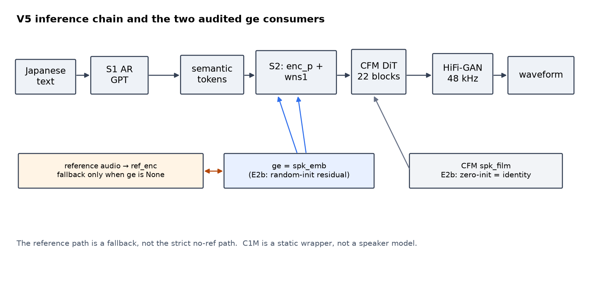
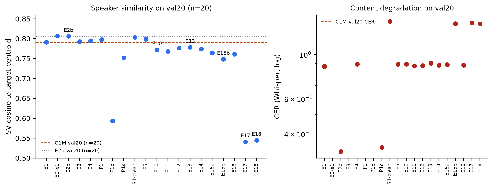

# GPT-SoVITS V5 的严格无参考单说话人推理：实现边界、条件通路审计与负结果

**声音 C 实验论文 v1.1（审计修订版）**  
2026-11-21  
基于 GPT-SoVITS V5dev（本地包 2026-10-06）的离线实验记录

> **状态与范围**：本文是负结果研究报告，不是成功交付。严格无参考的“文本推理路径”已经实现并做了运行时检查，但“训练学到的说话人身份稳定输出目标音色”没有成立；人耳判定也不支持。本文把“代码不再要求参考音频”与“模型已学会并锁定目标声音”严格分开。
>
> 本文不包含游戏解包、文本抽取等前置工作，不公开音频、角色语音或模型权重。所有数字来自本会话实际产物；无法复核的均标注为“summary-only / 工件缺失”。

---

## 摘要

本文研究：能否在不读取参考音频、参考文本或参考特征的条件下，让 GPT-SoVITS V5 单说话人地生成目标角色 Kan 的日文语音，并让训练学到的说话人参数真正进入声学模型。

我们把“reference-free”拆成四级：（1）推理不传外部参考音频；（2）不使用参考音频的缓存特征；（3）模型训练出稳定的说话人身份表示并实际消费；（4）不同文本和随机种子下稳定输出目标音色。当前系统只对（1）有代码级证据，对（2）有缓存清空和运行时检查的部分证据，**没有达到（3）和（4）**。

实现上，`ref_free=True` 会检查 `ref_audio_path`/`aux_ref_audio_paths` 为空、要求 `spk_emb` 存在、清空 `prompt_cache`，并用 `ge = spk_emb` 调用 `decode_encp`。`decode_encp` 在 `ge is None` 时仍有 `ref_enc(refer)` 回退；无参考路径传入了非空 `ge`，所以该回退未被触发，但不能把代码描述成“没有 ref_enc 分支”。`STRICT_NO_REF=1` 拦截了 `torchaudio.load`、`soundfile.read`、可选 `librosa.load`，以及 `TTS.set_ref_audio`/`_set_ref_spec`/`_set_prompt_semantic`；它仍不拦截任意文件读取（例如 `numpy.load`），这是一条仍然存在的审计边界。

评测上，真实 test50 的目标 SV 为 **0.8398**；无参考 E2b 50 条为 **0.8241**，C1M 后为 **0.8128**。开放域 20 句完全新编文本 CER **0.0754**，目标 SV 只有 **0.7332**；20 条输出 pairwise 均值 **0.8233**、最低 **0.6342**。但真实 test50 的同说话人 pairwise 均值只有 **0.7684**、最低 **0.4681**——生成音频的 pairwise 反而更高，因此 **pairwise 不能作为“不是同一个人”的证据**；它更多反映同一管线的信道同质性。在本评测中更有判别力的是到目标质心的距离：开放域比真实 test50 低约 **0.107**（其中约 0.011 来自 C1M 母带效应）。

训练侧，E10–E18 的九组条件注入/解冻（E15 两个生成臂）点估计都低于同划分的 C1M-val20 **0.7909**，但 E10–E18 的逐样本数据、权重和日志均已删除，只能作为 summary-only 负结果。E17/E18 解冻 `enc_p` 后 SV 0.541/0.545、CER 1.44/1.43；这支持“当前优化设置下内容编码器被破坏”，不支持“内容通道在架构上不能承载说话人身份”。

C1M 是固定低切/压缩/高架母带，不是模型级说话人学习。它把 LTAS/RMS 拉近真值，但不改善 CPP，且 50 条 SV 低于 raw；同划分 val20 的 C1M 也从 E2b 的 0.8063 降到 0.7909。Shelf-B 的 50 条 SV 为 0.8256（高于 raw），但 2–8 kHz 份额 0.206，明显过冲，且是在同一 test50 上做 wrapper 选择，不能当作独立泛化证据。

用户非盲试听后判定“没有一个同一个人”。这不是 ABX，也不是多人盲听；但它是否定验收，不能用 SV 均值驳回。本文的最终结论是：**L1 有代码与运行时证据；L2 只有部分证据；L3 未成立；L4 失败。**C1M 不是成功模型；E10–E18 是当前配置下的负结果，不是架构不可能性的证明。

**关键词**：GPT-SoVITS V5；无参考 TTS；单说话人；条件通路；负结果；评测效度；开放域

---

## 1. 引言

零样本 TTS 常用参考音频同时提供内容上下文和音色锚点。把参考完全移除后，模型必须从训练中固化说话人身份；这比少样本微调更苛刻，因为推理时不允许任何音频、文本或缓存特征。

我们的初始目标是：只输入日文文本；不读参考音频/文本/特征；训练学习固定说话人参数；重启后不依赖参考文件；音色稳定、发音正确、韵律可接受。

真正做下去后，问题分成四层：

1. **路径层**：代码是否还会走参考音频/缓存？
2. **消费层**：学习到的向量是否真的进入声学计算？
3. **身份层**：该向量是否带来稳定的目标音色？
4. **感知层**：自动指标是否等于人耳“同一个人”？

本文的主要修正是：早期版本把“路径层通过”误写成“身份层成立”，又把 pairwise 相似度误读成“不是同一个人”。本版逐项拆开，并保留失败结果。

### 1.1 贡献

- 给出 reference-free 的四级定义，明确当前只达到第 1 级并对第 2 级有部分证据；
- 给出 `ge` 两条消费路径与 `spk_emb`/`ref_enc` 尺度差异的代码级审计，但把机制解释降级为假设；
- 给出真实同说话人 test50 的 SV/pairwise 基线，纠正 pairwise 的反向解读；
- 给出同划分 val20 的 C1M 基线，移除 20 句与 50 句的跨划分比较；
- 明确 E10–E18 是 summary-only、工件缺失，不能做逐样本复算；
- 保留 C1M 的频响改善与 SV 下降、E17/E18 的内容崩溃、用户否定等不利结果。

---

## 2. Reference-Free 的四级定义

| 级别 | 定义 | 可检验证据 | 当前状态 |
|---|---|---|---|
| L1 | 推理不传外部参考音频 | 参数/缓存/调用路径检查 | **有代码与运行时证据** |
| L2 | 不使用参考音频的缓存特征 | 缓存污染后清空、`refer_spec=[]` | **部分证据**；改名测试不完整 |
| L3 | 训练出稳定说话人表示并被模型消费 | 零化/替换参数改变输出；条件通路审计 | **未成立**；内部零化探针无保留工件，不能作为可复核证据 |
| L4 | 不同文本/种子稳定输出目标音色 | 开放域 SV、pairwise、人耳 | **失败**；开放域 SV 0.733 |

这张表是全文的结论骨架。L1 不等于 L3/L4；“不要求参考音频”不能写成“已学会目标声音”。

---

## 3. 系统与条件通路

### 3.1 V5 推理链

```
日文文本
  → S1 AR GPT（s1v3.ckpt）
  → 语义 token
  → quantizer.decode → enc_p
  → CFM DiT（22 blocks）
  → HiFi-GAN（48 kHz）
  → waveform
```

参考条件路径为 `reference audio → ref_enc → ge`。在 E2b 中，`ge` 主要有两个消费者；当前代码还存在第三条 CFM 侧 `spk_film`，但 E2b 没有训练该键，加载后为零初始化恒等：

1. `enc_p` → `TextEncoder` → `mrte`：`x = cross_attn(...) + ssl_enc + ge`，随后再过 `c_post`（512→192）；
2. `wns1` → `Encoder` → `WN.cond_layer`：`(B,512,1) → (B,8192,1)`，加到 8 层门控激活前的加性项。

`CFMV5.spk_film` 是另一条 CFM 侧注入；E2b 的 ckpt 没有训练过的 `spk_film` 键，加载后零初始化，`gamma=beta=0`，FiLM 恒等。



### 3.2 无参考路径实际做了什么

`TTS.run` 在 `ref_free=True` 时：

- 拒绝非空 `ref_audio_path` 和 `aux_ref_audio_paths`；
- 要求 `speaker_id` 和 `vits_model.spk_emb`；
- 调用 `_clear_ref_cache()` 清空 `prompt_semantic`、`refer_spec`、`raw_audio` 等；
- 取 `ge = vits_model.spk_emb`，扩展 batch 后调用 `decode_encp(..., ge, ...)`。

`decode_encp` 的代码在 `ge is None` 时仍会执行：

```python
if ge is None:
    refer_lengths = ...
    refer_mask = ...
    ge = self.ref_enc(refer[:, :704] * refer_mask, refer_mask)
```

无参考路径传入 `ge=spk_emb`，因此该回退不是执行路径；但“代码没有 ref_enc 分支”的说法是错的，正确说法是“回退存在，但被非空 ge 短路”。

### 3.3 严格模式的实际覆盖

`infer_noref.py` 的 `STRICT_NO_REF=1` 做六件事：

```python
torchaudio.load = deny
sf.read = deny
librosa.load = deny          # if importable
TTS.set_ref_audio = deny
TTS._set_ref_spec = deny
TTS._set_prompt_semantic = deny
```

它没有全局拦截 `numpy.load` 或任意文件读取；`sf.write` 仍可用。当前 `infer_noref.py` 的代码路径只调用 `sf.write`，不调用 `sf.read`；这是静态审计加固，不是“所有文件读取都被证明阻断”。论文把这一限制写进 §9。

### 3.4 缓存与改名测试的边界

缓存污染测试（先 `set_ref_audio` 填充缓存，再 `ref_free`）显示 `prompt_semantic=None`、`refer_spec=[]`、`raw_audio` 不存在，这一条有运行时输出。

早期“参考目录改名后仍可生成”的测试只改了 `data/kan/wavs`，没有覆盖 `logs/kan/4-cnhubert`、`logs/kan/5-wav32k` 等特征缓存；而且该目录现在已恢复，状态不可复现。因此它只能作为一次性观察，不能作为 L2 的完整证明。

### 3.5 训练初始化缺陷（E2b）

`E2b` 的 `spk_emb` 由 `s2_train_v3_lora.py` 创建。实际顺序是：

1. `net_g = get_model(hps)`；
2. `init_spk_emb(net_g)`；
3. 加载 `pretrained_s2G`（`strict=False`）。

`init_spk_emb` 在**预训练 `ref_enc` 尚未加载**时调用，因此 `spk_emb` 从随机初始化 `ref_enc(neutral)` 出发，而不是预训练 `ref_enc(neutral)`。实测：

| 量 | 值 |
|---|---:|
| 预训练 `ref_enc(neutral)` 范数 | 33.10 |
| seed=1234 随机初始化 `spk_emb` 范数 | 1.478 |
| E2b ckpt `spk_emb` 范数 | 1.462 |

`ckpt` 与随机初始化的 cosine 不能作为证据：若 seed=1234 的随机初始化不能逐位复现，cosine≈0 是必然；若能逐位复现，则说明训练把向量转到了另一个方向，反而支持“训练改变了它”。本文只保留范数证据，不把 cosine 当作“仍是随机 init”的证明。

这使 §7.2 的“1.4622 vs 25.34”至少部分来自初始化顺序，而不是训练后的稳定学得表示。修复方式是把 `init_spk_emb` 移到预训练加载之后；本文没有重训 E2b，因此所有 E2b 结果仍对应这个带缺陷的初始化，必须在解释时保留这一限制。

---

## 4. 数据、训练与评测

### 4.1 数据与划分

1,200 句单说话人日文语音，约 102.1 分钟。按 `source_id_group` 划分为 1,100 train / 50 val / 50 test；test 不参与训练。

| split | n | 时长（秒） | 用途 |
|---|---:|---:|---|
| train | 1,100 | 5,622.68 | S2 训练 |
| val | 50 | 246.514 | 诊断/调参；20 句实验取前 20 |
| test | 50 | 256.995 | held-out 评测 |

**关键区分**：E1/E2/E3/P1/E10–E18 的“20 句”是 `val20` 的前 20 行，属于调参/诊断集；test50 才是 held-out。20 句结果不能与 50 句结果直接比较。

### 4.2 开放域 20 句

另写 20 句日文，主题为日常场景，不复制角色口癖，不来自 train/val/test；只用于推理与评测，不参与训练。它们与 train/val/test 的 8-gram 交集仅 1 条，但文本被作者清过标点，难度低于原台词；开放域 CER 的优势有一部分来自这个难度差，不能全部归因于模型。

### 4.3 评测指标

- **SV**：ERes2NetV2 嵌入与目标质心的余弦；质心由 `train.csv` 前 20 条训练参考计算，只用于评测。
- **CER**：Whisper small 日文转写与目标文本的字符错误率；`norm_text` 去掉标点/空白，但**没有去掉 `♪`**；test50 有 16/50 句含 `♪`，这会抬高 CER。
- **pairwise SV**：同一批输出两两余弦，不依赖目标质心；但需要真实同说话人基线才能解释。
- **LTAS/RMS/CPP**：频带、电平、倒谱突出度。
- **长重复**：CER>1 的样本数，单独报告。

### 4.4 真实同说话人基线

用同一 ERes2NetV2、同一目标质心（train 前 20 条），对 test50 真实音频计算：

| 分布 | n | 到质心 SV 均值 | pairwise 均值 | pairwise 最低 | pairwise p10 |
|---|---:|---:|---:|---:|---:|
| 真实 test50 | 50 | **0.8398** | **0.7684** | **0.4681** | **0.6763** |
| 真实 test50 前 20（与 open20 同 n） | 20 | — | **0.7530** | 0.5035 | 0.6381 |
| 生成 open20 | 20 | 0.7332 | 0.8233 | 0.6342 | 0.7594 |
| 生成 test50（raw） | 50 | 0.8241 | — | — | — |

生成 open20 的 pairwise **高于**真实同说话人（0.8233 vs 0.7684；同 n=20 时 0.8233 vs 0.7530），最低值也更高。所以 pairwise 不能被解释为“不是同一个人”；它只能说明这批输出的信道/嵌入更同质。最低值还受对数影响（open20 380 对，真实 test50 2450 对），主判据应看均值。在本评测中更有判别力的是到目标质心的距离：open20 比真实 test50 低 **0.1066**（含 C1M 效应约 0.011）。

---

## 5. 实验设计

### 5.1 条件注入路线

| 路线 | 注入点 | 关键问题 |
|---|---|---|
| E1 | `spk_emb` + CFM LoRA | 只改注意力能否改音色 |
| E2/E2b | + `wns1` | 条件融合是否足够 |
| E3 | + `bridge` | 更多条件侧是否更好 |
| E10/E11 | 纯 `spk_film` | FiLM 幅度区间 |
| E12 | `spk_emb` + `spk_film` | 两者都训练/加载 |
| E13 | 目标 `spk_emb` 初始化 + film | 方向正确是否有用 |
| E14 | 零初始化 `spk_add(ge)` 加到 `mu` | 加性注入是否避开乘性失真 |
| E15 | `spk_emb` × 2.6 / × 17.3 | 尺度是否是主要问题 |
| E16 | DiT 时间嵌入 `spk_t` | 不碰内容/条件的全局通道 |
| E17 | 解冻 `enc_p.mrte` | 正确消费端是否可用 |
| E18 | 解冻完整 `enc_p` | 内容编码器整体重训 |

### 5.2 可比性与工件

| 实验 | split | n | seed | steps | 工件状态 |
|---|---|---:|---|---:|---|
| E2b-val20 | val20 | 20 | 42 | 32 | 音频 + 结果；均值来自早期报告 |
| E10–E18 | val20 | 20 | 未记录 | 32 | **权重/日志/逐样本 JSON 已删，summary-only** |
| C1M-val20 | val20 | 20 | 42 | 32 | 本次补跑：音频 + score JSON |
| E2b-test50×3 | test50 | 150 | 42/43/44 | 32 | 3 个目录 + summary |
| C1M-50 | test50 | 50 | 42 | 32 | 音频 + results + score |
| Open20 | 新编 | 20 | 42 | 32 | 音频 + score + pairwise |

这张表是阅读所有数字的前置条件。E10–E18 的均值不能做逐样本统计，也不能当作可复现实验；它们是当时记录的 summary-only 负结果。

---

## 6. 结果

### 6.1 路径层：L1 通过，L2 部分

`STRICT_NO_REF=1` 下新进程能生成 48 kHz 音频；`ref_free` 拒绝参考路径、清空缓存；缓存污染测试后 `refer_spec=[]`。这些是实际运行观察。

但严格模式只覆盖六个已知 API，改名测试不完整；因此本文只写“L1 有代码/运行时证据，L2 部分证据”，不写“所有参考路径已被证明阻断”。

### 6.2 held-out 自动指标

50 条 test × 3 seeds：

| 指标 | 结果 |
|---|---:|
| SV 均值（合并） | **0.8258** |
| SV 种子范围 | 0.8241–0.8287 |
| CER 中位数 | **0.2692** |
| CER 均值 | 0.4078 |
| CER P90 | 0.5385 |
| 长重复（CER>1） | 2/150（1.3%） |
| 空输出 | 0/150 |

真实同说话人 test50 的目标 SV 是 **0.8398**；无参考 raw 的 50 条是 **0.8241**，C1M 后 **0.8128**。也就是说，held-out 台词上无参考与真实基线只差约 **0.016–0.027**，但这批句子与训练语料同分布，不能外推到开放域。

“参考控制”指 S1 `prompts=None`、S2 使用参考音频与参考 spec 的同文本运行；它不是严格无参考，也不是“参考音频 + 参考语义”的完整原版。该控制 SV **0.8938**、CER 均值 **0.6866**（中位数 **0.2662**；去掉最长重复 #49 后均值 **0.3049**）；参考控制的音色更高，但内容并没有整体更差——0.6866 的均值被 #49 的 CER 19.39 拉高。0.068 的 SV 差也不能被当作纯身份空间：参考控制本身高于真实 test50 的 0.8398，说明这个 SV 指标会奖励某些原型化输出。

### 6.3 val20 条件实验：点估计均低于匹配基线

E10–E18 的 20 句是 val20。匹配基线：

- E2b-val20：SV **0.8063**；
- C1M-val20（本次补跑，同一批 20 条 raw 输出加 C1M）：SV **0.7909**，CER **0.3523**。

C1M 在 val20 上把 CER 从 raw 的 **0.3268** 推到 **0.3523**（4/20 句变化），但在 test50 上从 **0.2900** 降到 **0.2874**；两个划分方向相反。逐句 CER 与另一母带 `e2b_pp20` 20/20 相同，说明这几句的 ASR 变化由共同高频提升驱动，不是 C1M 特有。因此本文只把 CER 当作描述量，不做“C1M 改善/恶化内容”的推断，也不把两个划分的 CER 直接相减。

九组条件实验的 SV 点估计为 0.5410–0.7784，全部低于同划分的 E2b-val20 **0.8063**，也低于 C1M-val20 **0.7909**；但 E10–E18 没有逐样本数据，不能做置信区间或显著性检验，只能写“点估计均低”。

| 实验 | SV | CER | 解释 |
|---|---:|---:|---|
| E10 film-only | 0.7725 | 0.8936 | FiLM 首次真正接入，仍退化 |
| E11 film-only | 0.7684 | 0.8765 | lr 5e-4，仍差 |
| E12 spk_emb+film | 0.7767 | 0.8798 | 两者都训练/加载，仍差 |
| E13 target-init | 0.7784 | 0.9061 | 目标初始化仍差 |
| E14 spk_add | 0.7743 | 0.8851 | 加性注入仍差 |
| E15a ×2.6 | 0.7644 | 0.8889 | 零训练尺度探针 |
| E15b ×17.3 | 0.7484 | 1.4273 | 内容崩 |
| E16 spk_t | 0.7611 | 0.8859 | 时间嵌入仍差 |
| E17 enc_p.mrte | 0.5410 | 1.4404 | 当前设置下内容崩 |
| E18 enc_p-full | 0.5448 | 1.4258 | 同上 |

E17/E18 的 CER 1.4258–1.4404 与 E15b 1.4273 落在同一窄带，形态上更像 runaway/长重复，而不是三种不同机制。由于逐样本 JSON 缺失，本文不把这三组当作机制证据；只记录“当前设置下失败”。



### 6.4 C1M：频响接近，不是音色

| 系统 | n | split | SV | CER | <500 Hz | 2–8 kHz | RMS | CPP |
|---|---:|---|---:|---:|---:|---:|---:|---:|
| 真值 test | 50 | test | — | — | 0.179 | 0.1535 | 0.1228 | 0.1659 |
| E2b raw | 50 | test | 0.8241 | 0.2900 | 0.2337 | 0.1269 | 0.0866 | 0.1262 |
| C1M | 50 | test | 0.8128 | 0.2874 | 0.1794 | 0.1533 | 0.117 | 0.127 |
| C1H | 50 | test | 0.8139 | 0.2907 | 0.173 | 0.170 | 0.116 | 0.127 |
| Shelf-B | 50 | test | **0.8256** | 0.2973 | 0.145 | 0.206 | 0.102 | 0.127 |

C1M 把低频和 2–8 kHz 份额拉得接近真值，但“最接近”取决于口径：C1H 的 `<500 Hz` 更低、2–8 kHz 更高，并不是所有频带都更近。C1M 的 SV 比 raw **低** 0.011，CPP 几乎不变。Shelf-B 的 SV 是唯一高于 raw 的 wrapper，但 2–8 kHz 份额 0.206 明显过冲，且四个 wrapper 都在同一 test50 上比较后选默认，test50 对 wrapper 不再是独立选择集。因此不能把 Shelf-B 当作“更好”的泛化证据。

同划分 val20 上，C1M 也从 E2b 的 0.8063 降到 0.7909。两个划分方向一致：C1M 是频响 wrapper，不是音色模型。


### 6.5 开放域：能读对，但目标音色漂移

20 句完全新编文本：

| 指标 | 开放域 20 | 真实 test50 |
|---|---:|---:|
| CER 均值 | **0.0754** | — |
| 目标 SV 均值 | **0.7332** | 0.8398 |
| SV 范围 | 0.666–0.860 | 0.672–0.913（真实逐句） |
| pairwise 均值 | 0.8233 | 0.7684 |
| pairwise 最低 | 0.6342 | 0.4681 |

开放域 CER 反而更好：句子更平、更少 `♪/……/～`；但目标 SV 比真实 test50 低 **0.1066**。注意：开放域 20 条是 C1M 后音频，而真实 test50 是 raw；C1M 在 test50 上会降低约 0.011，因此 0.1066 里混入了一小部分 wrapper 效应，不能全部归因于模型。raw open20 未保留，无法做完全匹配的 raw-vs-raw 比较。

分布上也不是完全分离：20 条里有 **2 条**达到或超过真实 test50 的均值 0.8398（最高 0.8601），所以“系统性下降”是均值层结论，不是“每一条都低”。

**pairwise 的解释必须反过来**：生成音频比真实同说话人更同质，不能用“pairwise 低”或“最低 0.634”证明“不是同一个人”。更有力的证据是目标 SV 的系统性下降，以及用户的人耳判断。


用户听完后说“就没有一个是同一个人的”。这是非盲、单听众反馈，不能当作 ABX 或总体统计；但它是否定验收，不能用 0.733 的平均值驳回。

### 6.6 文本标点不是根因

9/3/1 三句被用户点名最差。原句 / 去标点 / 改读音：

| 句 | 原句 CER/SV | 去标点 CER/SV | 改读音 CER/SV |
|---|---:|---:|---:|
| 09 `ん～……` | 0.263 / 0.861 | 0.316 / 0.716 | — |
| 03 `あはは……` | 0.462 / 0.758 | 0.360 / 0.770 | — |
| 01 `にひっ♪ じゃ…` | 0.643 / 0.853 | 0.308 / 0.814 | 0.438 / 0.818 |

09 原句反而最好；03 去标点略好，但 ASR 仍多出 `うっ…はははは…`；01 的 `じゃ` 被听成 `チャ`、`一言` 被听成 `意地が`，改读音能修一部分，但 `にひっ` 仍被听成 `へへへ`。在这 3 句里没有统一文本规则能同时修好。

---

## 7. 机制：哪些是观察，哪些是假设

### 7.1 `ge` 的消费路径

`ge` 同时进入 `enc_p.mrte` 和 `wns1.enc.cond_layer`。E2b 的 ckpt 中 `enc_p*` key 为 0（整段冻结）；`wns1` 被训练，ΔL2 约 6.12%，其中 `cond_layer` 约 5.40%。`spk_film` 不在 ckpt 中，加载后零初始化。

因此正确表述是：

- E2b 的 `ge` **被传入 `wns1` 并被 `cond_layer` 消费**，不是“完全没有进入声学模型”；是否有效是另一回事；
- E2b 的 `ge` **没有通过 CFM FiLM 进入**，因为 `spk_film` 恒等；
- `enc_p.mrte` 这条路径在 E2b 中冻结。

### 7.2 范数与尺度的描述性证据

实测：

- `spk_emb` 范数 **1.4622**（512 维，向量本身的每通道 RMS **0.0646**，按 `1.4622/√512`）；
- 参考 `ref_enc` 尺度 **25.34**（一条参考的输出范数，E13；工件已删）；
- `wns1.enc.cond_layer` 有效权重范数 **31.705**；
- `cond_layer.bias` 每通道 RMS **0.0804**；
- `Wg` 的输出范数 **3.0088**，8192 通道，输出每通道 RMS **0.0332**，是 bias 的 **0.41 倍**；
- 若把 `spk_emb` 拉到 25.34 尺度，`Wg` 输出每通道 RMS 约 **0.576**，是 bias 的 **7.17 倍**。

注意：**0.0646 是 `spk_emb` 向量的每通道 RMS，0.0332 是 `Wg` 输出的每通道 RMS**；两者不是同一个量，不能混用。与 bias 比较的是后者。

这里必须区分三件事：

1. **代码事实**：`ge` 同时传给 `enc_p` 与 `wns1`，`cond_layer` 是 1×1 投影 + `weight_norm`，对 `g` 没有额外归一化；tanh/sigmoid 作用在 `x_in + g_l` 的和上。
2. **观测事实**：ckpt 中 `spk_emb` 的范数与一条参考的 `ref_enc` 输出范数相差约 17.3 倍；`Wg` 输出与 bias 相比约 **0.41×**。但 §3.5 已说明 `spk_emb` 初始化顺序有缺陷，这个 1.4622 不能当作“预训练中性向量训练后的范数”。
3. **未证解释**：这不等于两个消费者“要求两个互相冲突的尺度”。1.4622 是 ckpt 参数范数，25.34 是一条参考的输出范数，两者不是同一层面的“需求”；`g_l` 加到的是 `x_in`，不是 bias，判断门控是否被接管应比较 `RMS(g_l)/RMS(x_in)`，本文没有做这项前向统计。

E15 的零训练缩放（×2.6 SV 0.7644/CER 0.8889；×17.3 SV 0.7484/CER 1.4273）与“尺度不是唯一问题”一致，但**不能反过来证明双标定点**。本文只保留“尺度差异与弱 socket 的描述性证据”，不写“机制已确认”。

### 7.3 E17/E18：当前设置下的失败

E17（只解冻 `enc_p.mrte`）和 E18（完整 `enc_p`）都出现 SV 0.541/0.545、CER 1.44/1.43。可能原因包括：

- 学习率 1e-4 对内容编码器仍过大；
- 优化器/梯度稳定性；
- 数据规模只有 1,100 句；
- 训练与推理条件不一致（`prompt_len=0`、CFM LoRA 同时训练）；
- 目标函数让内容编码器承担了不该由它承担的条件。

没有做这些因素的消融，因此不能断言“内容通道从架构上不能承载说话人身份”。正确结论是：**在当前优化设置下，解冻 `enc_p` 没有取得有效改善，且伴随内容崩溃**。

### 7.4 C1M 与 vocoder

D2 诊断显示：真实 mel 过同一个 V5 vocoder，CPP 只有 **0.1260**，与无参考 E2b 的 **0.1262** 几乎相同；真值约 **0.1659**。D2 是“GT mel → 同一个 48 kHz Generator”的受控前向，不是完整 TTS；它没有并排的教师参考行，因此 0.1260 不是该 vocoder 的 CPP 上限。该诊断说明 vocoder 是 CPP 瓶颈之一，不是 CFM 单独的问题。

P5 是在 D2 基础上解冻最后 upsample、微调 100 步的 vocoder 实验；GT mel 的 CPP 从 0.126 拉到 **0.1644**，但接回无参考后 SV **0.7424**、CER **0.8939**（20 条 summary-only，没有独立 score JSON）。它接近 E5 的 CER **0.8940**，但两者是不同工件，不能互证。该结果只作为负结果，不作为主表。


---

## 8. 失败分类

| 类别 | 现象 | 代表 | 结论 |
|---|---|---|---|
| A 合同边界 | 严格模式只覆盖部分读取函数 | `infer_noref.py` | L1 有证据，L2 部分 |
| B 条件未接入 | `spk_film` 零初始化 | E2b | 训练参数不等于生效；零化探针未留工件 |
| C 条件接入但弱 | `Wg` 输出 RMS 0.41× bias | E10–E16 | 点估计均低 |
| D 内容破坏 | `enc_p` 解冻后 CER 1.43 | E17/E18 | 当前设置下失败 |
| E 频响 wrapper | C1M 改善 LTAS，SV 下降 | C1M | 不是模型 |
| F 感知失败 | 开放域 SV 0.733，用户否定 | Open20 | 单说话人未成立 |
| G 评测误读 | pairwise 高于真实基线 | Open20 | 不能证明“不同人” |
| H 工件缺失 | E10–E18 无逐样本 | E10–E18 | summary-only |

---

## 9. 限制

1. **开放域只有 20 句**，不是 benchmark；它足以暴露漂移，不足以估计总体。
2. **人耳不是盲测/ABX**；用户知道系统，也知道目标；但它是否定验收。
3. **真实基线只有 test50**；不能代表所有情绪/文本。
4. **SV 目标质心来自训练参考**；评测侧，不进入推理；SV 不等于人耳。
5. **CER 不含 `♪` 清洗**；test50 有 16/50 句含 `♪`，CER 被抬高；开放域文本更干净。
6. **E10–E18 工件缺失**；只有均值，不能做逐样本统计。
7. **E15/E16 逐样本 JSON 未保留**；E15 不能确认机制。
8. **E17/E18 没有 lr/数据/优化器消融**；不能推出架构不可能。
9. **没有训练 seed 重复**；E2b 只有单训练 run，3 个采样 seed 不是训练 seed。
10. **没有评测器版本 hash**；Whisper small、ERes2NetV2 版本未固定。
11. **C1M 的 `.8128` 来自 50 条 C1M 结果；`mastered=None` 的旧 run 不能作为默认 C1M 的可复算来源**；本次 val20 补跑有完整 `mastered` 元数据。
12. **E2b 的 `spk_emb` 初始化顺序有缺陷**：它在预训练 `ref_enc` 加载前初始化，因此是随机 `ref_enc(neutral)`；这会影响 §7.2 的尺度解释。未重训。
13. **D2 没有并排的教师参考行**：0.1260 是 GT mel 过同一 vocoder 的 CPP，不是该 vocoder 的 CPP 上限；不能据此说“vocoder 决定了上限”。
14. **严格模式的运行时日志来自较早的两 API wrapper**；公开 `infer_noref.py` 的六 API 版本是加固版，未用同一日志重跑。L1 的代码路径证据不依赖这六个 patch，但“六 API 运行时全部触发”没有当日日志。
15. **E16 的 `spk_t` 注入代码不在当前树中**，只能依据历史实验记录；不能外部复核其注入点。
16. **公开仓库不包含音频/权重/语料**；不能从模型推理开始完整复现。

---

## 10. 经验清单

如果要在 V5 上再做无参考单说话人：

1. **先测零化**：候选说话人参数置零，输出是否变化；不变就是没接上。
2. **画消费路径**：用 ckpt key 数量验证 `enc_p`/`wns1`/CFM 是否真的消费 `ge`，不靠命名猜。
3. **量 bias**：被训练的 socket 里，说话人分量是否大于该层 bias；小于 bias 时不要指望它主导音色。
4. **同划分比较**：val20 的实验不要拿 test50 的基线；wrapper 也不要跨划分选。
5. **开放域 + 真实基线**：pairwise 必须和真实同说话人比；否则会把“同质”误读成“不同人”。
6. **工件先行**：权重/逐样本 JSON 删掉之前先做 summary 表；否则只能写 summary-only，不能做统计。

---

## 11. 结论

本文实现了 L1 的 V5 文本推理路径，并证明它在参数/缓存/运行时层面有证据；但 L2 只有部分证据，L3 未成立，L4 失败。

- 真实 test50 目标 SV **0.8398**；无参考 raw **0.8241**；C1M **0.8128**；
- 开放域 20 句 CER **0.0754**，目标 SV **0.7332**；
- 生成 pairwise **0.8233** 高于真实同说话人 **0.7684**，不能作为“不同人”的证据；
- 用户非盲判定“没有一个同一个人”；
- E10–E18 九组条件实验点估计均低于 C1M-val20 **0.7909**，但工件缺失，只能 summary-only；
- E17/E18 在当前设置下内容崩溃，不能推出架构不可能；
- C1M 是频响 wrapper，不是说话人模型。

因此，当前可交付的是“文本输入、无外部参考文件、缓存清空的管线”和一份可复核的失败审计；不能交付“已训练学会 Kan 的无参考模型”。如果继续，必须先补工件、做同划分对照，再考虑改架构或参考条件 V5；继续在冻结 ckpt 上换 lr/注入点，没有证据支持。

---

## 附录 A：复现边界

只复现统计/图（不需要模型）：

```bash
cd reference-free
python code/validate_paper.py
python code/make_figures.py
python code/make_html.py
```

`export_data.py` 只从 `data/open20_score.json` 重建 `open_domain.csv`，不需要音频或模型；`export_real_baseline.py` 需要本地音频、ERes2NetV2、V5 包，不是“无模型可跑”的脚本。`infer_noref.py` 需要 V5 包与训练权重，公开仓库不附带。

## 附录 B：数据字典

| 文件 | 内容 |
|---|---|
| `data/experiments.csv` | 主实验、n、SV/CER、provenance 标记 |
| `data/open_domain.csv` | 20 句新编文本逐句 CER/SV/时长 |
| `data/open20_score.json` | 上述 20 句的原始逐句评分 |
| `data/c1m_val20_score.json` | C1M-val20 的逐句评分与 mastered 元数据 |
| `data/split_ids.csv` | 1200 个 id 的 train/val/test 归属 |
| `data/real_baseline.json` | 真实 test50 的 SV/pairwise 摘要 |
| `data/pairwise.csv` | 生成 open20 的 20×20 相似度 |
| `data/real_test50.csv` | 真实 test50 逐句目标 SV |
| `data/real_pairwise.csv` | 真实 test50 的 50×50 相似度 |
| `data/heldout_summary.csv` | 3 seeds + pooled 的 SV/CER 摘要 |
| `data/worst3.csv` | 9/3/1 的原句/去标点/改读音指标 |
| `data/weight_audit.csv` | `spk_emb`、`ref_enc`、`cond_layer` 的权重级审计 |
| `data/diagnostics.csv` | D2/P5 的 CPP、SV、CER 与工件状态 |
| `data/bands.csv` | 真值/raw/C1M/C1H/Shelf-B 的 LTAS、RMS、CPP |
| `data/splits.csv` | train/val/test 数量、时长、SHA-256 |
| `data/provenance.csv` | 每个实验的 split/n/工件状态 |
| `data/c1_fir.npy` | C1M 静态 FIR，不是音频或权重 |

## 附录 C：引用与边界

1. GPT-SoVITS：<https://github.com/RVC-Boss/GPT-SoVITS>
2. VITS（`gin_channels` 全局条件的来源之一）：<https://arxiv.org/abs/2106.06103>
3. DiT：<https://arxiv.org/abs/2212.09748>
4. Flow Matching：<https://arxiv.org/abs/2210.02747>
5. HiFi-GAN：<https://arxiv.org/abs/2010.05646>
6. LoRA：<https://arxiv.org/abs/2106.09685>
7. Whisper：<https://arxiv.org/abs/2212.04356>；代码 <https://github.com/openai/whisper>
8. ERes2NetV2：本项目的 speaker verification 评测模型；具体权重随 V5 包提供，本文没有固定其版本 hash。
9. 2024 年未合并 PR #466（S1 `y_emb`）：<https://github.com/RVC-Boss/GPT-SoVITS/pull/466>。它只作为相关先例，不是 V5，也没有成功指标。
10. 公开的 V5 无参考说话人参数方法：本次检索未发现可复核实现；这不是“不存在”的证明，检索式和覆盖范围见 `research/external/V5_REF_FREE_SEARCH.md`。

本文不包含音频、角色语音或模型权重；角色名与作品名仅用于说明实验对象。

